# 🧠 Yapay Zekâ — Sınav Çalışma Notları

> Hocanın derste "buradan soru çıkacak" dediği konular + yüklenen iki PDF'in (*7-YapayZeka ilk* ve *Makine Öğrenmesine Giriş — Banu Diri*) özeti.
> **⭐ En önemli konu: Karınca Kolonisi Optimizasyonu** — bu yüzden en detaylı bölüm o, elle çözülmüş sayısal örnek de içeriyor.
>
> Tüm görseller `images/` klasöründe; çoğu gerçek bir simülasyon/hesaplama çalıştırılarak üretildi (ör. ACO gerçekten 25 şehirlik bir problemi çözüyor, ROC eğrileri gerçek modellerden hesaplandı).

---

## 📑 İçindekiler

1. [⭐ Karınca Kolonisi Optimizasyonu (ACO)](#1-karınca-kolonisi-optimizasyonu-aco)
2. [🔥 Ateşböceği Algoritması (Firefly)](#2-ateşböceği-algoritması-firefly-algorithm)
3. [📚 Uzman Sistemler](#3-uzman-sistemler-expert-systems)
4. [🤖 Agentic AI ve Gerçek Dünya Uygulamaları](#4-agentic-ai-ajan-tabanlı-yapay-zekâ)
5. [📊 Makine Öğrenmesi: Sınıflandırma, Karışıklık Matrisi, ROC](#5-makine-öğrenmesi-algoritmaları-ve-değerlendirme-ölçütleri)
6. [⚡ Nöronların Haberleşmesi ve Beynin Veriyi Algılaması](#6-nöronların-haberleşmesi-ve-beynin-veriyi-algılaması)
7. [📘 Ek: Temel YZ Kavramları (PDF 1 Özeti)](#7-ek-temel-yz-kavramları-pdf-1-özeti)
8. [🔗 Konular Arası Bağlantılar (Büyük Resim)](#8-konular-arası-bağlantılar-büyük-resim)
9. [📝 Sınav Öncesi Hızlı Tekrar + Formül Kağıdı](#9-sınav-öncesi-hızlı-tekrar-ve-formül-kağıdı)
10. [❓ Olası Sınav Soruları ve Cevapları](#10-olası-sınav-soruları-ve-cevapları)

---

# 1. Karınca Kolonisi Optimizasyonu (ACO)

## 1.1 Nedir?

**Karınca Kolonisi Optimizasyonu** (*Ant Colony Optimization — ACO*), gerçek karıncaların yuva ile yiyecek arasındaki **en kısa yolu bulma davranışından** esinlenmiş bir **meta-sezgisel (metaheuristic) optimizasyon** algoritmasıdır.

| Özellik | Açıklama |
|---|---|
| **Geliştiren** | **Marco Dorigo**, 1992 (doktora tezi) — ilk sürümü **Ant System (AS)** |
| **Ait olduğu alan** | **Sürü Zekâsı** (*Swarm Intelligence*) — basit bireylerin toplu davranışından zekâ doğar |
| **Problem tipi** | Özellikle **kombinatoryal (ayrık) optimizasyon**: en kısa yol, rota, çizelgeleme |
| **Klasik örnek** | **Gezgin Satıcı Problemi** (*Traveling Salesman Problem — TSP*): her şehre bir kez uğrayıp başlangıca dönen en kısa turu bul |
| **Temel fikir** | Yapay karıncalar çözüm üretir → iyi çözümlerin üzerine daha çok **feromon** bırakılır → sonraki karıncalar feromonu takip eder → zamanla en iyi yol "keşfedilir" |

> 💡 **Meta-sezgisel** = Garanti olarak en iyi çözümü bulmaz ama çok büyük problemlerde **kabul edilebilir sürede çok iyi** çözümler bulur. (25 şehirli TSP'de olası tur sayısı ≈ 3 × 10²³ — hepsini denemek imkânsız!)

## 1.2 Biyolojik İlham: Karıncalar En Kısa Yolu Nasıl Bulur?

Karıncalar neredeyse kördür, haritaları yoktur, birbirleriyle "konuşmazlar". Peki nasıl en kısa yolu bulurlar?

1. **Feromon:** Karıncalar yürürken yere **feromon** denen kimyasal bir koku bırakır.
2. **Feromonu takip etme:** Bir karınca yol seçerken **feromonu daha yoğun olan yolu daha yüksek olasılıkla** seçer (kesin değil, olasılıksal!).
3. **Kısa yol avantajı:** Kısa yoldan giden karınca yuvaya **daha erken döner** → aynı sürede o yoldan daha çok karınca geçer → kısa yolda feromon **daha hızlı birikir**.
4. **Pozitif geri besleme:** Daha çok feromon → daha çok karınca → daha da çok feromon... (kartopu etkisi)
5. **Buharlaşma:** Feromon zamanla **buharlaşır**. Uzun/kullanılmayan yollardaki feromon kaybolur → koloni kötü yolu "unutur".

### 🔑 Stigmerji (Stigmergy)

> **Stigmerji = ortam aracılığıyla dolaylı iletişim.** Karıncalar birbirine doğrudan mesaj göndermez; ortamı (yerdeki feromon) değiştirerek birbirlerini etkilerler. ACO'nun temel kavramıdır, **sınavda sorulabilir!**

### Çift Köprü Deneyi (Deneubourg, Goss ve ark., 1989–1990)

Yuva ile yiyecek arasına biri kısa biri uzun iki köprü konur. Başta karıncalar iki yola eşit dağılır; birkaç dakika sonra neredeyse hepsi **kısa yolu** kullanır.

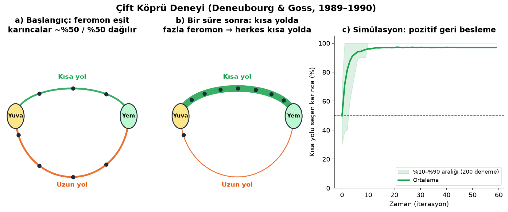

*(c) grafiği gerçek bir simülasyondur: başlangıçta %50 olan "kısa yolu seçen karınca oranı", pozitif geri besleme sayesinde ~%97'ye çıkıyor.*

## 1.3 Gerçek Karınca ↔ Yapay Karınca

| Gerçek karınca kolonisi | ACO algoritmasındaki karşılığı |
|---|---|
| Karınca | Bir çözüm (tur) inşa eden basit ajan |
| Yuva → yiyecek yolu | Problemin bir çözümü (ör. TSP turu) |
| Yolun uzunluğu | Çözümün maliyeti (tur uzunluğu $L_k$) |
| Yere bırakılan feromon | Kenarlardaki sayısal değer $\tau_{ij}$ |
| Feromonun buharlaşması | $\tau_{ij} \leftarrow (1-\rho)\,\tau_{ij}$ |
| Karıncanın gözüyle gördüğü yakınlık | Sezgisel bilgi $\eta_{ij} = 1/d_{ij}$ |
| Kısa yolda daha çok feromon birikmesi | Kısa tura $Q/L_k$ kadar **daha fazla** feromon bırakılması |
| Karıncanın aynı yere iki kez gitmemesi | **Tabu listesi** (ziyaret edilen şehirlerin hafızası) |

> ⚠️ Yapay karıncaların gerçeklerden farkı: **hafızaları vardır** (tabu listesi), **sezgisel bilgi** (mesafe) kullanırlar ve feromonu genelde **tur bittikten sonra**, turun kalitesine göre bırakırlar.

## 1.4 Algoritmanın Adımları

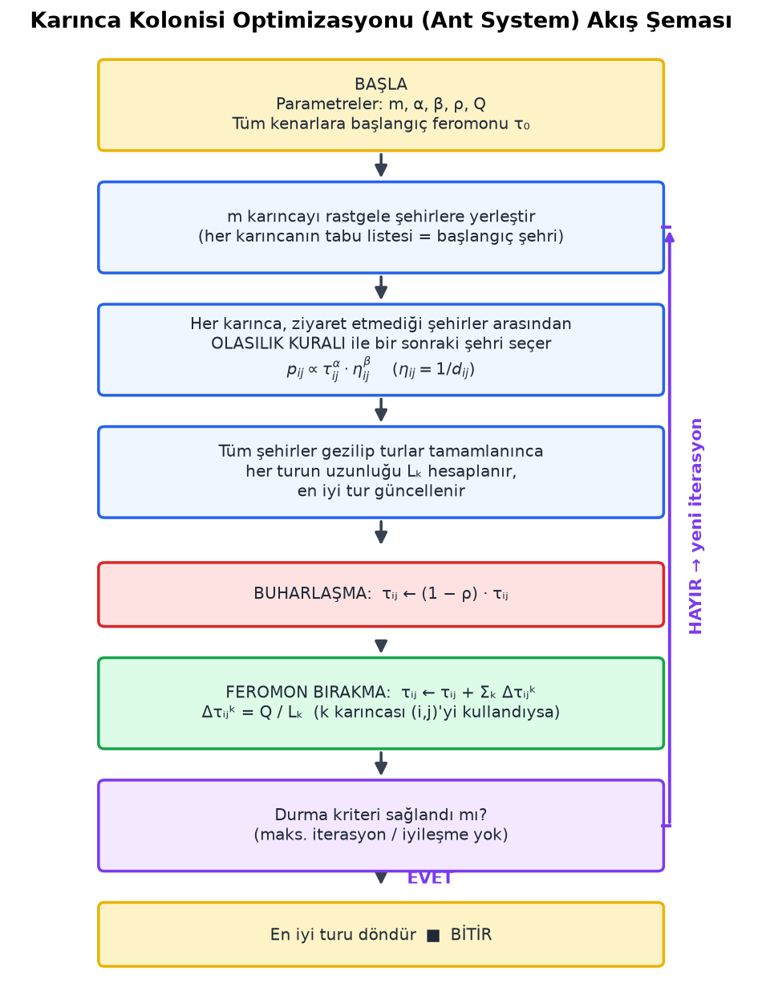

**Sözde kod (pseudocode):**

```text
1. Parametreleri belirle (m, α, β, ρ, Q) ve tüm kenarlara τ₀ feromonu ata
2. TEKRARLA (durma kriteri sağlanana kadar):
   a. m karıncayı rastgele şehirlere yerleştir
   b. HER karınca için:
        Tüm şehirler gezilene kadar:
            Ziyaret edilmemiş şehirler arasından OLASILIK KURALI ile birini seç
            Seçilen şehri tabu listesine ekle
        Başlangıç şehrine dön, tur uzunluğu L_k'yı hesapla
   c. En iyi turu güncelle
   d. BUHARLAŞMA:      τ_ij ← (1 − ρ) · τ_ij          (tüm kenarlar)
   e. FEROMON BIRAKMA: τ_ij ← τ_ij + Σ_k Δτ_ij^k      (Δτ = Q / L_k)
3. En iyi turu döndür
```

## 1.5 Formüller (Ezberlenmesi Gereken 3 Formül)

### ① Geçiş Olasılığı (Durum Geçiş Kuralı)

$k$. karıncanın $i$ şehrindeyken $j$ şehrine gitme olasılığı:

$$
p_{ij}^{k} = \frac{[\tau_{ij}]^{\alpha}\cdot[\eta_{ij}]^{\beta}}{\sum_{l \in N_i^k}[\tau_{il}]^{\alpha}\cdot[\eta_{il}]^{\beta}} \qquad (j \in N_i^k \text{ ise; değilse } 0)
$$

### ② Buharlaşma

$$
\tau_{ij} \leftarrow (1-\rho)\cdot\tau_{ij}
$$

### ③ Feromon Bırakma

$$
\tau_{ij} \leftarrow \tau_{ij} + \sum_{k=1}^{m}\Delta\tau_{ij}^{k}, \qquad
\Delta\tau_{ij}^{k} =
\begin{cases}
\dfrac{Q}{L_k} & k.\ \text{karınca } (i,j) \text{ kenarını kullandıysa}\\[4pt]
0 & \text{aksi halde}
\end{cases}
$$

(② ve ③ çoğu kaynakta tek formülde birleştirilir: $\tau_{ij} \leftarrow (1-\rho)\tau_{ij} + \sum_k \Delta\tau_{ij}^k$)

| Sembol | Anlamı |
|---|---|
| $\tau_{ij}$ | $i$–$j$ kenarındaki **feromon miktarı** (koloninin "öğrendiği" bilgi, *geçmiş deneyim*) |
| $\eta_{ij} = 1/d_{ij}$ | **Sezgisel bilgi / görünürlük** — yakın şehir daha cazip (*anlık açgözlü bilgi*) |
| $\alpha$ | Feromonun **önem katsayısı** |
| $\beta$ | Sezgisel bilginin (mesafenin) **önem katsayısı** |
| $\rho$ | **Buharlaşma oranı** $(0 < \rho \le 1)$ |
| $Q$ | Bırakılan feromon miktarı sabiti |
| $L_k$ | $k$. karıncanın tur uzunluğu → **kısa tur = çok feromon** |
| $m$ | Karınca sayısı (genelde şehir sayısı kadar) |
| $N_i^k$ | $k$. karıncanın $i$'den gidebileceği **henüz ziyaret edilmemiş** şehirler (tabu listesi dışındakiler) |

## 1.6 Parametrelerin Etkisi

| Parametre | Çok küçükse | Çok büyükse | Tipik değer |
|---|---|---|---|
| **α** (feromon önemi) | α = 0 → feromon yok sayılır, algoritma **açgözlü (greedy) en yakın komşu** aramasına döner | Karıncalar feromona körü körüne uyar → **erken yakınsama / durgunluk (stagnation)**, yerel optimuma takılma | 1 |
| **β** (mesafe önemi) | β = 0 → sadece feromona bakılır, mesafe önemsenmez → kötü sonuç, hızlı durgunluk | Neredeyse greedy davranır, keşif azalır | 2 – 5 |
| **ρ** (buharlaşma) | Feromon çok yavaş azalır → kötü yollar unutulmaz, **erken yakınsama** | Feromon çabuk silinir → koloni öğrendiğini unutur, **rastgele aramaya** yaklaşır | 0.1 – 0.5 |
| **m** (karınca sayısı) | Az keşif | Hesaplama maliyeti artar | ≈ şehir sayısı |
| **Q** | Feromon miktarının ölçeği | — | 1 – 100 |

> 🎯 **Sınav cümlesi:** *Buharlaşma, algoritmanın yerel optimuma takılmasını (erken yakınsamayı) önler ve keşfi (exploration) destekler. α ve β, "geçmiş deneyim (feromon)" ile "anlık sezgi (mesafe)" arasındaki dengeyi kurar.*
>
> **Keşif (exploration) ↔ Sömürü (exploitation) dengesi:** Feromonu takip etmek *sömürü*, olasılıksal seçim ve buharlaşma *keşif* sağlar.

Aşağıdaki grafik aynı durumda (A şehrindeki karınca, örnekteki 1. iterasyon sonrası feromonlarla) farklı α–β değerlerinin seçim olasılıklarını nasıl değiştirdiğini gösteriyor:

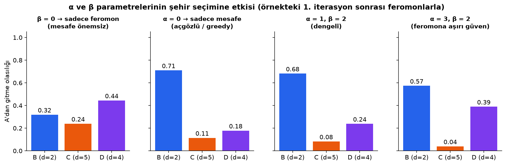

## 1.7 Elle Çözülmüş Örnek (Sınavda Bu Tarz Soru Gelebilir!)

**Problem:** 4 şehirli TSP. Mesafeler:

| | A | B | C | D |
|---|---|---|---|---|
| **A** | – | 2 | 5 | 4 |
| **B** | 2 | – | 3 | 6 |
| **C** | 5 | 3 | – | 2 |
| **D** | 4 | 6 | 2 | – |

**Parametreler:** $\alpha = 1,\ \beta = 2,\ \rho = 0.5,\ Q = 10,\ \tau_0 = 1$, $m = 2$ karınca (ikisi de A'dan başlıyor).

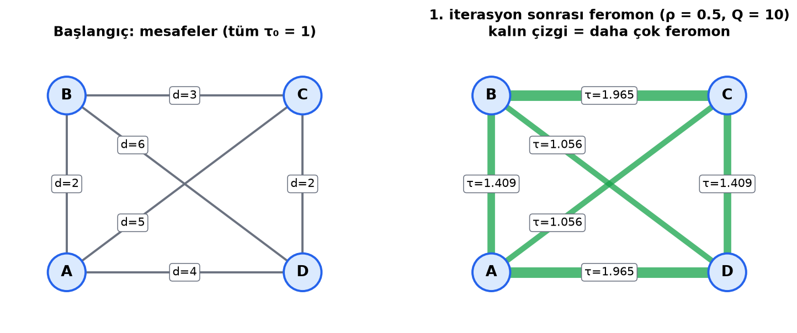

### Adım 1 — Karınca 1, A şehrinde: nereye gitsin?

Ziyaret edilmemiş şehirler: B, C, D. Başta tüm $\tau = 1$ olduğu için sadece mesafe belirleyici.

| Aday | $d$ | $\eta = 1/d$ | $\tau^{\alpha}$ | $\eta^{\beta}$ | $\tau^{\alpha}\cdot\eta^{\beta}$ | **Olasılık** |
|---|---|---|---|---|---|---|
| B | 2 | 0.500 | 1 | 0.2500 | 0.2500 | 0.2500 / 0.3525 = **0.709** |
| C | 5 | 0.200 | 1 | 0.0400 | 0.0400 | 0.0400 / 0.3525 = **0.113** |
| D | 4 | 0.250 | 1 | 0.0625 | 0.0625 | 0.0625 / 0.3525 = **0.177** |
| | | | | **Toplam** | **0.3525** | **1.000** |

**Rulet tekerleği seçimi:** Kümülatif aralıklar B: [0, 0.709), C: [0.709, 0.822), D: [0.822, 1). Rastgele sayı **r = 0.45** → **B seçilir**.

> ⚠️ Karınca en olası şehri değil, **olasılığa göre rastgele** seçer. Bu sayede kötü görünen yollar da arada denenir (keşif).

### Adım 2 — Karınca 1, B şehrinde

Kalanlar: C ($d=3$), D ($d=6$) → $\eta^2$: $1/9 = 0.111$ ve $1/36 = 0.028$ → $P(C) = 0.111/0.139 = \mathbf{0.80}$, $P(D) = \mathbf{0.20}$. r = 0.30 → **C**. Sonra mecburen **D**, sonra **A**'ya dönüş.

> **Karınca 1'in turu:** A → B → C → D → A, &nbsp; $L_1 = 2 + 3 + 2 + 4 = \mathbf{11}$

### Adım 3 — Karınca 2

A'da r = 0.75 → (0.709 ≤ 0.75 < 0.822) → **C** seçilir. C'de kalanlar B ($\eta^2 = 0.111$), D ($\eta^2 = 0.25$) → $P(B) = 0.31$, $P(D) = 0.69$; r = 0.20 → **B**. Sonra D, sonra A.

> **Karınca 2'nin turu:** A → C → B → D → A, &nbsp; $L_2 = 5 + 3 + 6 + 4 = \mathbf{18}$

### Adım 4 — Feromon güncelleme

**(a) Buharlaşma:** tüm kenarlar $\tau = (1 - 0.5)\cdot 1 = 0.5$

**(b) Bırakma:** $\Delta\tau^1 = Q/L_1 = 10/11 = 0.909$ &nbsp;&nbsp; $\Delta\tau^2 = 10/18 = 0.556$

| Kenar | Karınca 1 kullandı mı? | Karınca 2 kullandı mı? | Yeni $\tau$ |
|---|---|---|---|
| A–B | ✔ (+0.909) | ✘ | 0.5 + 0.909 = **1.409** |
| A–C | ✘ | ✔ (+0.556) | 0.5 + 0.556 = **1.056** |
| A–D | ✔ (+0.909) | ✔ (+0.556) | 0.5 + 0.909 + 0.556 = **1.965** |
| B–C | ✔ (+0.909) | ✔ (+0.556) | **1.965** |
| B–D | ✘ | ✔ (+0.556) | **1.056** |
| C–D | ✔ (+0.909) | ✘ | **1.409** |

(Simetrik TSP'de $\tau_{ij} = \tau_{ji}$.)

### Adım 5 — Öğrenme gerçekleşti mi? (2. iterasyonda A'dan seçim olasılıkları)

| Aday | $\tau\cdot\eta^2$ | 1. iterasyon olasılığı | **2. iterasyon olasılığı** |
|---|---|---|---|
| B | 1.409 × 0.25 = 0.352 | 0.709 | **0.681** |
| C | 1.056 × 0.04 = 0.042 | 0.113 | **0.082** ⬇ |
| D | 1.965 × 0.0625 = 0.123 | 0.177 | **0.237** ⬆ |

✅ En iyi tur **A–B–C–D–A (11)** — bu tur A'dan **B** veya (ters yönde) **D** ile başlar. Bu iki kenarın toplam olasılığı **0.886 → 0.918**'e çıktı; kötü turun kenarı **A–C**'nin olasılığı ise **0.113 → 0.082**'ye düştü. Yani koloni **kısa turu "öğrenmeye" başladı.** (11 gerçekten optimumdur: 4 şehirde sadece 3 farklı tur var: 11, 15, 18.)

## 1.8 Gerçek Simülasyon: 25 Şehirli TSP

Aşağıdaki görsel, yukarıdaki formüllerle yazılmış gerçek bir ACO programının çıktısı (m = 25, α = 1, β = 3, ρ = 0.5, Q = 100). **Mavi çizgilerin kalınlığı = feromon miktarı.**

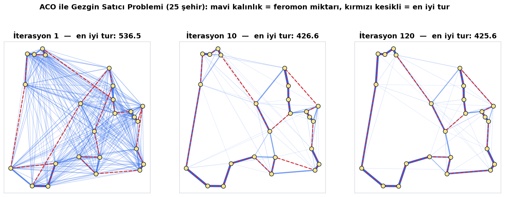

- **İterasyon 1:** Feromon her yere dağınık → turlar karmaşık (536.5)
- **İterasyon 10:** Feromon iyi kenarlarda yoğunlaşmaya başladı (426.6)
- **İterasyon 120:** Feromon neredeyse sadece en iyi turun üzerinde (425.6) → koloni **yakınsadı**

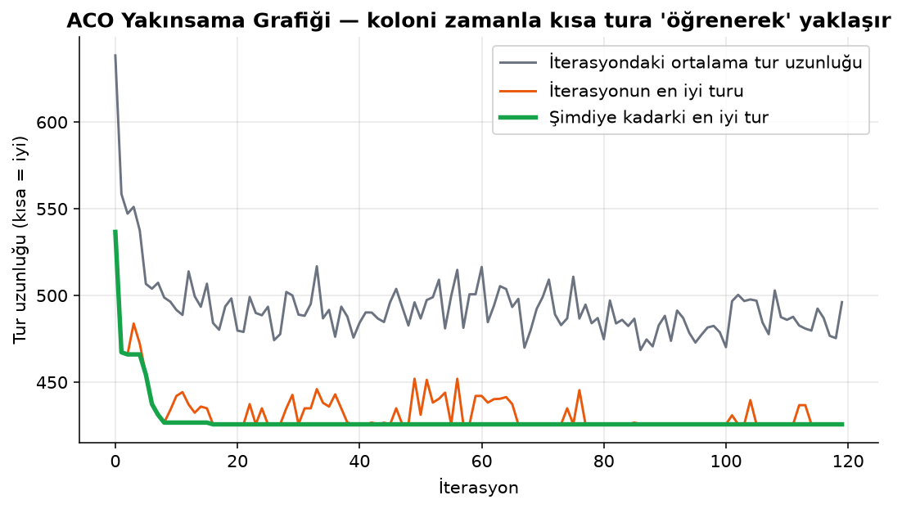

## 1.9 ACO Çeşitleri

| Algoritma | Yıl / Kişi | Farkı |
|---|---|---|
| **Ant System (AS)** | Dorigo, 1992/1996 | İlk sürüm; **tüm karıncalar** feromon bırakır |
| **Elitist AS** | Dorigo, 1996 | Şimdiye kadarki **en iyi tura ekstra** feromon eklenir |
| **Rank-based AS** | Bullnheimer ve ark., 1999 | Karıncalar sıralanır, iyi olanlar daha çok feromon bırakır |
| **Ant Colony System (ACS)** | Dorigo & Gambardella, 1997 | $q_0$ olasılıkla **en iyi kenarı doğrudan seçer** (sömürü), yoksa olasılık kuralı; **yerel feromon güncelleme** (geçilen kenarın feromonu azaltılır → keşif); sadece en iyi karınca global güncelleme yapar |
| **MAX-MIN AS (MMAS)** | Stützle & Hoos, 2000 | Feromon $[\tau_{min}, \tau_{max}]$ aralığında **sınırlandırılır** → durgunluk önlenir; sadece en iyi karınca feromon bırakır |
| **AntNet** | Di Caro & Dorigo, 1998 | Bilgisayar ağlarında **dinamik yönlendirme (routing)** |

## 1.10 Gerçek Dünya Uygulama Alanları

| Alan | Örnek |
|---|---|
| 🚚 **Lojistik / Araç Rotalama (VRP)** | Kargo, market dağıtımı, çöp toplama araçlarının rotaları |
| 🌐 **Ağ yönlendirme** | AntNet — internet/telekom paketleri için en iyi yol; trafik değişince uyum sağlar |
| 🏭 **Çizelgeleme** | İş-atölye (job-shop) çizelgeleme, üretim planlama, ders/sınav programı |
| 🤖 **Robot yol planlama** | Engeller arasında en kısa/güvenli yol |
| 📡 **Kablosuz sensör ağları** | Enerji verimli veri iletim yolu |
| 🧬 **Biyoinformatik** | Protein katlanması, DNA dizileme |
| 🖼️ **Görüntü işleme** | Kenar tespiti (karıncalar piksellerde gezer) |
| 📊 **Makine öğrenmesi** | **Özellik seçimi** (feature selection), kural çıkarımı (Ant-Miner) |
| 🎨 **Graf problemleri** | Graf boyama, karesel atama problemi (QAP) |

## 1.11 Avantajlar ve Dezavantajlar

| ✅ Avantajlar | ❌ Dezavantajlar |
|---|---|
| Pozitif geri besleme ile **hızlı iyi çözüm** bulur | Teorik analizi zor; yakınsama **süresi belirsiz** |
| **Dağıtık / paralel** çalışır (karıncalar bağımsız) | Parametre (α, β, ρ) ayarına **duyarlı** |
| **Dinamik** problemlere uyum sağlar (yol kapanırsa yeni yol bulur) | **Erken yakınsama** / durgunluk riski |
| Esnek: farklı problemlere uyarlanabilir | Büyük problemlerde hesaplama maliyeti yüksek olabilir |
| Sağlam (robust): tek karınca hatası sonucu bozmaz | Olasılıksal → her çalıştırmada farklı sonuç |

## 1.12 Kısa Python Kodu

```python
import numpy as np

def aco_tsp(D, m=20, alpha=1, beta=3, rho=0.5, Q=100, iters=100):
    n = len(D)
    eta = 1 / (D + np.eye(n))          # sezgisel bilgi (köşegende 0'a bölmeyi önle)
    tau = np.ones((n, n))              # başlangıç feromonu τ0 = 1
    best_tour, best_len = None, np.inf
    for _ in range(iters):
        tours = []
        for _ in range(m):                              # her karınca
            tour = [np.random.randint(n)]
            while len(tour) < n:                        # tüm şehirler gezilene kadar
                i = tour[-1]
                p = (tau[i] ** alpha) * (eta[i] ** beta)
                p[tour] = 0                             # tabu listesi
                tour.append(np.random.choice(n, p=p / p.sum()))   # rulet seçimi
            L = sum(D[tour[k], tour[(k + 1) % n]] for k in range(n))
            tours.append((tour, L))
            if L < best_len: best_tour, best_len = tour, L
        tau *= (1 - rho)                                # buharlaşma
        for tour, L in tours:                           # feromon bırakma
            for k in range(n):
                a, b = tour[k], tour[(k + 1) % n]
                tau[a, b] += Q / L; tau[b, a] += Q / L
    return best_tour, best_len
```

---

# 2. Ateşböceği Algoritması (Firefly Algorithm)

## 2.1 Nedir?

**Ateşböceği Algoritması (FA)**, ateşböceklerinin **ışık saçarak (biyolüminesans) birbirini çekmesinden** esinlenmiş, **sürü zekâsı** tabanlı bir meta-sezgisel optimizasyon algoritmasıdır.

- **Geliştiren:** **Xin-She Yang**, Cambridge Üniversitesi, **2007–2008**
- **Problem tipi:** Özellikle **sürekli (continuous)** optimizasyon — bir fonksiyonun maksimum/minimumunu bulmak
- **Güçlü yanı:** **Çok tepeli (multimodal)** problemlerde birden fazla iyi çözümü **aynı anda** bulabilir

## 2.2 Biyolojik İlham

- Ateşböcekleri, karınlarındaki kimyasal reaksiyonla **ışık yanıp söndürür** (eş bulma, av çekme, uyarı amaçlı).
- **Parlak** olan ateşböceği diğerlerini **daha çok çeker.**
- Işık, **mesafe arttıkça azalır** (ters kare yasası $I \propto 1/r^2$) ve **hava tarafından emilir** → uzaktaki ateşböceği sönük görünür.

## 2.3 Üç İdealize Kural (Yang)

1. **Tüm ateşböcekleri tek cinsiyetlidir** → herhangi bir ateşböceği herhangi birini çekebilir.
2. **Çekicilik parlaklıkla orantılıdır** ve **mesafe arttıkça azalır.** Daha **sönük** olan, daha **parlak** olana doğru hareket eder. Kendinden parlak kimse yoksa **rastgele** hareket eder.
3. **Parlaklık, amaç fonksiyonunun değeriyle belirlenir** (maksimizasyonda $I \propto f(x)$) → **iyi çözüm = parlak ateşböceği.**

## 2.4 Formüller

**Işık şiddeti (mesafeye göre):**

$$
I(r) = I_0\, e^{-\gamma r^2}
$$

**Çekicilik (attractiveness):**

$$
\beta(r) = \beta_0\, e^{-\gamma r^2}
$$

**İki ateşböceği arası mesafe (Öklid):**

$$
r_{ij} = \lVert x_i - x_j \rVert = \sqrt{\sum_{k=1}^{d}(x_{i,k} - x_{j,k})^2}
$$

**Hareket denklemi** ($i$, kendinden parlak $j$'ye doğru gider):

$$
x_i^{t+1} = x_i^{t} + \underbrace{\beta_0\, e^{-\gamma r_{ij}^2}\,(x_j^t - x_i^t)}_{\text{çekim terimi}} + \underbrace{\alpha\,\epsilon_i^t}_{\text{rastgelelik terimi}}
$$

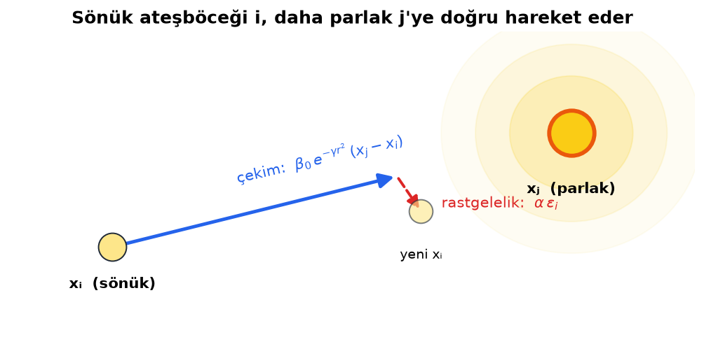

| Sembol | Anlamı | Tipik değer |
|---|---|---|
| $\beta_0$ | $r = 0$'daki **maksimum çekicilik** | 1 |
| $\gamma$ | **Işık soğurma katsayısı** — çekiciliğin mesafeyle ne kadar hızlı azaldığı | 0.01 – 100 (genelde 1) |
| $\alpha$ | **Rastgelelik katsayısı** (keşif) — zamanla azaltılır: $\alpha_t = \alpha_0\,\theta^t$ | 0.2 – 0.5 |
| $\epsilon_i$ | Rastgele vektör (Gauss veya düzgün dağılım) | — |

### γ'nın Özel Durumları (Sınav Sorusu Olabilir!)

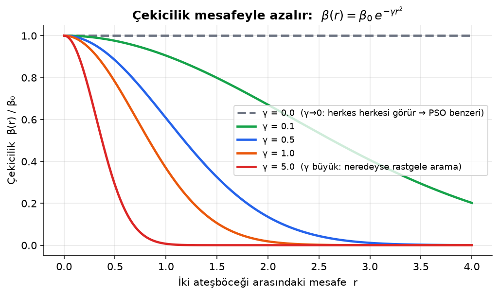

| Durum | Sonuç |
|---|---|
| **γ → 0** | Çekicilik sabit ($\beta = \beta_0$), her ateşböceği her yerden görülür → algoritma **Parçacık Sürü Optimizasyonu (PSO)**'na benzer |
| **γ → ∞** | Çekicilik hemen sıfırlanır, kimse kimseyi görmez → **rastgele arama** |
| **γ orta** | Ateşböcekleri **alt gruplara ayrılır**, her grup bir tepeye toplanır → çok tepeli problemlerde güçlü |

## 2.5 Algoritma Adımları

```text
1. Amaç fonksiyonu f(x) tanımla; β0, γ, α ve n (ateşböceği sayısı) belirle
2. n ateşböceğini arama uzayına RASTGELE yerleştir
3. Her birinin parlaklığını hesapla: I_i = f(x_i)
4. TEKRARLA (maks. iterasyon):
     her i için:
        her j için:
           EĞER I_j > I_i İSE:              # j daha parlaksa
               r_ij mesafesini hesapla
               β = β0 · exp(−γ r_ij²)        # çekicilik
               x_i'yi j'ye doğru hareket ettir (hareket denklemi)
               I_i'yi yeniden hesapla
     En parlak ateşböceği rastgele hareket eder
     α'yı azalt, en iyi çözümü kaydet
5. En parlak ateşböceğini (en iyi çözümü) döndür
```

**Karmaşıklık:** Her iterasyonda tüm çiftler karşılaştırılır → $O(n^2 \cdot t)$

## 2.6 Simülasyon: 4 Tepeli Bir Fonksiyon

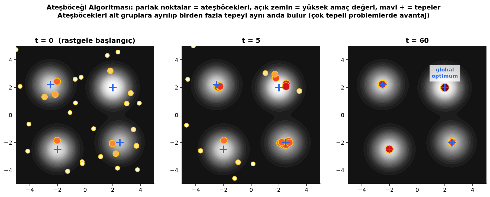

30 ateşböceği rastgele başladı; t = 60'ta **4 tepenin hepsine** gruplar halinde toplandılar ve en yüksek tepe (global optimum, değer 1.0) bulundu. Bu **"otomatik alt gruplara bölünme"** özelliği FA'yı PSO'dan ayırır.

## 2.7 Uygulama Alanları, Avantajlar, Dezavantajlar

**Uygulama alanları:** mühendislik tasarım optimizasyonu (kiriş, yay, basınçlı kap), çizelgeleme, görüntü işleme (eşikleme, segmentasyon), özellik seçimi, kümeleme, yapay sinir ağı eğitimi, ekonomik yük dağıtımı (elektrik), anten tasarımı, rota planlama.

| ✅ Avantajlar | ❌ Dezavantajlar |
|---|---|
| Çok tepeli problemlerde **birden çok optimumu** aynı anda bulur | $O(n^2)$ — çok ateşböceğinde yavaş |
| Basit, az parametreli, kodlaması kolay | γ ve α ayarına duyarlı |
| Yerel optimumdan kaçınma yeteneği iyi | Sabit α ile optimum etrafında salınım yapabilir |
| PSO'yu özel durum olarak içerir (γ → 0) | Ayrık problemler için uyarlama gerekir |

## 2.8 🆚 ACO — Ateşböceği — PSO Karşılaştırması

| | **Karınca Kolonisi (ACO)** | **Ateşböceği (FA)** | **Parçacık Sürüsü (PSO)** |
|---|---|---|---|
| İlham | Karıncaların feromon izi | Ateşböceklerinin ışığı | Kuş/balık sürüleri |
| Geliştiren / Yıl | Dorigo, 1992 | Yang, 2008 | Kennedy & Eberhart, 1995 |
| İletişim | **Dolaylı** (ortam üzerinden — stigmerji) | **Doğrudan** (ışığı görme), mesafeye bağlı | Doğrudan (global en iyi bilgisi) |
| "Bellek" | Kenarlardaki feromon | Yok (sadece konumlar) | Kişisel ve global en iyi |
| Problem tipi | **Ayrık / kombinatoryal** (TSP, rota) | **Sürekli** (fonksiyon optimizasyonu) | Sürekli |
| Çözümün temsili | Graf üzerinde yol | Uzayda nokta | Uzayda nokta |
| Ortak nokta | Hepsi **sürü zekâsı**, **popülasyon tabanlı**, **meta-sezgisel**, **olasılıksal** | | |

---

# 3. Uzman Sistemler (Expert Systems)

## 3.1 Tanım

> **Uzman sistem**, belirli bir alandaki **insan uzmanın bilgisini ve karar verme yeteneğini taklit eden**, bu bilgiyi bir **bilgi tabanında** saklayıp **çıkarım mekanizmasıyla** problem çözen bilgisayar programıdır.
>
> *Edward Feigenbaum* (uzman sistemlerin babası): "Çözümü için önemli ölçüde insan uzmanlığı gerektiren zor problemleri, bilgi ve çıkarım prosedürleri kullanarak çözen akıllı bilgisayar programı."

- **Bilgi tabanlı** (*knowledge-based*) ve **sembolik** yapay zekânın en başarılı örneğidir.
- PDF'teki tarihçeye göre: **1980'lerde** uzman sistemlerin geliştirilmesiyle YZ, "yapay zekâ kışı"ndan sonra **yeniden ilgi görmüştür.**
- Temel fikir: **Bilgi (kurallar) ile çıkarım mekanizması birbirinden ayrıdır.** → Bilgi tabanı değiştirilerek aynı motor başka alanda kullanılabilir (bu yüzden "uzman sistem kabukları" vardır).

## 3.2 Ünlü Uzman Sistemler

| Sistem | Yıl / Yer | Alan | Not |
|---|---|---|---|
| **DENDRAL** | 1965, Stanford | Kimya — kütle spektrometresi verisinden **molekül yapısı** bulma | **İlk** uzman sistem kabul edilir |
| **MYCIN** | 1970'ler, Stanford (Shortliffe) | Tıp — **kan enfeksiyonu teşhisi** ve antibiyotik önerisi | ~600 kural, **geri zincirleme**, **güven faktörü (CF)**; uzmanlar kadar başarılıydı ama etik/hukuki sebeplerle klinikte kullanılmadı |
| **XCON (R1)** | 1980, DEC – CMU | **Bilgisayar sistemi konfigürasyonu** (VAX) | **İleri zincirleme**; şirkete yılda on milyonlarca dolar tasarruf — ilk büyük ticari başarı |
| **PROSPECTOR** | 1970'ler sonu, SRI | Jeoloji — **maden yatağı** arama | Değerli bir molibden yatağının bulunmasına katkı sağladı |
| **CADUCEUS / INTERNIST-I** | 1970–80'ler | İç hastalıkları teşhisi | Yüzlerce hastalığı kapsıyordu |
| **EMYCIN, CLIPS** | — | Uzman sistem **kabukları (shell)** | Bilgi tabanı boş motorlar; CLIPS NASA tarafından geliştirildi |

## 3.3 Mimari (Bileşenler)

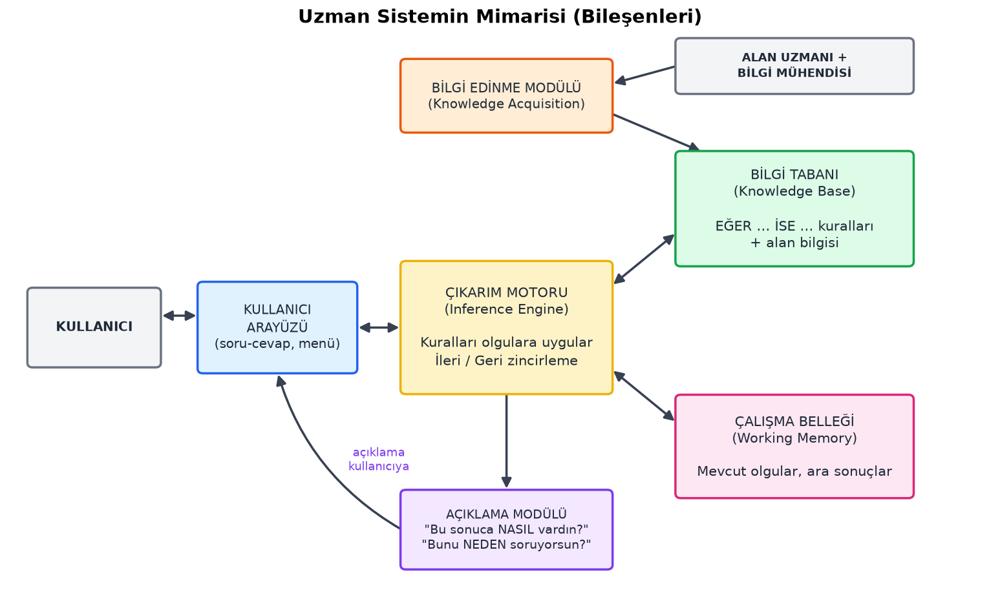

| Bileşen | Görevi |
|---|---|
| **Bilgi Tabanı** (*Knowledge Base*) | Alan bilgisini içerir: **olgular** (facts) ve **EĞER–İSE (IF–THEN) kuralları**. Sistemin "uzmanlık" kısmıdır. |
| **Çıkarım Motoru** (*Inference Engine*) | Sistemin "beyni". Kuralları olgulara uygulayarak **yeni bilgi/sonuç üretir** (ileri veya geri zincirleme). |
| **Çalışma Belleği** (*Working Memory*) | O anki probleme ait olguları ve ara sonuçları tutar (kısa süreli bellek). |
| **Kullanıcı Arayüzü** | Kullanıcı ile sistem arasında soru-cevap iletişimi. |
| **Açıklama Modülü** (*Explanation Facility*) | **"NASIL** bu sonuca vardın?" ve **"NEDEN** bu soruyu soruyorsun?" sorularını cevaplar → **şeffaflık / güven**. |
| **Bilgi Edinme Modülü** (*Knowledge Acquisition*) | Uzmandan bilginin alınıp bilgi tabanına aktarılmasını sağlar. |

**Kişiler:**
- **Alan uzmanı** (*domain expert*): Bilgiye sahip olan kişi (ör. doktor).
- **Bilgi mühendisi** (*knowledge engineer*): Uzmanla görüşüp bilgiyi kurallara dönüştüren kişi.
- **Kullanıcı**: Sisteme danışan kişi.

## 3.4 Bilgi Gösterimi

| Yöntem | Açıklama | Örnek |
|---|---|---|
| **Üretim kuralları** (en yaygın) | EĞER (koşul) İSE (sonuç/eylem) | EĞER ateş > 38 VE öksürük VAR İSE enfeksiyon şüphesi |
| **Çerçeveler** (*frames*) | Nesneleri özellik-değer yuvalarıyla tanımlama | Kuş: {kanat: 2, uçar: evet} |
| **Anlamsal ağlar** (*semantic nets*) | Kavramlar düğüm, ilişkiler kenar | Kanarya —**bir**→ Kuş —**sahiptir**→ Kanat |
| **Mantık** | Yüklem mantığı (Prolog) | `anne(ayse, ali).` |

## 3.5 Çıkarım: İleri ve Geri Zincirleme

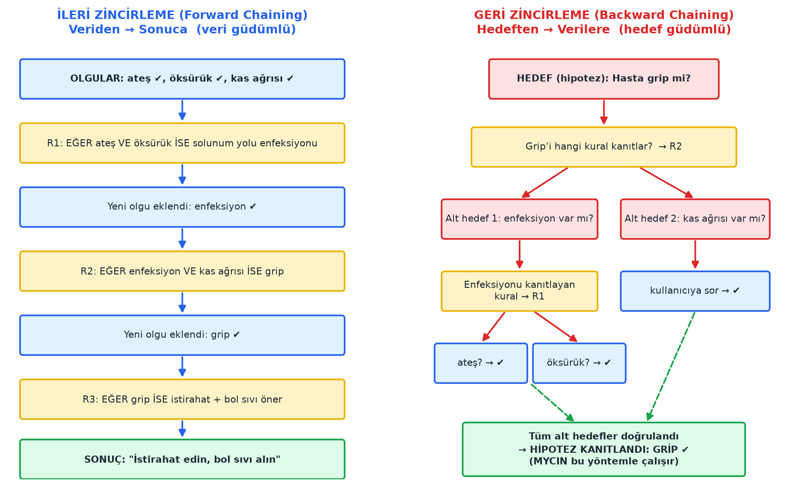

| | **İleri Zincirleme** (*Forward Chaining*) | **Geri Zincirleme** (*Backward Chaining*) |
|---|---|---|
| Yön | **Veriden → sonuca** | **Hedeften → veriye** |
| Başlangıç | Bilinen olgular | Bir hipotez / hedef |
| Mantık | "Elimdeki verilerle hangi kurallar tetiklenir? Ne sonuç çıkar?" | "Bu hipotezi kanıtlamak için neyin doğru olması gerekir?" |
| Diğer adı | **Veri güdümlü** (*data-driven*) | **Hedef güdümlü** (*goal-driven*) |
| Uygun olduğu durum | İzleme, planlama, konfigürasyon, kontrol; olası sonuç sayısı çok | **Teşhis**; olası sonuç sayısı az, kontrol edilecek hipotez belli |
| Klasik örnek | **XCON** | **MYCIN** |

## 3.6 Belirsizlikle Başa Çıkma

Gerçek dünyada bilgi kesin değildir ("muhtemelen grip"). Uzman sistemlerin yöntemleri:

- **Güven faktörü** (*Certainty Factor — CF*, MYCIN): −1 (kesin yanlış) ile +1 (kesin doğru) arası değer. *"EĞER ateş VE öksürük İSE grip (CF = 0.7)"*
- **Bulanık mantık** (*fuzzy logic*): "yüksek ateş" gibi keskin olmayan kavramlar, 0–1 arası üyelik derecesi
- **Bayes olasılığı**: Koşullu olasılık ile güncelleme

## 3.7 Avantajlar ve Dezavantajlar

| ✅ Avantajlar | ❌ Dezavantajlar |
|---|---|
| Uzman bilgisini **kalıcı** hale getirir (uzman emekli olsa da bilgi kalır) | **Bilgi edinme darboğazı**: Uzmanın bilgisini kurallara dökmek çok zor ve pahalı |
| **Tutarlı** kararlar (yorulmaz, duygusal değildir), 7/24 çalışır | **Öğrenemez** — yeni durum için kuralı birinin yazması gerekir |
| **Açıklanabilir**: neden o kararı verdiğini söyler | **Kırılgan** (*brittle*): uzmanlık alanı dışında tamamen başarısız |
| Uzman olmayan kişiye uzman desteği sağlar, maliyeti düşürür | **Sağduyu** (common sense) yoktur |
| Aynı anda birçok yerde kullanılabilir | Kural sayısı artınca bakım zorlaşır, kurallar çelişebilir |

## 3.8 🆚 Uzman Sistem — Makine Öğrenmesi — İnsan Uzman

| | **Uzman Sistem** | **Makine Öğrenmesi** | **İnsan Uzman** |
|---|---|---|---|
| Bilgi kaynağı | Uzmandan **elle** yazılan kurallar | **Veriden otomatik** öğrenilen örüntüler | Eğitim + deneyim |
| Öğrenme | ❌ Yok | ✅ Var | ✅ Var |
| Açıklanabilirlik | ✅ Yüksek (kurallar okunur) | Genelde düşük (derin öğrenme "kara kutu") | Orta |
| Veri ihtiyacı | Az | **Çok** | — |
| Yeni duruma uyum | Zayıf | İyi (veri varsa) | Çok iyi |
| Yorgunluk / tutarsızlık | Yok | Yok | Var |

> 💡 Günümüzde ikisi birleşiyor: **hibrit sistemler** (ML ile tahmin + kural tabanlı kontrol), ayrıca LLM tabanlı **ajanlar** uzman sistemlerin yerini alıyor (bkz. Bölüm 4).

---

# 4. Agentic AI (Ajan Tabanlı Yapay Zekâ)

## 4.1 Önce Temel Kavram: "Ajan" (Agent) Nedir?

> **Ajan**, çevresini **algılayıcılar (sensörler)** ile algılayan ve çevresi üzerinde **eyleyiciler (aktüatörler)** ile eylemde bulunan her şeydir. *(Russell & Norvig, "Artificial Intelligence: A Modern Approach")*
>
> **Akıllı/rasyonel ajan**: Algıladıklarına göre, **performans ölçütünü en üst düzeye çıkaracak** eylemi seçen ajandır.

### PEAS Tanımı — Örnek: Otonom Taksi

Bir ajan tasarlanırken **PEAS** ile tanımlanır (sınavda "bir ajanın PEAS'ını yazın" gelebilir):

| | Anlamı | Otonom taksi için |
|---|---|---|
| **P** — Performance (Performans ölçütü) | Neye göre başarılı sayılır? | Güvenlik, hız, yasalara uyum, konfor, kâr |
| **E** — Environment (Ortam) | Nerede çalışır? | Yollar, trafik, yayalar, hava durumu |
| **A** — Actuators (Eyleyiciler) | Nasıl etki eder? | Direksiyon, gaz, fren, sinyal, korna, ekran |
| **S** — Sensors (Algılayıcılar) | Nasıl algılar? | Kamera, LIDAR, radar, GPS, hız sensörü |

### Ajan Türleri (Basitten Karmaşığa)

| Tür | Nasıl karar verir? | Örnek |
|---|---|---|
| **Basit refleks ajanı** | Sadece **şu anki** algıya göre EĞER–İSE | Termostat, otomatik kapı (PDF'teki **Reaktif YZ**) |
| **Model tabanlı refleks ajanı** | Dünyanın **iç modelini** (geçmiş durumu) tutar | Robot süpürge (haritası var) (PDF'teki **Sınırlı Bellek**) |
| **Hedef tabanlı ajan** | Hedefe ulaştıracak eylemi **planlar** | GPS navigasyon |
| **Fayda tabanlı ajan** | Birden çok yol varsa **en faydalısını** seçer | Otonom araç (hızlı + güvenli + ekonomik) |
| **Öğrenen ajan** | Deneyimden **öğrenerek** kendini geliştirir | AlphaGo, AlphaStar (PDF) |

## 4.2 Agentic AI Nedir?

> **Agentic AI**, kendisine verilen bir **hedefe** ulaşmak için **otonom olarak** planlayan, karar veren, **araçlar kullanarak gerçek dünyada eylem yapan**, sonuçları gözlemleyip planını **güncelleyen** yapay zekâ sistemleridir. Genelde "beyin" olarak bir **büyük dil modeli (LLM)** kullanır.

**Farkı tek cümlede:** Klasik üretken YZ (ChatGPT ile sohbet) **cevap verir**; Agentic AI **işi yapar.**

| | **Üretken YZ (Generative AI)** | **Agentic AI** |
|---|---|---|
| Ne yapar? | Metin/görsel/kod **üretir** | Hedefe ulaşmak için **eylem gerçekleştirir** |
| Etkileşim | Tek soru → tek cevap | Çok adımlı, döngüsel |
| Otonomi | Düşük — her adımda insan yönlendirir | **Yüksek** — alt görevleri kendisi belirler |
| Araç kullanımı | Genelde yok | **Var** (web, API, veritabanı, kod, e-posta...) |
| Bellek | Sadece konuşma bağlamı | Kısa + uzun süreli bellek |
| Örnek | "Bana İstanbul için tatil planı yaz" → metin | "İstanbul tatilimi ayarla" → uçuş arar, karşılaştırır, rezervasyon yapar, takvime ekler |

**YZ'nin evrimi:** Kural tabanlı (uzman sistemler) → Makine öğrenmesi → Derin öğrenme → Üretken YZ (LLM) → **Agentic AI**

## 4.3 Agentic AI'nin Bileşenleri

| Bileşen | Görevi |
|---|---|
| 🧠 **Akıl yürütme çekirdeği (LLM)** | Durumu anlar, karar verir, ne yapacağını düşünür |
| 🗺️ **Planlama** | Büyük hedefi **alt görevlere böler** (*task decomposition*), sıralar |
| 💾 **Bellek** | **Kısa süreli:** o anki görev bağlamı · **Uzun süreli:** geçmiş deneyimler, kullanıcı tercihleri |
| 🛠️ **Araç kullanımı** (*tool use*) | Web arama, API çağırma, kod çalıştırma, veritabanı sorgulama, e-posta gönderme, robot kolu kontrolü |
| 🔍 **Yansıtma** (*reflection*) | Kendi çıktısını değerlendirir, hatayı fark edip düzeltir |
| 👤 **İnsan denetimi** (*human-in-the-loop*) | Ödeme, silme gibi kritik adımlarda insan onayı |

## 4.4 Çalışma Mantığı: Algıla → Düşün → Eylem → Gözlemle → Öğren

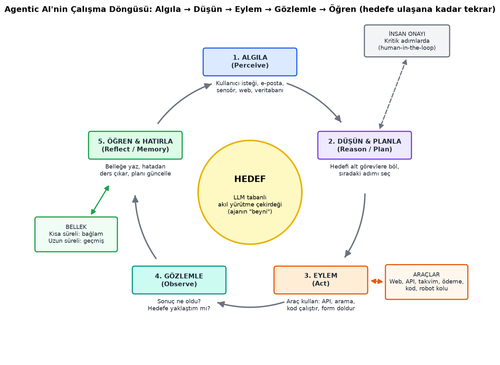

Bu döngü, PDF'teki "YZ'nin temel çalışma prensipleri" ile örtüşür: **veri toplama (algılama) → model/algoritma (düşünme) → tahmin ve karar verme (eylem) → hata düzeltme ve geliştirme (geri bildirim) → bağlam ve adaptasyon.** Bu yaklaşıma **ReAct** (*Reason + Act*: düşün ve eyle) de denir.

## 4.5 🌍 Dış Dünya Problemlerinde Nasıl Uygulanır? — Adım Adım Örnek

**Senaryo:** Bir e-ticaret şirketinin müşteri hizmetleri ajanı. Müşteri yazıyor: *"Siparişim 1 haftadır gelmedi!"*

| Adım | Ajan ne yapıyor? |
|---|---|
| **1. Algıla** | Mesajı okur, müşterinin kimliğini ve sipariş numarasını tespit eder |
| **2. Düşün & Planla** | "Önce sipariş durumunu kontrol et → kargo takibine bak → gecikme varsa şirket politikasına göre çözüm sun" |
| **3. Eylem** | **Sipariş veritabanı API**'sini ve **kargo firması API**'sini sorgular |
| **4. Gözlemle** | Sonuç: Paket 4 gündür transfer merkezinde bekliyor |
| **5. Yeniden planla** | Politika: "5 günden fazla gecikmede ücretsiz yeniden gönderim" → yeni gönderim oluşturulmalı |
| **6. Eylem + İnsan onayı** | Tutar sınırı aşılıyorsa yöneticiden onay ister → yeni gönderimi oluşturur → müşteriye takip numarasıyla e-posta atar |
| **7. Öğren & Hatırla** | "Bu transfer merkezinde son 1 ayda 12 gecikme" → belleğe yazar, lojistik ekibine rapor eder |

> Klasik bir chatbot burada sadece "Kargo firmasıyla iletişime geçin" derdi. Agentic AI **sorunu kendisi çözüyor.**

### Sektörlere Göre Gerçek Dünya Uygulamaları

| Sektör | Agentic AI ne yapıyor? |
|---|---|
| 🏥 **Sağlık** | Giyilebilir cihazlardan (nabız, şeker, tansiyon) veriyi algılar, riski hesaplar, anormallikte doktoru uyarır, hastaya ilaç hatırlatması gönderir |
| 💻 **Yazılım geliştirme** | Hata kaydını okur → kodu inceler → düzeltmeyi yazar → testleri çalıştırır → değişikliği gönderir |
| 🚚 **Lojistik / tedarik zinciri** | Talebi tahmin eder, rotaları planlar, gecikmede alternatif rota bulur, müşteriyi bilgilendirir |
| 💰 **Finans** | Şüpheli işlemi tespit eder, kartı geçici bloke eder, müşteriye doğrulama sorusu gönderir |
| 🏭 **Üretim** | Sensörlerden makine titreşimini izler, arıza öngörür, bakım emri ve yedek parça siparişi oluşturur |
| 🏠 **Akıllı ev / enerji** | Elektrik fiyatları ve hava tahminine göre ısıtmayı, şarjı, çamaşır makinesini planlar |
| 🎓 **Eğitim** | Öğrencinin hatalarını analiz edip kişisel çalışma planı oluşturur ve takip eder |
| 🚗 **Otonom araçlar** | Klasik ajan örneği: sensörlerle algılar, rota planlar, direksiyon/fren ile eylem yapar |

## 4.6 Çoklu Ajan Sistemleri (Multi-Agent Systems)

Karmaşık işlerde **tek ajan yerine uzmanlaşmış birden fazla ajan** birlikte çalışır. Bir **orkestratör ajan** işi böler ve dağıtır:

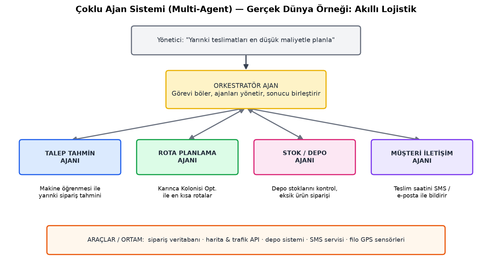

> 🔗 **Bağlantı:** Bu örnekteki *rota planlama ajanı* rotayı **Karınca Kolonisi Optimizasyonu** ile, *talep tahmin ajanı* ise **makine öğrenmesi** ile hesaplayabilir. Ayrıca ACO'daki her karınca da aslında **basit bir ajandır** — çok sayıda basit ajanın etkileşiminden zekâ doğması (**sürü zekâsı**) çoklu ajan sistemlerinin doğadaki örneğidir.

## 4.7 Riskler ve Önlemler

| Risk | Açıklama | Önlem |
|---|---|---|
| **Halüsinasyon / yanlış eylem** | Yanlış bilgiye dayanıp gerçek dünyada hatalı işlem yapması (yanlış ödeme, yanlış e-posta) | İnsan onayı, doğrulama adımları |
| **Güvenlik** | Kötü niyetli içeriklerle ajanın kandırılması (*prompt injection*), yetkisiz erişim | En az yetki ilkesi, araç izinleri |
| **Sorumluluk** | Ajan hata yaparsa **kim sorumlu?** (PDF'teki otonom araç etik sorusu ile aynı) | Kayıt tutma (log), şeffaflık |
| **Kontrol kaybı** | Uzun otonom zincirlerde hataların birikmesi | Adım sınırları, izleme, geri alma imkânı |
| **Gizlilik** | Kişisel verilere erişim | Veri minimizasyonu, şifreleme |

---

# 5. Makine Öğrenmesi Algoritmaları ve Değerlendirme Ölçütleri

## 5.1 Makine Öğrenmesi Nedir? (PDF 2)

- Çok büyük miktardaki verinin **elle işlenmesi ve analizi mümkün değildir.**
- **Amaç:** Geçmişteki verileri kullanarak **gelecek için tahminde bulunmak.**
- Makine öğrenmesi yöntemleri, geçmiş veriyi kullanarak **yeni veri için en uygun modeli** bulmaya çalışır.
- Verinin incelenip içinden işe yarayan bilginin çıkarılmasına **veri madenciliği** (*data mining*) denir.
- PDF'in sonuç cümlesi: *"Makineler insanlığın işgücüne sağladıkları katkıyı, makine öğrenmesi metotları sayesinde insanlığın **beyin gücüne** de sağlamaya başlamışlardır."*

### Öğrenme Türleri

| Tür | Veri | Amaç | Örnek |
|---|---|---|---|
| **Denetimli (eğiticili)** *(supervised)* | **Etiketli** (doğru cevap belli) | Girdi → çıktı ilişkisini öğren | Spam filtresi, hastalık teşhisi |
| **Denetimsiz (eğiticisiz)** *(unsupervised)* | **Etiketsiz** | Gizli yapıyı / grupları keşfet | Müşteri segmentasyonu, K-means |
| **Pekiştirmeli** *(reinforcement)* | Ödül / ceza | Deneme-yanılma ile en iyi davranışı öğren | AlphaGo, robotlar, AlphaStar |

## 5.2 Problem (Metot) Türleri

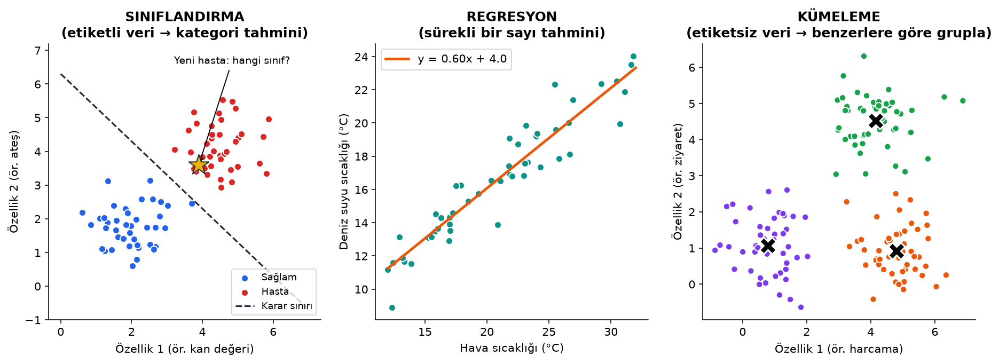

| Tür | Tanım (PDF) | Örnek |
|---|---|---|
| **Sınıflandırma** | Geçmiş verinin **sınıfı biliniyorsa**, yeni gelen verinin **hangi sınıfa** dahil olacağını bulmak | Sağlam / hasta, spam / değil, kredi ver / verme |
| **Kümeleme** | Sınıflar **bilinmiyorsa**, birbirine benzeyen verilerin oluşturduğu **kümeleri** bulmak | 256 rengi 16 renge indirmek, müşteri grupları |
| **Regresyon (eğri uydurma)** | Sınıf yerine **sürekli** bir değerin tahmini; giriş–çıkış arasındaki fonksiyonun eğrisi bulunur | Hava sıcaklığından deniz suyu sıcaklığını tahmin |
| **Birliktelik kuralları** | Birlikte görülen olayları bulmak | **Sepet analizi**: x alan müşterilerin %80'i y'yi de alıyorsa, x alıp y almayanlar y'nin potansiyel müşterisidir |

## 5.3 Verilerin Sayısallaştırılması

ML yöntemlerinin çoğunda veri önce **sayıya çevrilir:**

| Veri | Sayısallaştırma |
|---|---|
| **Resim** | Her piksel → renkli: **R, G, B** (3 matris), siyah-beyaz: gri seviyesi (1 matris) |
| **Metin** | Harf, hece, kelimelerin **frekansları** |
| **Video** | Resim + **zaman** bilgisi (hangi kare hangisinden sonra) |
| **Ses** | Genlik ve frekansın **zaman içindeki değişimi** |

**PDF örneği:** 10 satır × 6 sütunluk "2" rakamı resmi → 60 uzunluğunda 0/1 vektörü → **60 özellik**. 10 rakam × 10 font = **100 örnek × 60 boyutlu matris**. Bu matris **eğitim** ve **test** kümesine ayrılır; model eğitim kümesiyle kurulur, başarısı **daha önce hiç görmediği** test kümesinde ölçülür.

## 5.4 Özellik Seçimi ve Özellik Çıkarımı

Özellik çok fazlaysa (ör. DNA'da 5000 özellik) bazıları sınıflandırmada işe yaramaz. İki çözüm:

1. **Özellik seçimi** (*feature selection*): Var olan özelliklerden **bazılarını seç**
   - **Filtre** (*filter*): Özellikleri **tek tek** değerlendir → Bilgi kazancı, S2N
   - **Sarmalayıcı** (*wrapper*): Özellik **alt kümeleri** oluşturup sınıflandırıcıyla dene (N özellik → 2ᴺ alt küme!). Hızlandırmak için: hepsiyle başlayıp **birer birer çıkar** veya tek özellikle başlayıp **birer birer ekle**
   - **Duyarlılık analizi**: Diğer özellikler sabitken bir özelliği değiştir, sonuca etkisini ölç
2. **Özellik çıkarımı** (*feature extraction*): Özelliklerin **lineer birleşiminden yeni özellikler** üret → **PCA, LDA**

### Bilgi Kazancı (Information Gain) ve Entropi

$$
\text{Entropi}(S) = -p\log_2 p - q\log_2 q
\qquad\qquad
\text{Gain}(S, A) = \text{Entropi}(S) - \sum_{v \in \text{Değerler}(A)} \frac{|S_v|}{|S|}\,\text{Entropi}(S_v)
$$

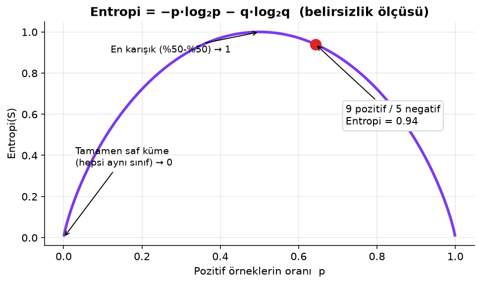

**PDF örneği:** 14 örnek, 9 pozitif 5 negatif → $-\frac{9}{14}\log_2\frac{9}{14} - \frac{5}{14}\log_2\frac{5}{14} = \mathbf{0.94}$

**PDF'teki piknik örneğinin çözümü:**

| Olay | Hava | Nem | Rüzgar | Su sıcaklığı | Pikniğe gidildi mi? |
|---|---|---|---|---|---|
| 1 | güneşli | normal | güçlü | ılık | Evet |
| 2 | güneşli | yüksek | güçlü | ılık | Evet |
| 3 | yağmurlu | yüksek | güçlü | ılık | Hayır |
| 4 | güneşli | yüksek | güçlü | soğuk | Evet |

- $\text{Entropi}(S)$: 3 Evet, 1 Hayır → $-\frac34\log_2\frac34 - \frac14\log_2\frac14 = 0.811$
- **Hava:** güneşli {E,E,E} → 0; yağmurlu {H} → 0 → $\text{Gain} = 0.811 - 0 = \mathbf{0.811}$
- **Nem:** normal {E} → 0; yüksek {E,H,E} → 0.918 → $0.811 - \frac34(0.918) = \mathbf{0.123}$
- **Rüzgar:** hep "güçlü" → hiç bilgi vermez → $\mathbf{0}$
- **Su sıcaklığı:** ılık {E,E,H} → 0.918; soğuk {E} → 0 → $\mathbf{0.123}$

✅ **En büyük bilgi kazancı = Hava** → en ayırt edici özellik (PDF ile aynı sonuç). Karar ağaçları da düğümleri bu şekilde seçer.

**Sinyal/Gürültü oranı (S2N):** **Sınıflar arası** farkı büyük, **sınıf içi** farkı küçük özellikler seçilir.

### PCA ve LDA

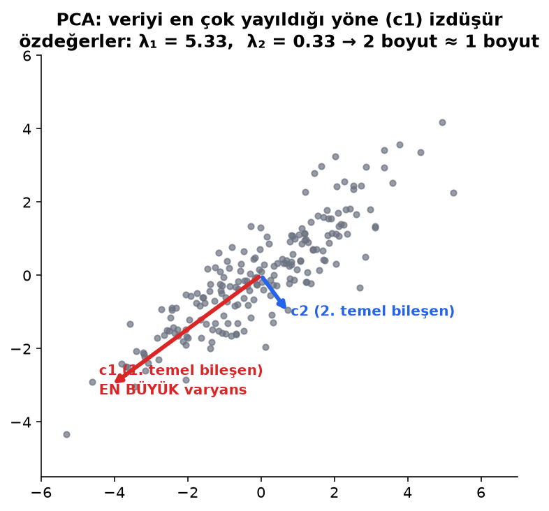

| | **PCA** (Temel Bileşen Analizi) | **LDA** (Doğrusal Ayırtaç Analizi) |
|---|---|---|
| Fikir | Verinin **en çok değiştiği (varyansı en büyük)** yönleri bul | Sınıfları **en iyi ayıran** yönleri bul |
| Sınıf bilgisi | ❌ Kullanmaz (denetimsiz) | ✅ Kullanır (denetimli) |
| Adımlar | Kovaryans matrisi → özdeğerler → en büyük M özdeğerin özvektörleri → veriyi bunlara izdüşür (N → M boyut) | Sınıflar arası / sınıf içi dağılım oranını maksimize et |
| Zayıf yanı | Sınıflar iç içe geçebilir → sınıflandırma başarısı düşebilir | — |

> Özdeğer = verinin o özvektöre izdüşümündeki **varyans**. En büyük özdeğerler seçilir.

## 5.5 Sınıflandırma Algoritmaları

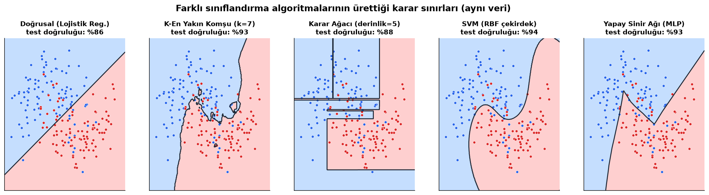

| Algoritma | Nasıl çalışır? | Artı / Eksi |
|---|---|---|
| **Doğrusal Regresyon** | $w_0 + w_1x + w_2y \ge 0$ şeklinde düz çizgi; en az hata yapan $w_i$'leri bulur | Basit ama **yeterince esnek değil** |
| **SVM** (Destek Vektör Makineleri) | Sınıfları ayıran ve **her iki sınıfa da en uzak** (maksimum marjin) hiperdüzlemi bulur. Doğrusal ayrılamıyorsa veriyi **yüksek boyuta taşır** (çekirdek hilesi, ör. $(x_1^2,\ x_2^2,\ \sqrt2 x_1x_2)$) | Güçlü, genelleme iyi; büyük veride yavaş |
| **Karar Ağaçları** | **Böl ve yönet**: entropiyle en iyi özellik/eşik seçilip veri bölünür, yaprakta tek sınıf kalana kadar devam | **Kurallar anlaşılır** (EĞER X > 5 İSE mavi...); aşırı öğrenmeye yatkın |
| **Yapay Sinir Ağları** | Biyolojik nöronlardan esinlenmiş; $x = \sum W_iA_i + \theta$, $y = \frac{1}{1+e^{-x}}$. Tek nöron = **perceptron**; doğrusal olmayan sınırlar için **çok katmanlı perceptron**, **geri yayılım** (backpropagation) ile eğitilir | Çok güçlü; kara kutu, çok veri ister |
| **K-En Yakın Komşu (KNN)** | **Eğitim yok** (örnek tabanlı / tembel). Yeni örneğe **en yakın K** örneğe bakılır, **çoğunluk** hangi sınıftaysa o seçilir. Uzaklık: Öklid $d = \sqrt{\sum (a_r(x_i) - a_r(x_j))^2}$ — *"Bana arkadaşını söyle, sana kim olduğunu söyleyeyim"* | Basit; test aşaması yavaş |
| **LVQ** (Öğrenmeli Vektör Kuantalama) | Her sınıf için **betimleyici (prototip) vektörler** öğrenilir; test örneği **en yakın prototipin** sınıfına atanır | KNN'den hızlı |
| **Naive Bayes, Random Forest, C4.5** | PDF'teki karşılaştırma tablosunda geçen diğer yöntemler | — |

### "Neden bu kadar çok algoritma var?" (PDF)

> **Her veri kümesinde mükemmel çalışan tek bir yöntem yoktur.** (*No Free Lunch* teoremi)

| Veri kümesi | NB | SVM | 1NN | C4.5 | RF |
|---|---|---|---|---|---|
| amlall (7129 özellik) | **97.14** | 92.86 | 94.29 | 83.39 | 95.71 |
| ann | 95.55 | 93.74 | 93.40 | **99.58** | 99.50 |
| bi75ds3 | 68.49 | 62.11 | 63.19 | 65.01 | **72.00** |
| derma | 77.97 | **79.37** | 76.26 | 75.20 | 76.96 |
| gkanser | 94.29 | **96.26** | **96.26** | 93.62 | 95.38 |
| Hava | 89.31 | 86.48 | 89.72 | 91.82 | **95.02** |

→ Her veri kümesinde kazanan algoritma farklı!

## 5.6 Kümeleme Algoritmaları

- **Eğiticisiz** öğrenmedir, sınıf bilgisi kullanılmaz.
- Veriyi en iyi **temsil eden vektörleri** (küme merkezleri) bulur → veriler bu merkezlerle kodlanabilir → **sıkıştırma** algoritmalarının temelidir (renk kümeleme: 106.846 renk → 55 renk; kod kitabı / codebook).
- PDF örneği: `12 15 13 87 4 5 9 67 1 2` → 3 küme ile `12 12 12 77 3 3 3 77 3 3`

### K-Means

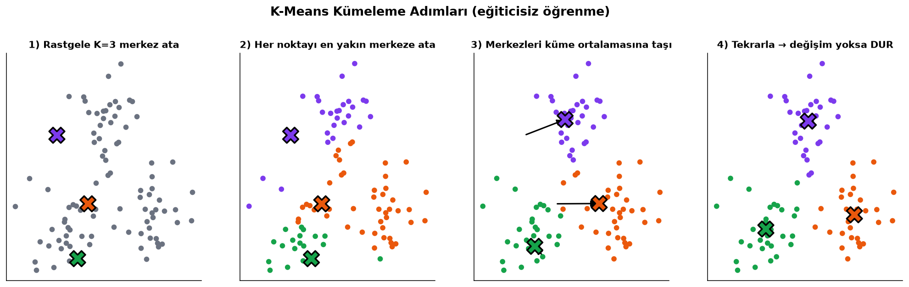

1. Rastgele **K** küme merkezi ata (K kullanıcı tarafından verilir)
2. Her örneği **en yakın merkezin** kümesine ata
3. Merkezleri **kümedeki örneklerin ortalamasına** taşı
4. Küme değiştiren örnek kalmayana kadar 2–3'ü tekrarla

### SOM (Kendi Kendini Düzenleyen Haritalar — Kohonen)

- K-means'te merkezler arasında ilişki yoktur; **SOM'da merkezler 1 veya 2 boyutlu bir dizide komşudur.**
- K-means'te **sadece kazanan** merkez güncellenir; SOM'da kazanan nöronun **komşuları da** güncellenir (yakın komşu daha çok hareket eder).

## 5.7 Model Doğrulama: Eğitim/Test, K-Fold, Aşırı Öğrenme

### K-Katlı Çapraz Doğrulama (K-Fold Cross Validation)

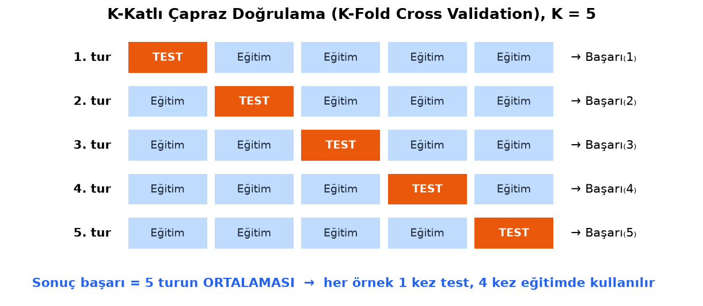

Veri K eşit parçaya bölünür; her turda **bir parça test**, kalanlar **eğitim**; K kez tekrarlanır, başarıların **ortalaması** alınır. → Tek bir şanslı/şanssız bölünmeye bağlı kalmayız.

### Aşırı Öğrenme (Overfitting)

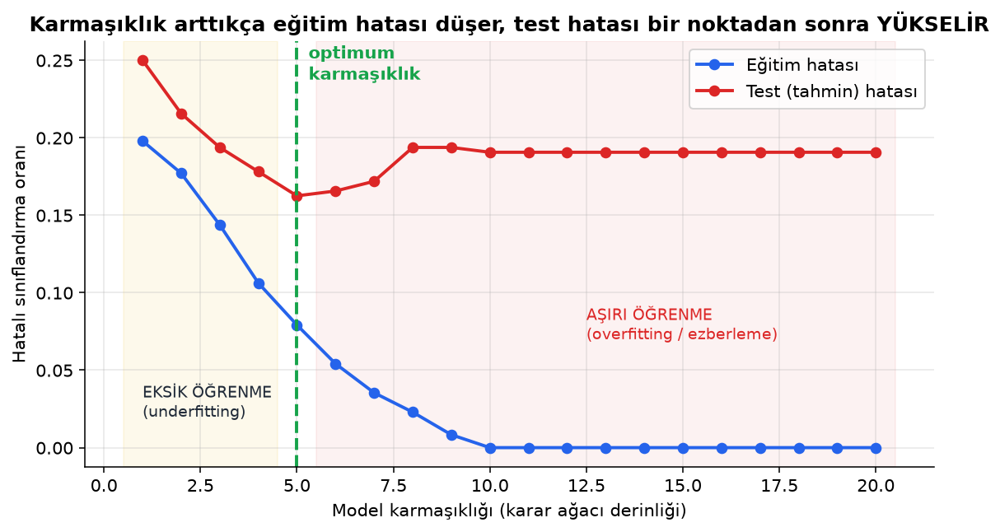

> PDF: *"Modelin karmaşıklığı arttığında eğitim kümesindeki hata düşerken test kümesindeki hata yükselir. Her veri kümesi için optimum nokta farklıdır."*

- **Eksik öğrenme** (*underfitting*): Model çok basit, eğitim ve test hatası **ikisi de yüksek**
- **Aşırı öğrenme** (*overfitting*): Model eğitim verisini **ezberler** (gürültü dahil) → eğitim hatası ≈ 0, test hatası yüksek

## 5.8 ❓ Sınıflandırma Neden Yapılır?

**Sınıflandırma**, geçmişte **etiketlenmiş** örneklerden öğrenip **yeni bir örneğin hangi önceden tanımlı sınıfa ait olduğunu** otomatik olarak tahmin etmektir. Amaç:

1. **Karar vermeyi otomatikleştirmek ve hızlandırmak** — milyonlarca e-postayı insan tek tek okuyamaz
2. **Gelecekteki / bilinmeyen durumları tahmin etmek** — bu hasta kanser mi? bu kredi geri ödenir mi?
3. **İnsan hatasını ve öznelliği azaltmak** — aynı özelliklere aynı karar (PDF'teki Çin mahkeme örneği)
4. **Uzman olmayan kişiye uzman desteği sağlamak** — teşhis destek sistemleri
5. **Riskleri önceden tespit etmek** — dolandırıcılık, arıza, siber saldırı

**PDF'teki örnekler:** el yazısı/OCR (hangi harf?), kredi değerlendirme (ver/verme), gen mikrodizilimi (ALL / AML lösemi), yüz tanıma (bu kim, içeri girsin mi?), parmak izi, ses tanıma, imza doğrulama (gerçek/taklit), spam tespiti, güvenlik kamerasında olağan dışı durum, balık hali (Salmon mı Sea Bass mı?).

> ⚠️ Ama bir sınıflandırıcıyı kullanmadan önce **ne kadar iyi olduğunu ölçmek** zorundayız → **karışıklık matrisi, istatistiksel ölçütler ve ROC.**

## 5.9 Karışıklık Matrisi (Confusion Matrix)

Sınıflandırıcının tahminleriyle gerçek sınıfları karşılaştıran tablodur. **Pozitif** = aradığımız sınıf (ör. hasta), **Negatif** = diğeri (sağlam).

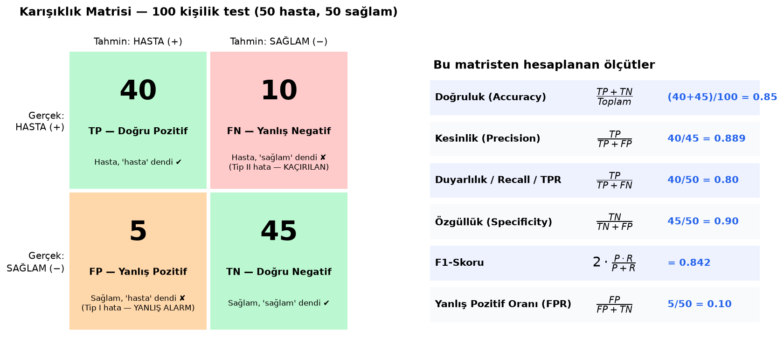

| | **Tahmin: Pozitif** | **Tahmin: Negatif** |
|---|---|---|
| **Gerçek: Pozitif** | **TP** (Doğru Pozitif) ✔ | **FN** (Yanlış Negatif) ✘ — **Tip II hata** (kaçırma) |
| **Gerçek: Negatif** | **FP** (Yanlış Pozitif) ✘ — **Tip I hata** (yanlış alarm) | **TN** (Doğru Negatif) ✔ |

> 🧠 **Ezber hilesi:** İkinci kelime (*Pozitif/Negatif*) = modelin **tahmini**. Birinci kelime (*Doğru/Yanlış*) = tahmin **doğru muydu?** → **FN** = "Yanlış Negatif" = model "negatif" dedi ama **yanlış** dedi → aslında pozitifti.

### İstatistiksel Ölçütler

| Ölçüt | Formül | Soru | Örnekteki değer |
|---|---|---|---|
| **Doğruluk** (*Accuracy*) | $\frac{TP+TN}{TP+TN+FP+FN}$ | Tüm tahminlerin ne kadarı doğru? | 85/100 = **0.85** |
| **Hata oranı** | $1 - \text{Doğruluk}$ | — | **0.15** |
| **Kesinlik** (*Precision*) | $\frac{TP}{TP+FP}$ | "Hasta" dediklerimin ne kadarı gerçekten hasta? | 40/45 = **0.889** |
| **Duyarlılık** (*Recall, Sensitivity, TPR*) | $\frac{TP}{TP+FN}$ | Gerçek hastaların ne kadarını yakaladım? | 40/50 = **0.80** |
| **Özgüllük** (*Specificity, TNR*) | $\frac{TN}{TN+FP}$ | Gerçek sağlamların ne kadarına "sağlam" dedim? | 45/50 = **0.90** |
| **Yanlış Pozitif Oranı** (*FPR*) | $\frac{FP}{FP+TN} = 1 - \text{Özgüllük}$ | Sağlamların ne kadarına yanlış alarm verdim? | 5/50 = **0.10** |
| **F1-Skoru** | $2\cdot\frac{\text{Kesinlik}\cdot\text{Duyarlılık}}{\text{Kesinlik}+\text{Duyarlılık}}$ | Kesinlik ve duyarlılığın **harmonik ortalaması** | **0.842** |

### Hangi Ölçüt Ne Zaman Önemli?

| Durum | Önemli ölçüt | Neden? |
|---|---|---|
| **Kanser taraması**, salgın hastalık | **Duyarlılık (Recall)** ⬆ | Hastayı kaçırmak (**FN**) hayati tehlike; yanlış alarm (FP) sadece ek test demek |
| **Spam filtresi** | **Kesinlik (Precision)** ⬆ | Önemli bir e-postayı spam'e atmak (**FP**) çok kötü; birkaç spam'in gelmesi tolere edilir |
| **Dolandırıcılık tespiti** | Duyarlılık + F1 | Dolandırıcılığı kaçırmak pahalı ama çok yanlış alarm da müşteriyi kızdırır |
| **Dengesiz veri** | **F1, ROC-AUC** (doğruluk DEĞİL!) | Aşağıdaki tuzak 👇 |

> ⚠️ **Doğruluk tuzağı (dengesiz veri):** 1000 kişiden sadece 10'u hasta olsun. Model hiçbir şey öğrenmeden **herkese "sağlam"** desin → Doğruluk = 990/1000 = **%99** 😮 ama Duyarlılık = 0/10 = **%0** → hiçbir hastayı bulamadı! Bu yüzden tek başına doğruluğa güvenilmez.

## 5.10 Eşik Değeri, ROC Eğrisi ve AUC

Çoğu sınıflandırıcı doğrudan "hasta/sağlam" demez, **bir olasılık (skor)** verir: ör. "%73 hasta". Bunu karara çevirmek için bir **eşik** (*threshold*) seçilir: skor ≥ eşik → pozitif.

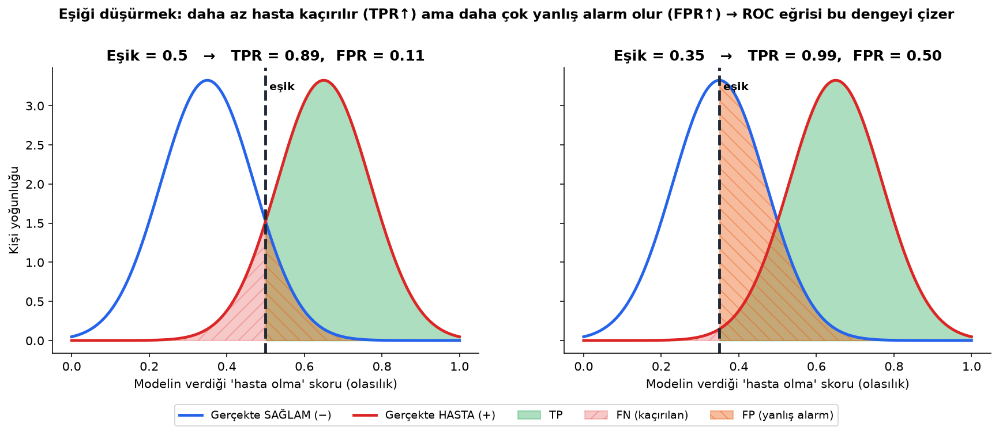

- **Eşik düşerse:** daha çok kişiye "hasta" denir → **TPR ↑** (daha az hasta kaçar) ama **FPR ↑** (daha çok yanlış alarm)
- **Eşik yükselirse:** tam tersi

### ROC Eğrisi (Receiver Operating Characteristic)

> **ROC eğrisi**, sınıflandırıcının **tüm olası eşik değerleri için** **TPR (Duyarlılık)** değerini **y ekseninde**, **FPR (1 − Özgüllük)** değerini **x ekseninde** çizen grafiktir. (Adı II. Dünya Savaşı'nda **radar sinyallerini** düşman uçağı / gürültü diye ayırt etme çalışmalarından gelir.)

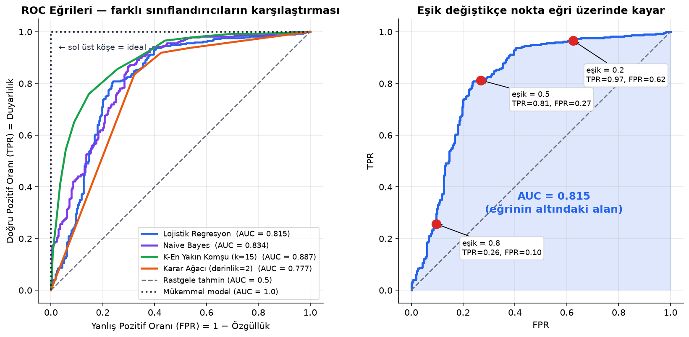

**Yorumlama:**
- **Sol üst köşe (0, 1)** = mükemmel sınıflandırıcı (TPR = 1, FPR = 0)
- **Köşegen çizgi** = **rastgele tahmin** (yazı-tura)
- Eğri **sol üst köşeye ne kadar yakınsa** model o kadar iyi
- Köşegenin **altında** kalan model → tahminleri tersine çevirirsen iyi olur 🙂

### AUC (Area Under the Curve — Eğri Altındaki Alan)

ROC eğrisinin altında kalan alandır; modelin **eşikten bağımsız tek bir başarı puanıdır.**

> **AUC'nin anlamı:** Rastgele seçilen bir **pozitif** örneğe, rastgele seçilen bir **negatif** örnekten **daha yüksek skor verme olasılığı.**

| AUC | Yorum |
|---|---|
| **1.0** | Mükemmel |
| 0.9 – 1.0 | Çok iyi |
| 0.8 – 0.9 | İyi |
| 0.7 – 0.8 | Orta / kabul edilebilir |
| 0.6 – 0.7 | Zayıf |
| **0.5** | **Rastgele** — model hiçbir şey öğrenmemiş |

Yukarıdaki gerçek örnekte **K-En Yakın Komşu (AUC = 0.887)** en iyi, **derinliği 2 olan karar ağacı (AUC = 0.777)** en zayıf model.

**ROC'un avantajları:** Eşikten bağımsız karşılaştırma yapar; modelleri tek grafikte kıyaslar; uygulamaya göre (kanser → yüksek TPR, spam → düşük FPR) **en uygun eşiği seçmeye** yardım eder.

## 5.11 Regresyon İçin İstatistiksel Ölçütler

Sınıflandırmada sınıf, regresyonda **sayı** tahmin edildiği için farklı ölçütler kullanılır ($y_i$: gerçek, $\hat y_i$: tahmin):

| Ölçüt | Formül | Anlamı |
|---|---|---|
| **MAE** (Ortalama Mutlak Hata) | $\frac1n\sum \lvert y_i - \hat y_i\rvert$ | Ortalama kaç birim yanılıyoruz? |
| **MSE** (Ortalama Kare Hata) | $\frac1n\sum (y_i - \hat y_i)^2$ | Büyük hataları daha çok cezalandırır |
| **RMSE** | $\sqrt{MSE}$ | MSE'nin orijinal birimdeki hali |
| **R²** (Belirlilik katsayısı) | $1 - \frac{\sum (y_i-\hat y_i)^2}{\sum (y_i-\bar y)^2}$ | Modelin açıkladığı varyans oranı (1 = mükemmel) |

---

# 6. Nöronların Haberleşmesi ve Beynin Veriyi Algılaması

> Hoca: *"Nöronların haberleşmesi, beyinle etkileşip veriyi algılaması mantığı önemli."* — Bu bölüm hem biyolojiyi hem de **yapay sinir ağlarının bu biyolojiden nasıl esinlendiğini** anlatıyor.

## 6.1 Temel Bilgiler

- İnsan beyninde yaklaşık **86 milyar nöron** vardır.
- Her nöron **binlerce** (≈1.000–10.000) başka nöronla bağlantı (**sinaps**) kurar → toplam **~100 trilyon** sinaps.
- Beyin vücut ağırlığının ~%2'si olmasına rağmen enerjinin ~**%20**'sini kullanır (~20 watt).
- **Nöron içinde** iletişim → **ELEKTRİKSEL** (aksiyon potansiyeli)
- **Nöronlar arasında** iletişim → **KİMYASAL** (sinaps, nörotransmitter)

## 6.2 Nöronun Yapısı

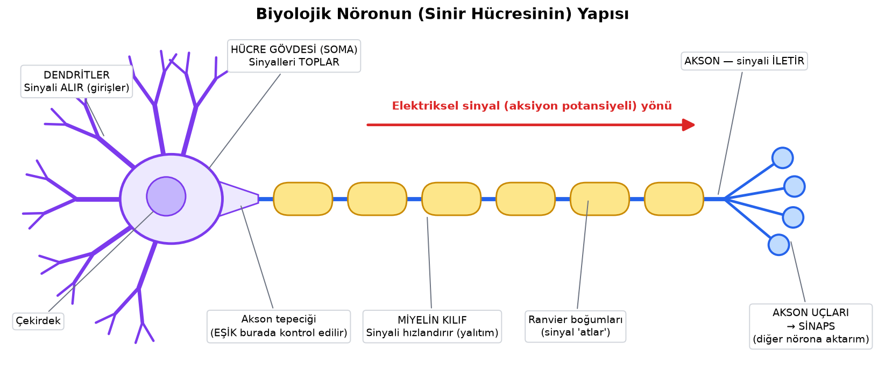

| Bölüm | Görevi | Yapay sinir ağındaki karşılığı |
|---|---|---|
| **Dendritler** | Diğer nöronlardan gelen sinyalleri **alır** | **Girişler** $(x_1, \dots, x_n)$ |
| **Sinaps** | İki nöron arasındaki bağlantı noktası; bağlantının **gücü değişebilir** | **Ağırlıklar** $(w_1, \dots, w_n)$ |
| **Hücre gövdesi (soma)** | Gelen sinyalleri **toplar**, çekirdeği içerir | **Toplama** $\sum w_i x_i$ |
| **Akson tepeciği** | Toplam sinyal **eşiği aşarsa** aksiyon potansiyeli başlatır | **Eşik / bias + aktivasyon fonksiyonu** |
| **Akson** | Sinyali uzağa **iletir** (1 mm – 1 m uzunluğunda olabilir) | **Çıkış** $y$ |
| **Miyelin kılıf** | Aksonu yalıtır, sinyali **hızlandırır** | — |
| **Ranvier boğumları** | Miyelin aralıkları; sinyal boğumdan boğuma **atlar** (*saltatory conduction*) | — |
| **Akson uçları** | Sinyali sinaps aracılığıyla **sonraki nöronlara** aktarır | Sonraki katmana bağlantı |

### Nöron Türleri

| Tür | Görevi |
|---|---|
| **Duyusal (afferent) nöron** | Duyu organlarından **merkeze** (omurilik/beyin) bilgi taşır |
| **Motor (efferent) nöron** | Merkezden **kaslara/bezlere** komut taşır |
| **Ara nöron (internöron)** | Merkezi sinir sisteminde nöronlar arası bağlantı, işleme |

## 6.3 Nöron İçi İletişim: Aksiyon Potansiyeli (Elektriksel)

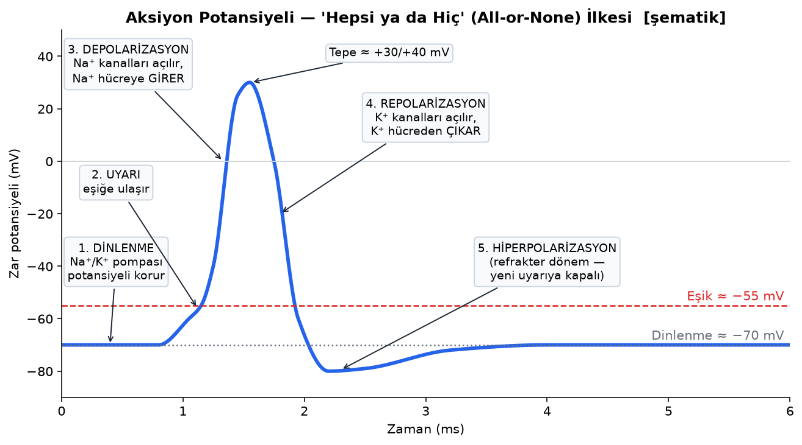

| Aşama | Ne oluyor? |
|---|---|
| **1. Dinlenme potansiyeli (≈ −70 mV)** | Hücre içi dışına göre negatif. **Na⁺/K⁺ pompası** (3 Na⁺ dışarı, 2 K⁺ içeri) bu farkı korur. |
| **2. Uyarı / eşik (≈ −55 mV)** | Dendritlerden gelen sinyallerin toplamı akson tepeciğinde **eşiği aşarsa** süreç başlar. Aşmazsa **hiçbir şey olmaz.** |
| **3. Depolarizasyon** | Voltaj kapılı **Na⁺ kanalları açılır**, Na⁺ hücreye **girer** → potansiyel hızla **+30/+40 mV**'a çıkar. |
| **4. Repolarizasyon** | Na⁺ kanalları kapanır, **K⁺ kanalları açılır**, K⁺ hücreden **çıkar** → potansiyel düşer. |
| **5. Hiperpolarizasyon** | Potansiyel kısa süre dinlenmenin de altına iner (~−80 mV). **Refrakter dönem**: nöron bu sırada yeni uyarıya yanıt veremez → sinyal **tek yönde** ilerler. |

### 🔑 "Hepsi ya da Hiç" İlkesi (All-or-None)

> Uyarı eşiği aşmazsa aksiyon potansiyeli **hiç oluşmaz**; aşarsa **her zaman aynı büyüklükte** oluşur. Daha güçlü uyarı **daha büyük** bir sinyal üretmez!

Bu ilke, ilk yapay nöron modeli olan **McCulloch–Pitts nöronunun (1943)** ve **basamak (step) aktivasyon fonksiyonunun** temelidir: toplam ≥ eşik → 1, değilse → 0.

**İletim hızı:** Miyelinli aksonlarda ~**120 m/s**'ye kadar, miyelinsizlerde ~1 m/s. (Multipl skleroz/MS hastalığında miyelin hasar görür → sinyal yavaşlar.)

## 6.4 Nöronlar Arası İletişim: Sinaps (Kimyasal)

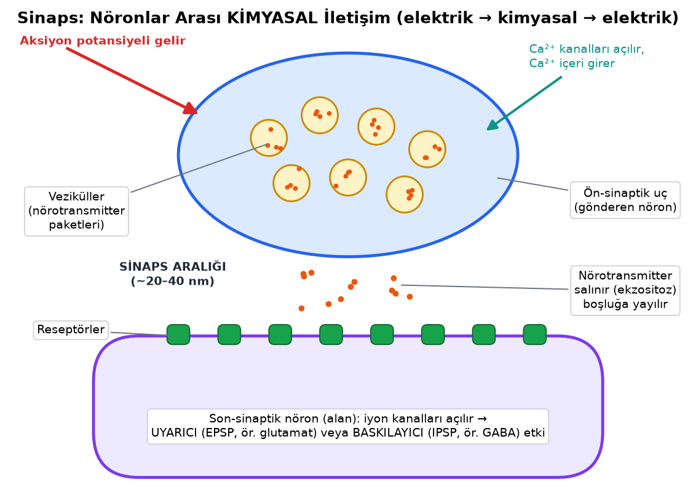

**Sinaptik iletimin adımları:**

1. **Aksiyon potansiyeli** akson ucuna (ön-sinaptik uç) ulaşır.
2. Voltaj kapılı **Ca²⁺ kanalları açılır**, kalsiyum hücreye girer.
3. Ca²⁺, **veziküllerin** hücre zarıyla kaynaşmasını tetikler → **nörotransmitter** sinaps aralığına salınır (**ekzositoz**).
4. Nörotransmitter ~20–40 nm'lik **sinaps aralığında** yayılır.
5. Son-sinaptik nörondaki **reseptörlere** bağlanır → iyon kanalları açılır.
6. Etki **uyarıcı** (EPSP — nöronu eşiğe yaklaştırır) veya **baskılayıcı** (IPSP — eşikten uzaklaştırır) olur.
7. Nörotransmitter **geri alınır** (*reuptake*) veya **enzimle parçalanır** → sinyal sonlanır.

> **Özet:** Elektrik → Kimyasal → Elektrik

### Önemli Nörotransmitterler

| Nörotransmitter | Etki | Görev / ilişkili durum |
|---|---|---|
| **Glutamat** | Uyarıcı (ana) | Öğrenme ve bellek |
| **GABA** | Baskılayıcı (ana) | Sakinleştirme; eksikliği → kaygı, nöbet |
| **Dopamin** | Duruma göre | Ödül, motivasyon, hareket; Parkinson'da azalır |
| **Serotonin** | Çoğunlukla baskılayıcı | Ruh hali, uyku, iştah; depresyonla ilişkili |
| **Asetilkolin** | Uyarıcı | Kas kasılması, dikkat, bellek; Alzheimer'da azalır |
| **Noradrenalin** | Uyarıcı | Uyanıklık, stres (savaş ya da kaç) |
| **Endorfin** | Baskılayıcı | Doğal ağrı kesici |

### Sinyallerin Toplanması (Entegrasyon)

Bir nörona aynı anda yüzlerce uyarıcı ve baskılayıcı sinyal gelir. Soma bunları **toplar**:
- **Uzaysal toplama:** Farklı sinapslardan **aynı anda** gelen sinyaller toplanır
- **Zamansal toplama:** Aynı sinapstan **art arda hızlı** gelen sinyaller toplanır
- Toplam **eşiği aşarsa** → nöron ateşlenir

> 👉 Bu tam olarak yapay nörondaki **ağırlıklı toplam** $\sum w_i x_i$'dir: uyarıcı sinaps = **pozitif ağırlık**, baskılayıcı sinaps = **negatif ağırlık**.

## 6.5 Beyin Veriyi Nasıl Algılar?

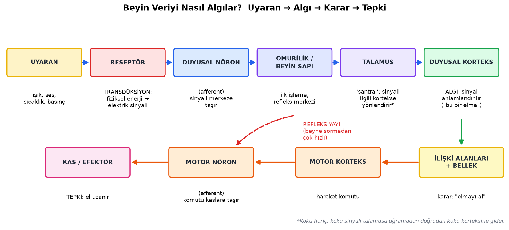

### Adım Adım Algılama

1. **Uyaran:** Dış dünyadan fiziksel enerji (ışık, ses dalgası, basınç, sıcaklık, kimyasal molekül)
2. **Transdüksiyon (dönüştürme):** Duyu **reseptörleri** bu enerjiyi **elektrik sinyaline** (aksiyon potansiyeline) çevirir. → Beyin dünyayı doğrudan görmez; **sadece elektrik sinyallerini** "okur"!
3. **İletim:** **Duyusal (afferent) nöronlar** sinyali omuriliğe/beyin sapına taşır
4. **Yönlendirme:** **Talamus** bir "santral" gibi sinyali ilgili korteks bölgesine gönderir (**koku hariç**)
5. **Algı:** **Duyusal korteks** sinyali işler ve **anlamlandırır** ("bu kırmızı bir elma")
6. **Karar:** İlişki alanları + **bellek** ile birleştirilir, karar verilir ("elmayı al")
7. **Tepki:** **Motor korteks** → **motor (efferent) nöronlar** → **kaslar** hareket eder

**Refleks yayı:** Sıcak sobaya dokunduğunda sinyal **omurilikte** doğrudan motor nörona aktarılır, beyne sormadan elini çekersin (çok hızlı). Acıyı **sonra** hissedersin.

### Duyular ve İlgili Beyin Bölgeleri

| Duyu | Reseptör | İşlendiği yer |
|---|---|---|
| 👁️ Görme | Retinadaki fotoreseptörler (**çubuk**: ışık/karanlık, **koni**: renk) | **Oksipital lob** (görme korteksi) |
| 👂 İşitme | Kulak salyangozundaki (koklea) **kıl hücreleri** | **Temporal lob** (işitme korteksi) |
| ✋ Dokunma, ağrı, sıcaklık | Deride mekano-, termo-, nosiseptörler | **Parietal lob** (somatosensoriyel korteks) |
| 👅 Tat | Tat tomurcukları (kemoreseptör) | Tat korteksi (insula) |
| 👃 Koku | Burundaki koku reseptörleri (kemoreseptör) | Koku korteksi — **talamusa uğramaz**, duygu/bellek merkezine (limbik sistem) yakındır |
| 🧠 Karar, planlama | — | **Frontal lob** |

### Beyin Uyaranın Şiddetini Nasıl Anlar? → Frekans Kodlama

"Hepsi ya da hiç" ilkesine göre her aksiyon potansiyeli aynı büyüklükte. O halde beyin **hafif dokunma** ile **sert basıncı** nasıl ayırt eder?

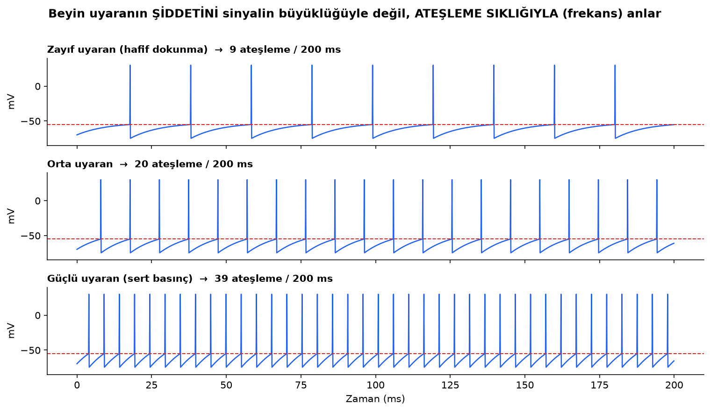

| Bilgi | Nasıl kodlanır? |
|---|---|
| **Uyaranın şiddeti** | **Ateşleme sıklığı** (frekans kodlama / *rate coding*) + kaç nöronun ateşlendiği (**popülasyon kodlama**) |
| **Uyaranın türü** (ışık mı ses mi?) | **Hangi yoldan / hangi beyin bölgesine** geldiği (*labeled line*) — sinyal aynıdır, gittiği yer farklıdır |
| **Uyaranın yeri** | Hangi reseptörün ve hangi nöronun aktif olduğu (beyinde vücudun bir "haritası" vardır) |

### Algı = Veri + Beklenti

- **Aşağıdan yukarı işleme** (*bottom-up*): Duyulardan gelen ham veri → algı
- **Yukarıdan aşağı işleme** (*top-down*): Bellek, beklenti, deneyim algıyı şekillendirir (optik illüzyonlar bu yüzden olur; beyin eksik bilgiyi **tahminle** tamamlar)

## 6.6 Beyin Nasıl Öğrenir? → Sinaptik Plastisite

- **Hebb Kuralı (Donald Hebb, 1949):** *"Birlikte ateşlenen nöronlar birbirine bağlanır."* (*Cells that fire together, wire together*) → İki nöron sık sık birlikte aktifse aralarındaki sinaps **güçlenir.**
- **Uzun süreli güçlenme (LTP):** Tekrarlanan uyarıyla sinaps kalıcı olarak güçlenir → **öğrenme ve bellek** böyle oluşur.
- Kullanılmayan bağlantılar **zayıflar / budanır.**

> 👉 Yapay sinir ağlarında **öğrenme = ağırlıkların güncellenmesi**dir. Biyolojide sinaps gücü değişir, YSA'da $w_i$ değişir (geri yayılım / backpropagation ile).

## 6.7 Biyolojik Nörondan Yapay Nörona

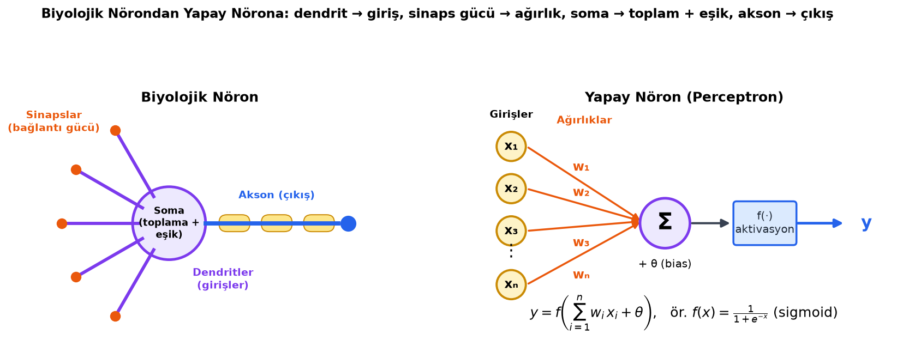

$$
y = f\left(\sum_{i=1}^{n} w_i\,x_i + \theta\right) \qquad\qquad \text{Sigmoid: } f(x) = \frac{1}{1+e^{-x}} \quad \text{(PDF 2'deki formül)}
$$

| Biyolojik sinir sistemi | Yapay sinir ağı |
|---|---|
| Nöron | Nöron / düğüm / perceptron |
| Dendrit | Giriş $x_i$ |
| Sinaps gücü | Ağırlık $w_i$ |
| Uyarıcı / baskılayıcı sinaps | Pozitif / negatif ağırlık |
| Soma'da toplama | $\sum w_i x_i$ |
| Eşik potansiyeli (−55 mV) | Bias $\theta$ + aktivasyon fonksiyonu |
| Hepsi ya da hiç | Basamak fonksiyonu (sigmoid/ReLU yumuşak versiyonları) |
| Akson | Çıkış $y$ |
| Sinaptik plastisite (Hebb, LTP) | Ağırlık güncelleme (geri yayılım) |
| Duyu → talamus → korteks katmanları | Giriş katmanı → gizli katmanlar → çıkış katmanı |
| Görme korteksindeki kenar algılayan hücreler (Hubel & Wiesel) | **Evrişimli sinir ağları (CNN)** |

**Tarihçe:** McCulloch & Pitts nöron modeli (**1943**) → Hebb öğrenme kuralı (**1949**) → Rosenblatt **Perceptron** (**1958**) → Çok katmanlı ağlar + **geri yayılım** (1986, Rumelhart, Hinton, Williams) → **Derin öğrenme** (2010'lar).

**Önemli farklar:** Beyin ~20 W ile çalışır, **paralel** ve **çok seyrek** ateşleme yapar, zaman (spike) bilgisini kullanır; yapay ağlar ise çok daha fazla enerji ve veri ister. Beynin ateşleme (spike) tabanlı çalışmasını taklit eden modellere **Spiking Neural Networks**, bunlara özel çiplere **nöromorfik çipler** denir.

---

# 7. Ek: Temel YZ Kavramları (PDF 1 Özeti)

**Yapay Zekâ:** Bilgisayar sistemlerinin **insan zekâsını taklit ederek** öğrenme, problem çözme, karar verme, dil anlama gibi görevleri yerine getirme yeteneği.

| Dönem | Olay |
|---|---|
| 1950'ler | **Dartmouth Konferansı** (1956) — "yapay zekâ" terimi ilk kez; **Turing Testi** |
| 1960–70'ler | Büyük heyecan → beklenen başarı gelmeyince **"yapay zekâ kışı"** |
| **1980'ler** | **Uzman sistemler** ile yeniden ilgi |
| 1990'lar | İnternet → büyük veri → veri madenciliği |
| 2000'ler+ | **Derin öğrenme** → görüntü tanıma, NLP'de sıçrama |

| Türler (kapasiteye göre) | Seviyeler (işlevselliğe göre) |
|---|---|
| **Dar YZ** — tek görev; bugünkü **tüm** sistemler (ChatGPT, Siri, satranç) | **Reaktif** — bellek yok (Deep Blue) |
| **Genel YZ** — insan gibi çok alanda; teorik | **Sınırlı bellek** — geçmişi kısa süre kullanır (otonom araç, AlphaStar) |
| **Süper YZ** — insanı aşan; tamamen teorik | **Zihin teorisi** — duyguları/niyetleri anlar; henüz yok |
| | **Öz bilinçli** — kendi bilinci var; bilim kurgu |

**Temel bileşenler:** Makine öğrenmesi · Derin öğrenme · Bilişsel hesaplama (IBM Watson) · Görüntü işleme · Doğal dil işleme · Yapay sinir ağları

**Öğrenme yöntemleri:** Denetimli · Denetimsiz · Pekiştirmeli

**Dezavantajlar (etik):** İş kaybı · önyargı ve ayrımcılık · gizlilik · **sorumluluk** (otonom araç kazasında kim sorumlu?) · şeffaflık eksikliği (kara kutu) · yüksek maliyet · bağımlılık

---

# 8. Konular Arası Bağlantılar (Büyük Resim)

| Konu | İlham kaynağı | Bilgi nereden gelir? | Ne için kullanılır? |
|---|---|---|---|
| **Uzman Sistemler** | İnsan uzmanın akıl yürütmesi | **Elle yazılan kurallar** (sembolik) | Teşhis, konfigürasyon, karar destek |
| **Makine Öğrenmesi** | İstatistik | **Veriden** öğrenilen örüntüler | Sınıflandırma, regresyon, kümeleme |
| **Yapay Sinir Ağları** | **Beyindeki nöronlar** | Veriden — ağırlık güncelleme | Görüntü, ses, dil, derin öğrenme |
| **Karınca Kolonisi** | **Karıncaların feromon izi** | Koloninin ortak "hafızası" (feromon) | **Ayrık** optimizasyon (rota, TSP) |
| **Ateşböceği** | **Ateşböceklerinin ışığı** | Popülasyonun konumları | **Sürekli** optimizasyon |
| **Agentic AI** | İnsan gibi hedef odaklı davranış | LLM + araçlar + bellek | Gerçek dünyada çok adımlı görevleri **otonom** yapmak |

> 💡 **Ortak fikir:** Doğa (beyin, karınca, ateşböceği) milyonlarca yıllık evrimle "optimize olmuş" çözümler sunar; YZ bunları taklit eder → **doğadan esinlenen hesaplama** (*nature-inspired computing*). ACO ve FA'da **basit bireylerin etkileşiminden** zekâ doğar (sürü zekâsı); beyinde de **basit nöronların etkileşiminden** bilinç doğar; Agentic AI'de de **ajanlar** birlikte çalışır.

---

# 9. Sınav Öncesi Hızlı Tekrar ve Formül Kağıdı

### 🐜 ACO
- **Dorigo, 1992**, Ant System, sürü zekâsı, meta-sezgisel, **TSP**
- **Feromon** + **stigmerji** (ortam aracılığıyla dolaylı iletişim) + **pozitif geri besleme** + **buharlaşma**
- $p_{ij} = \dfrac{\tau_{ij}^{\alpha}\,\eta_{ij}^{\beta}}{\sum_{l}\tau_{il}^{\alpha}\,\eta_{il}^{\beta}}$, &nbsp; $\eta_{ij} = 1/d_{ij}$
- $\tau_{ij} \leftarrow (1-\rho)\,\tau_{ij} + \sum_k Q/L_k$
- α = feromon önemi, β = mesafe önemi, ρ = buharlaşma (erken yakınsamayı önler), tabu listesi = hafıza
- α = 0 → greedy; β = 0 → sadece feromon (durgunluk)
- Çeşitler: AS, Elitist AS, Rank AS, **ACS** ($q_0$, yerel güncelleme), **MMAS** ($\tau_{min}$–$\tau_{max}$)
- Uygulama: rota (VRP), ağ yönlendirme (AntNet), çizelgeleme, robot yolu, özellik seçimi

### 🔥 Ateşböceği
- **Yang, 2008**; sürekli optimizasyon; çok tepeli problemlerde güçlü
- 3 kural: tek cinsiyet · çekicilik ∝ parlaklık, mesafeyle azalır · parlaklık = amaç fonksiyonu
- $\beta = \beta_0 e^{-\gamma r^2}$, &nbsp; $x_i \leftarrow x_i + \beta_0 e^{-\gamma r_{ij}^2}(x_j - x_i) + \alpha\epsilon_i$
- γ → 0: PSO benzeri; γ → ∞: rastgele arama; karmaşıklık $O(n^2 t)$

### 📚 Uzman Sistem
- Bilgi tabanı + **çıkarım motoru** + çalışma belleği + arayüz + **açıklama** + bilgi edinme
- **İleri zincirleme** (veri → sonuç, XCON) / **Geri zincirleme** (hedef → veri, MYCIN)
- DENDRAL (ilk), MYCIN (tıp, CF), XCON (konfigürasyon), PROSPECTOR (maden)
- En büyük sorun: **bilgi edinme darboğazı**, öğrenememe, kırılganlık

### 🤖 Agentic AI
- Ajan = sensör + aktüatör; **PEAS**; ajan türleri: refleks → model → hedef → fayda → öğrenen
- Döngü: **Algıla → Düşün/Planla → Eylem (araç) → Gözlemle → Öğren/Hatırla**
- Bileşenler: LLM, planlama, bellek, araç kullanımı, yansıtma, insan onayı
- GenAI **cevap verir**, Agentic AI **işi yapar**

### 📊 ML Ölçütleri
- Doğruluk = (TP+TN)/Toplam · Kesinlik = TP/(TP+FP) · **Duyarlılık = TPR = TP/(TP+FN)**
- Özgüllük = TN/(TN+FP) · **FPR = FP/(FP+TN) = 1 − Özgüllük** · F1 = 2PR/(P+R)
- FP = Tip I (yanlış alarm), FN = Tip II (kaçırma)
- **ROC:** y = TPR, x = FPR, tüm eşikler; **AUC:** 1 = mükemmel, 0.5 = rastgele
- Dengesiz veride doğruluk yanıltır → F1 / AUC
- Entropi = −p log₂p − q log₂q; Gain(S,A) = Entropi(S) − Σ (|Sᵥ|/|S|)·Entropi(Sᵥ)

### ⚡ Nöron
- Dendrit (al) → Soma (topla) → Akson tepeciği (eşik) → Akson (ilet) → Sinaps (aktar)
- Dinlenme **−70 mV**, eşik **−55 mV**, tepe **+30/+40 mV**; Na⁺ girer (depolarizasyon), K⁺ çıkar (repolarizasyon)
- **Hepsi ya da hiç**; şiddet → **frekansla** kodlanır
- Nöron içi **elektriksel**, nöronlar arası **kimyasal** (Ca²⁺ → vezikül → nörotransmitter → reseptör)
- Uyaran → **reseptör (transdüksiyon)** → duyusal nöron → omurilik → **talamus** → korteks → karar → motor nöron → kas
- **Hebb:** birlikte ateşlenen nöronlar birbirine bağlanır → YSA'da ağırlık güncelleme

---

# 10. Olası Sınav Soruları ve Cevapları

> Cevapları görmek için soruya tıkla.

### 🐜 Karınca Kolonisi (en çok buradan!)

<details>
<summary><b>S1.</b> Karınca kolonisi optimizasyonunun temel çalışma prensibini açıklayınız.</summary>

Gerçek karıncalar yürürken feromon bırakır ve yol seçerken feromonu yoğun olan yolu daha yüksek olasılıkla seçer. Kısa yoldaki karıncalar daha çabuk döndüğü için kısa yolda feromon daha hızlı birikir; bu **pozitif geri besleme** ile koloni en kısa yola yakınsar. Feromonun **buharlaşması** ise kötü yolların unutulmasını sağlar. ACO bunu taklit eder: yapay karıncalar **olasılık kuralıyla** ($\tau^\alpha\eta^\beta$) çözüm (tur) oluşturur, her iterasyon sonunda feromon **buharlaştırılır** ve iyi (kısa) turlara $Q/L_k$ kadar **feromon eklenir.** İterasyonlar ilerledikçe feromon en iyi çözüm üzerinde yoğunlaşır.

</details>

<details>
<summary><b>S2.</b> Stigmerji nedir? ACO ile ilişkisi nedir?</summary>

Stigmerji, bireylerin **ortamı değiştirerek dolaylı yoldan** iletişim kurmasıdır. Karıncalar birbirine doğrudan mesaj göndermez; yere feromon bırakarak ortamı değiştirir, diğer karıncalar bu değişikliğe göre davranır. ACO'da ortam = graf, feromon = kenarlardaki $\tau_{ij}$ değerleridir; karıncalar sadece bu değerler üzerinden "haberleşir".

</details>

<details>
<summary><b>S3.</b> Geçiş olasılığı formülünü yazınız ve her terimi açıklayınız.</summary>

$p_{ij}^k = \dfrac{\tau_{ij}^\alpha \eta_{ij}^\beta}{\sum_{l \in N_i^k} \tau_{il}^\alpha \eta_{il}^\beta}$ — $\tau_{ij}$: kenardaki feromon (geçmiş deneyim), $\eta_{ij} = 1/d_{ij}$: sezgisel bilgi (yakınlık), α: feromonun önemi, β: sezgisel bilginin önemi, $N_i^k$: k. karıncanın henüz ziyaret etmediği şehirler (tabu listesi dışı). Payda normalizasyon içindir (olasılıkların toplamı 1).

</details>

<details>
<summary><b>S4.</b> Buharlaşma katsayısı ρ'nun görevi nedir? ρ = 0 ve ρ = 1 olsaydı ne olurdu?</summary>

Buharlaşma, eski/kötü çözümlerin feromonunu azaltarak **erken yakınsamayı (yerel optimuma takılmayı) önler** ve keşfi destekler. **ρ = 0:** hiç buharlaşma olmaz, feromon sürekli birikir, ilk bulunan (belki kötü) yollar kalıcı olur → durgunluk. **ρ = 1:** feromon her iterasyonda tamamen silinir, koloni hiçbir şey hatırlamaz → sadece son iterasyonun bilgisi kalır, öğrenme olmaz.

</details>

<details>
<summary><b>S5.</b> α = 0 veya β = 0 olursa algoritma nasıl davranır?</summary>

**α = 0:** Feromon etkisiz → sadece mesafe kullanılır → olasılıksal **açgözlü (en yakın komşu)** algoritmasına dönüşür, koloni öğrenmez. **β = 0:** Mesafe bilgisi etkisiz → sadece feromon kullanılır → başta rastgele, sonra feromon nereye birikmişse oraya gider; kötü çözümlerde hızlıca **durgunluğa** girer.

</details>

<details>
<summary><b>S6.</b> (Sayısal) A'daki karınca için B (d=2), C (d=5), D (d=4) şehirleri var; tüm τ = 1, α = 1, β = 2. Gitme olasılıklarını hesaplayınız.</summary>

$\eta^2$: B = 0.25, C = 0.04, D = 0.0625 → toplam 0.3525 → **P(B) = 0.709, P(C) = 0.113, P(D) = 0.177.** (Bkz. Bölüm 1.7)

</details>

<details>
<summary><b>S7.</b> (Sayısal) ρ = 0.5, Q = 10, τ = 1. Uzunluğu 11 olan tur ve uzunluğu 18 olan tur aynı kenarı kullanıyorsa o kenarın yeni feromonu nedir?</summary>

$\tau = (1-0.5)\cdot 1 + 10/11 + 10/18 = 0.5 + 0.909 + 0.556 = \mathbf{1.965}$

</details>

<details>
<summary><b>S8.</b> Yapay karıncaların gerçek karıncalardan farkları nelerdir?</summary>

1) **Hafızaları vardır** (tabu listesi — aynı şehre tekrar gitmezler). 2) **Sezgisel bilgi** ($\eta = 1/d$) kullanırlar, gerçek karıncalar mesafeyi bilmez. 3) Feromonu genelde **tur bittikten sonra** ve **çözüm kalitesine göre** ($Q/L_k$) bırakırlar. 4) **Ayrık zamanda** (iterasyonlarla) çalışırlar. 5) Elitizm, feromon sınırları gibi doğada olmayan ek mekanizmalar kullanılabilir.

</details>

<details>
<summary><b>S9.</b> ACO'nun gerçek hayattaki uygulama alanlarına 4 örnek veriniz.</summary>

Kargo/dağıtım araçlarının rota planlaması (VRP), internet/telekom ağlarında paket yönlendirme (AntNet), fabrika iş çizelgeleme (job-shop), robot yol planlama, kablosuz sensör ağlarında yönlendirme, ML'de özellik seçimi, görüntüde kenar tespiti.

</details>

<details>
<summary><b>S10.</b> ACS (Ant Colony System) ve MMAS, temel Ant System'den nasıl farklıdır?</summary>

**ACS:** $q_0$ olasılıkla en iyi kenarı doğrudan seçer (sömürü), değilse olasılık kuralını kullanır; karınca bir kenardan geçince o kenarın feromonunu **azaltır (yerel güncelleme)** → diğerleri farklı yolları dener; global güncellemeyi sadece en iyi karınca yapar. **MMAS:** feromonu $[\tau_{min}, \tau_{max}]$ arasında sınırlar ve sadece en iyi karıncanın feromon bırakmasına izin verir → durgunluk önlenir.

</details>

### 🔥 Ateşböceği

<details>
<summary><b>S11.</b> Ateşböceği algoritmasının üç temel kuralı nedir?</summary>

1) Tüm ateşböcekleri tek cinsiyetlidir, herkes herkesi çekebilir. 2) Çekicilik parlaklıkla orantılıdır ve mesafe arttıkça azalır; sönük olan parlak olana gider, kendinden parlak yoksa rastgele hareket eder. 3) Parlaklık amaç fonksiyonunun değeriyle belirlenir.

</details>

<details>
<summary><b>S12.</b> Hareket denklemini yazınız; γ → 0 ve γ → ∞ durumlarını yorumlayınız.</summary>

$x_i \leftarrow x_i + \beta_0 e^{-\gamma r_{ij}^2}(x_j - x_i) + \alpha\epsilon_i$. **γ → 0:** çekicilik mesafeden bağımsız, herkes en parlağı görür → PSO'ya benzer. **γ → ∞:** çekicilik sıfır, kimse kimseyi görmez → rastgele arama.

</details>

<details>
<summary><b>S13.</b> ACO ile ateşböceği algoritmasını karşılaştırınız.</summary>

İkisi de sürü zekâsı, popülasyon tabanlı, meta-sezgisel ve olasılıksaldır. ACO **dolaylı** iletişim (feromon/stigmerji) kullanır, **ayrık** problemlere (TSP, rota) uygundur, kenarlarda bir "hafıza" (feromon) tutar. FA **doğrudan** iletişim (ışığı görme) kullanır, **sürekli** fonksiyon optimizasyonuna uygundur, çok tepeli problemlerde birden çok optimumu bulabilir; hafızası yoktur.

</details>

### 📚 Uzman Sistemler

<details>
<summary><b>S14.</b> Uzman sistemin bileşenlerini ve görevlerini yazınız.</summary>

Bilgi tabanı (kurallar ve olgular), çıkarım motoru (kuralları uygulayıp sonuç üretir), çalışma belleği (o anki olgular), kullanıcı arayüzü, açıklama modülü (nasıl/neden sorularını cevaplar), bilgi edinme modülü (uzmandan bilgiyi aktarır). Bkz. Bölüm 3.3.

</details>

<details>
<summary><b>S15.</b> İleri ve geri zincirlemeyi örnekle karşılaştırınız.</summary>

**İleri:** Olgulardan başlar, kuralları tetikleyerek sonuca gider (veri güdümlü) — ör. "ateş + öksürük → enfeksiyon → grip → istirahat öner"; XCON. **Geri:** Hipotezden başlar, onu kanıtlamak için gereken koşulları geriye doğru arar (hedef güdümlü) — ör. "Grip mi? → enfeksiyon ve kas ağrısı var mı? → ateş ve öksürük var mı?"; MYCIN.

</details>

<details>
<summary><b>S16.</b> Uzman sistemlerin makine öğrenmesine göre avantaj ve dezavantajı nedir?</summary>

**Avantaj:** Kararlarını açıklayabilir (şeffaf), az veriyle çalışır, uzman bilgisini korur. **Dezavantaj:** Öğrenemez, kuralları elle yazmak zor ve pahalıdır (bilgi edinme darboğazı), uzmanlık alanı dışında kırılgandır, sağduyusu yoktur.

</details>

### 🤖 Agentic AI

<details>
<summary><b>S17.</b> Agentic AI nedir? Klasik üretken yapay zekâdan farkı nedir?</summary>

Kendisine verilen hedefe ulaşmak için otonom olarak planlayan, araçlar kullanarak gerçek dünyada eylem yapan, sonucu gözlemleyip planını güncelleyen YZ'dir. Üretken YZ istenen içeriği **üretir** (tek seferlik cevap); Agentic AI çok adımlı bir döngüde **işi gerçekten yapar** (araç kullanır, bellek tutar, yüksek otonomi).

</details>

<details>
<summary><b>S18.</b> Agentic AI'nin bir dış dünya probleminde nasıl uygulandığını bir örnekle adım adım açıklayınız.</summary>

Döngü: **Algıla → Düşün/Planla → Eylem → Gözlemle → Öğren.** Örn. müşteri hizmetleri: şikâyeti algılar → planlar (sipariş ve kargo kontrolü) → API'lerle sorgular → gecikmeyi gözlemler → politikaya göre yeniden planlar → (gerekirse insan onayıyla) yeni gönderim oluşturup müşteriye bildirir → gecikme örüntüsünü belleğe yazıp raporlar. Bkz. Bölüm 4.5.

</details>

<details>
<summary><b>S19.</b> Otonom bir araç için PEAS tanımını yapınız.</summary>

**P:** güvenlik, hız, yasal sürüş, konfor · **E:** yol, trafik, yaya, hava · **A:** direksiyon, gaz, fren, sinyal, korna · **S:** kamera, LIDAR, radar, GPS, hız sensörü.

</details>

### 📊 Makine Öğrenmesi

<details>
<summary><b>S20.</b> Sınıflandırma neden yapılır?</summary>

Etiketli geçmiş veriden öğrenip yeni bir örneğin hangi önceden tanımlı sınıfa ait olduğunu otomatik tahmin etmek için: kararları otomatikleştirmek/hızlandırmak, bilinmeyen durumları tahmin etmek (teşhis, kredi), insan hatasını ve öznelliği azaltmak, riskleri önceden tespit etmek (dolandırıcılık, spam).

</details>

<details>
<summary><b>S21.</b> TP = 40, FN = 10, FP = 5, TN = 45 için doğruluk, kesinlik, duyarlılık, özgüllük ve F1'i hesaplayınız.</summary>

Doğruluk = 85/100 = **0.85** · Kesinlik = 40/45 = **0.889** · Duyarlılık = 40/50 = **0.80** · Özgüllük = 45/50 = **0.90** · F1 = 2·0.889·0.8/(0.889+0.8) = **0.842**

</details>

<details>
<summary><b>S22.</b> ROC eğrisi nedir, eksenleri nelerdir? AUC = 0.5 ve AUC = 1 ne anlama gelir?</summary>

Sınıflandırıcının **tüm eşik değerleri** için **TPR'yi (y ekseni)** **FPR'ye (x ekseni)** karşı çizen grafiktir. Eğri sol üst köşeye ne kadar yakınsa model o kadar iyidir. AUC eğrinin altındaki alandır; **AUC = 1** mükemmel ayırım, **AUC = 0.5** rastgele tahmin (köşegen) demektir.

</details>

<details>
<summary><b>S23.</b> Hangi durumda doğruluk yanıltıcıdır? Hangi ölçüt kullanılmalıdır?</summary>

**Dengesiz veride.** Ör. 1000 kişiden 10'u hasta; herkese "sağlam" diyen model %99 doğruluk alır ama hiçbir hastayı bulamaz (duyarlılık = 0). Bu durumda **duyarlılık, kesinlik, F1 ve ROC-AUC** kullanılmalıdır.

</details>

<details>
<summary><b>S24.</b> Kanser taramasında ve spam filtresinde hangi ölçüt daha önemlidir? Neden?</summary>

**Kanser:** Duyarlılık (recall) — hasta kaçırmak (FN) hayati. **Spam:** Kesinlik (precision) — önemli e-postayı spam'e atmak (FP) kabul edilemez.

</details>

<details>
<summary><b>S25.</b> Aşırı öğrenme nedir? Nasıl önlenir?</summary>

Modelin eğitim verisini (gürültü dahil) ezberleyip yeni veride başarısız olmasıdır: eğitim hatası düşük, test hatası yüksek. Önlemler: daha basit model / optimum karmaşıklık, daha fazla veri, **çapraz doğrulama (k-fold)**, özellik seçimi, budama (karar ağaçlarında), düzenlileştirme.

</details>

<details>
<summary><b>S26.</b> KNN algoritması nasıl çalışır?</summary>

Eğitim aşaması yoktur (örnek tabanlı). Test örneğinin eğitim kümesindeki tüm örneklere **Öklid uzaklığı** hesaplanır, **en yakın K** örnek seçilir, bunlar arasında **en çok bulunan sınıf** test örneğinin sınıfı olur.

</details>

### ⚡ Nöronlar

<details>
<summary><b>S27.</b> Nöronlar arasında iletişim nasıl gerçekleşir?</summary>

Nöron **içinde** elektriksel (aksiyon potansiyeli), nöronlar **arasında** kimyasaldır: aksiyon potansiyeli akson ucuna gelir → Ca²⁺ kanalları açılır → veziküller nörotransmitteri sinaps aralığına salar → nörotransmitter son-sinaptik nöronun reseptörlerine bağlanır → iyon kanalları açılır → uyarıcı (EPSP) veya baskılayıcı (IPSP) etki → toplam eşiği aşarsa sonraki nöron ateşlenir → nörotransmitter geri alınır/parçalanır.

</details>

<details>
<summary><b>S28.</b> "Hepsi ya da hiç" ilkesi nedir? Beyin uyaranın şiddetini nasıl anlar?</summary>

Uyarı eşiği (−55 mV) aşmazsa aksiyon potansiyeli oluşmaz; aşarsa her zaman aynı büyüklükte oluşur. Bu yüzden şiddet sinyalin büyüklüğüyle değil, **ateşleme frekansıyla** (güçlü uyaran = daha sık ateşleme) ve **ateşlenen nöron sayısıyla** kodlanır.

</details>

<details>
<summary><b>S29.</b> Beyin dış dünyadan gelen veriyi nasıl algılar?</summary>

Uyaran → **reseptörler** fiziksel enerjiyi elektrik sinyaline çevirir (**transdüksiyon**) → **duyusal nöronlar** sinyali omuriliğe/beyne taşır → **talamus** ilgili korteks bölgesine yönlendirir (koku hariç) → **duyusal korteks** anlamlandırır (algı) → bellek ve ilişki alanlarıyla karar verilir → **motor korteks** ve **motor nöronlar** ile kaslara tepki komutu gider. Algı, gelen veri (bottom-up) ile beklenti/deneyimin (top-down) birleşimidir.

</details>

<details>
<summary><b>S30.</b> Biyolojik nöron ile yapay nöron arasındaki benzerlikleri açıklayınız.</summary>

Dendrit → giriş ($x_i$); sinaps gücü → ağırlık ($w_i$); soma'da toplama → $\sum w_i x_i$; eşik potansiyeli → bias ve aktivasyon fonksiyonu; akson → çıkış ($y$); sinaptik plastisite (Hebb) → ağırlık güncelleme (öğrenme). Formül: $y = f(\sum w_i x_i + \theta)$, ör. sigmoid $f(x) = 1/(1+e^{-x})$.

</details>

---

## 📚 Kaynaklar

- Ders PDF'leri: *7-YapayZeka ilk* (Ç.Ü. Enformatik Bölümü) ve *Makine Öğrenmesine Giriş* (Doç. Dr. Banu Diri, YTÜ)
- Dorigo, M., Stützle, T. — *Ant Colony Optimization*, MIT Press, 2004
- Dorigo, M., Gambardella, L. M. — "Ant Colony System", *IEEE Trans. Evolutionary Computation*, 1997
- Yang, X.-S. — *Nature-Inspired Metaheuristic Algorithms*, 2008; ["Firefly Algorithm: Recent Advances and Applications" (arXiv:1308.3898)](https://arxiv.org/abs/1308.3898)
- Russell, S., Norvig, P. — *Artificial Intelligence: A Modern Approach* (ajanlar, PEAS, uzman sistemler)
- Alpaydın, E. — *Introduction to Machine Learning*, MIT Press
- Kandel, E. ve ark. — *Principles of Neural Science* (nöron, sinaps, algı)
- Fawcett, T. — "An introduction to ROC analysis", *Pattern Recognition Letters*, 2006

> 🍀 **Sınavda başarılar!** Son tekrar için [Bölüm 9](#9-sınav-öncesi-hızlı-tekrar-ve-formül-kağıdı)'u ve ACO'daki [elle çözülmüş örneği](#17-elle-çözülmüş-örnek-sınavda-bu-tarz-soru-gelebilir) mutlaka gözden geçir.
