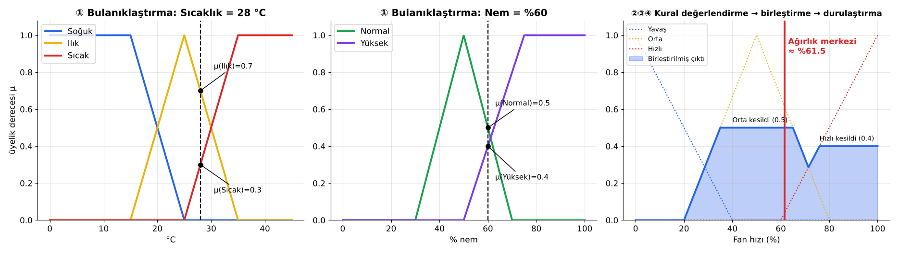
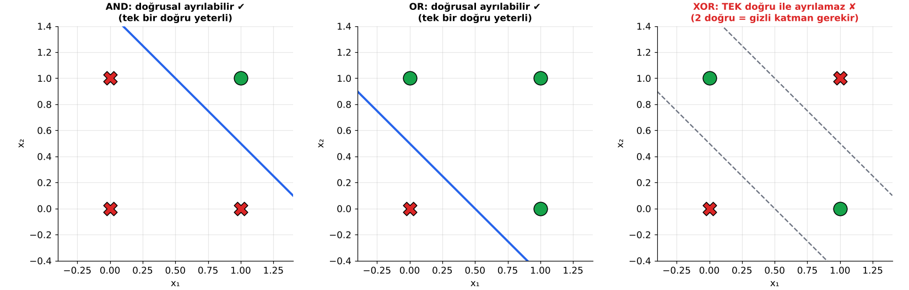

# 🧠 Yapay Zekâ — Sınav Çalışma Notları

> Hocanın derste "buradan soru çıkacak" dediği konular + yüklenen iki PDF'in (*7-YapayZeka ilk* ve *Makine Öğrenmesine Giriş — Banu Diri*) özeti.
> **⭐ En önemli konu: Karınca Kolonisi Optimizasyonu** — bu yüzden en detaylı bölüm o.
>
> 📝 Notlar **formül ve sayısal hesap içermez**; kavramlar, karşılaştırmalar ve sınavda sorulabilecek kilit bilgiler üzerine kuruludur.
>
> Tüm görseller `images/` klasöründe; çoğu gerçek bir simülasyon çalıştırılarak üretildi (ör. ACO gerçekten 25 şehirlik bir problemi çözüyor, ROC eğrileri gerçek modellerden hesaplandı).

---

## 📑 İçindekiler

1. [⭐ Karınca Kolonisi Optimizasyonu (ACO)](#1-karınca-kolonisi-optimizasyonu-aco)
2. [🔥 Ateşböceği Algoritması (Firefly)](#2-ateşböceği-algoritması-firefly-algorithm)
3. [📚 Uzman Sistemler](#3-uzman-sistemler-expert-systems)
4. [🧩 Yapay Zekâda Çıkarım (Inference) Nasıl Yapılır?](#4-yapay-zekâda-çıkarım-inference-nasıl-yapılır)
5. [🤖 Agentic AI ve Gerçek Dünya Uygulamaları](#5-agentic-ai-ajan-tabanlı-yapay-zekâ)
6. [📊 Makine Öğrenmesi: Sınıflandırma, Karışıklık Matrisi, ROC](#6-makine-öğrenmesi-algoritmaları-ve-değerlendirme-ölçütleri)
7. [⚡ Nöronların Haberleşmesi ve Beynin Veriyi Algılaması](#7-nöronların-haberleşmesi-ve-beynin-veriyi-algılaması)
8. [📘 Ek: Temel YZ Kavramları (PDF 1 Özeti)](#8-ek-temel-yz-kavramları-pdf-1-özeti)
9. [🔗 Konular Arası Bağlantılar (Büyük Resim)](#9-konular-arası-bağlantılar-büyük-resim)
10. [📝 Sınav Öncesi Hızlı Tekrar](#10-sınav-öncesi-hızlı-tekrar)
11. [❓ Olası Sınav Soruları ve Cevapları](#11-olası-sınav-soruları-ve-cevapları)

---

# 1. Karınca Kolonisi Optimizasyonu (ACO)

## 1.1 Nedir?

**Karınca Kolonisi Optimizasyonu** (*Ant Colony Optimization — ACO*), gerçek karıncaların yuva ile yiyecek arasındaki **en kısa yolu bulma davranışından** esinlenmiş bir **meta-sezgisel (metaheuristic) optimizasyon** algoritmasıdır.

| Özellik | Açıklama |
|---|---|
| **Geliştiren** | **Marco Dorigo**, 1992 (doktora tezi) — ilk sürümü **Ant System (AS)** |
| **Ait olduğu alan** | **Sürü Zekâsı** (*Swarm Intelligence*) — basit bireylerin toplu davranışından zekâ doğar |
| **Problem tipi** | Özellikle **kombinatoryal (ayrık) optimizasyon**: en kısa yol, rota, çizelgeleme |
| **Klasik örnek** | **Gezgin Satıcı Problemi** (*Traveling Salesman Problem — TSP*): her şehre bir kez uğrayıp başlangıca dönen en kısa turu bul |
| **Temel fikir** | Yapay karıncalar çözüm üretir → iyi çözümlerin üzerine daha çok **feromon** bırakılır → sonraki karıncalar feromonu takip eder → zamanla en iyi yol "keşfedilir" |

> 💡 **Meta-sezgisel** = Garanti olarak en iyi çözümü bulmaz ama çok büyük problemlerde **kabul edilebilir sürede çok iyi** çözümler bulur. (25 şehirli TSP'de olası tur sayısı ≈ 3 × 10²³ — hepsini denemek imkânsız!)

## 1.2 Biyolojik İlham: Karıncalar En Kısa Yolu Nasıl Bulur?

Karıncalar neredeyse kördür, haritaları yoktur, birbirleriyle "konuşmazlar". Peki nasıl en kısa yolu bulurlar?

1. **Feromon:** Karıncalar yürürken yere **feromon** denen kimyasal bir koku bırakır.
2. **Feromonu takip etme:** Bir karınca yol seçerken **feromonu daha yoğun olan yolu daha yüksek olasılıkla** seçer (kesin değil, olasılıksal!).
3. **Kısa yol avantajı:** Kısa yoldan giden karınca yuvaya **daha erken döner** → aynı sürede o yoldan daha çok karınca geçer → kısa yolda feromon **daha hızlı birikir**.
4. **Pozitif geri besleme:** Daha çok feromon → daha çok karınca → daha da çok feromon... (kartopu etkisi)
5. **Buharlaşma:** Feromon zamanla **buharlaşır**. Uzun/kullanılmayan yollardaki feromon kaybolur → koloni kötü yolu "unutur".

### 🔑 Stigmerji (Stigmergy)

> **Stigmerji = ortam aracılığıyla dolaylı iletişim.** Karıncalar birbirine doğrudan mesaj göndermez; ortamı (yerdeki feromon) değiştirerek birbirlerini etkilerler. ACO'nun temel kavramıdır, **sınavda sorulabilir!**

### Çift Köprü Deneyi (Deneubourg, Goss ve ark., 1989–1990)

Yuva ile yiyecek arasına biri kısa biri uzun iki köprü konur. Başta karıncalar iki yola eşit dağılır; birkaç dakika sonra neredeyse hepsi **kısa yolu** kullanır.


*(c) grafiği gerçek bir simülasyondur: başlangıçta %50 olan "kısa yolu seçen karınca oranı", pozitif geri besleme sayesinde ~%97'ye çıkıyor.*

## 1.3 Gerçek Karınca ↔ Yapay Karınca

| Gerçek karınca kolonisi | ACO algoritmasındaki karşılığı |
|---|---|
| Karınca | Bir çözüm (tur) inşa eden **basit ajan** |
| Yuva → yiyecek yolu | Problemin bir **çözümü** (ör. TSP turu) |
| Yolun uzunluğu | Çözümün **maliyeti** (tur uzunluğu) |
| Yere bırakılan feromon | Graf kenarlarında tutulan **feromon değeri** → koloninin **ortak hafızası** |
| Feromonun buharlaşması | Her iterasyonda tüm kenarlardaki feromonun **belli bir oranda azaltılması** |
| Karıncanın yakını görmesi | **Sezgisel bilgi / görünürlük**: yakın şehir daha cazip |
| Kısa yolda daha çok feromon birikmesi | Kısa tur yapan karıncanın **daha çok** feromon bırakması |
| Karıncanın aynı yere iki kez gitmemesi | **Tabu listesi** (ziyaret edilen şehirlerin hafızası) |

> ⚠️ Yapay karıncaların gerçeklerden farkı: **hafızaları vardır** (tabu listesi), **sezgisel bilgi** (mesafe) kullanırlar ve feromonu genelde **tur bittikten sonra**, turun kalitesine göre bırakırlar.

## 1.4 Algoritmanın Adımları


```text
1. Parametreleri belirle (karınca sayısı, α, β, buharlaşma oranı ρ)
   ve tüm kenarlara EŞİT başlangıç feromonu ver
2. TEKRARLA (durma kriteri sağlanana kadar):
   a. Karıncaları rastgele şehirlere yerleştir
   b. HER karınca için:
        Tüm şehirler gezilene kadar:
            Ziyaret edilmemiş şehirlerden birini GEÇİŞ KURALI ile (feromon + yakınlık) olasılıksal seç
            Seçilen şehri tabu listesine ekle
        Başlangıç şehrine dön, turun uzunluğunu kaydet
   c. Şimdiye kadarki en iyi turu güncelle
   d. BUHARLAŞMA: tüm kenarlardaki feromonu azalt
   e. FEROMON BIRAKMA: her karınca kendi turunun kenarlarına feromon ekler (tur ne kadar kısaysa o kadar çok)
3. En iyi turu döndür
```

**Durma kriterleri:** maksimum iterasyon sayısına ulaşmak · belirli sayıda iterasyon boyunca **iyileşme olmaması** · hedeflenen çözüm kalitesine ulaşmak · süre sınırı · tüm karıncaların aynı turu üretmesi (durgunluk).

## 1.5 Algoritmanın Üç Temel Mekanizması

### ① Geçiş Kuralı — Karınca bir sonraki şehri nasıl seçer?

Karınca, henüz **ziyaret etmediği** şehirler arasından seçim yaparken **iki bilgiye** bakar:

| Bilgi | Anlamı | Benzetme |
|---|---|---|
| **Feromon (τ)** | O kenarı daha önce kaç iyi karınca kullanmış? | **Geçmiş deneyim** — koloninin hafızası |
| **Sezgisel bilgi (η)** | O şehir ne kadar yakın? (mesafe arttıkça azalır) | **Anlık, açgözlü bilgi** — gözle görülen |

- İki bilgi ne kadar yüksekse o şehrin **seçilme olasılığı** o kadar yüksektir.
- **α** feromonun, **β** mesafenin ne kadar önemli olduğunu belirler.
- Seçim **kesin değil, olasılıksaldır** → **rulet tekerleği seçimi**: her aday, olasılığı kadar büyük bir dilime sahiptir; tekerlek rastgele çevrilir. En cazip şehir **çoğunlukla** seçilir ama **her zaman** değil → kötü görünen yollar da arada denenir (**keşif**).

### ② Buharlaşma

Her iterasyon sonunda **tüm** kenarlardaki feromon **ρ oranında azaltılır.**
- Kötü / kullanılmayan yolların feromonu zamanla silinir → koloni onları **unutur**.
- İlk bulunan (belki kötü) çözüme **kilitlenmeyi (erken yakınsama)** önler.

### ③ Feromon Bırakma

Her karınca turundaki kenarlara feromon ekler; **miktar tur uzunluğuyla ters orantılıdır:**
- **Kısa tur → çok feromon**, uzun tur → az feromon
- Birden fazla karıncanın kullandığı kenarda feromon **üst üste** birikir
- Sonuç: iyi turların kenarları iterasyonlar ilerledikçe **daha cazip** hâle gelir → **pozitif geri besleme**

| Kavram / Sembol | Anlamı |
|---|---|
| **τ (tau)** | Kenardaki feromon miktarı |
| **η (eta)** | Sezgisel bilgi (yakınlık / görünürlük) |
| **α (alfa)** | Feromonun önem derecesi |
| **β (beta)** | Sezgisel bilginin (mesafenin) önem derecesi |
| **ρ (ro)** | Buharlaşma oranı (0 ile 1 arası) |
| **Q** | Bırakılan feromon miktarını ölçekleyen sabit |
| **m** | Karınca sayısı (genelde şehir sayısı kadar) |
| **Tabu listesi** | Karıncanın gittiği şehirlerin listesi → aynı şehre tekrar gidilmez |

## 1.6 Parametrelerin Etkisi

| Parametre | Çok küçükse | Çok büyükse | Tipik değer |
|---|---|---|---|
| **α** (feromon önemi) | α = 0 → feromon yok sayılır, algoritma **açgözlü (greedy) en yakın komşu** aramasına döner | Karıncalar feromona körü körüne uyar → **erken yakınsama / durgunluk (stagnation)**, yerel optimuma takılma | 1 |
| **β** (mesafe önemi) | β = 0 → sadece feromona bakılır, mesafe önemsenmez → kötü sonuç, hızlı durgunluk | Neredeyse greedy davranır, keşif azalır | 2 – 5 |
| **ρ** (buharlaşma) | Feromon çok yavaş azalır → kötü yollar unutulmaz, **erken yakınsama** | Feromon çabuk silinir → koloni öğrendiğini unutur, **rastgele aramaya** yaklaşır | 0.1 – 0.5 |
| **m** (karınca sayısı) | Az keşif | Hesaplama maliyeti artar | ≈ şehir sayısı |
| **Q** | Feromon miktarının ölçeği | — | 1 – 100 |

> 🎯 **Sınav cümlesi:** *Buharlaşma, algoritmanın yerel optimuma takılmasını (erken yakınsamayı) önler ve keşfi (exploration) destekler. α ve β, "geçmiş deneyim (feromon)" ile "anlık sezgi (mesafe)" arasındaki dengeyi kurar.*
>
> **Keşif (exploration) ↔ Sömürü (exploitation) dengesi:** Feromonu takip etmek *sömürü*, olasılıksal seçim ve buharlaşma *keşif* sağlar.

## 1.7 Keşif–Sömürü Dengesi, Durgunluk ve ACO'yu Bir Probleme Uygulamak

### Keşif (Exploration) ↔ Sömürü (Exploitation)

| | **Keşif** | **Sömürü** |
|---|---|---|
| Ne demek? | **Yeni**, denenmemiş yolları aramak | Bilinen **iyi** yolları kullanmak |
| ACO'da kim sağlar? | Olasılıksal (rulet) seçim, **buharlaşma**, ACS'deki **yerel güncelleme**, MMAS'ın **alt sınırı** | **Feromonu takip etmek**, büyük α, **elitizm**, ACS'deki **q₀** kuralı |
| Fazlası olursa | Rastgele arama → yakınsamaz | **Erken yakınsama** → yerel optimuma takılır |

> 🎯 İyi bir meta-sezgiselin sırrı bu ikisi arasındaki **dengedir.** Başta keşif, sona doğru sömürü ağırlıklı olmalıdır.

### Durgunluk (Stagnation)

**Tüm karıncaların aynı (çoğu zaman en iyi olmayan) turu üretmeye başlamasıdır.** Feromon tek bir yolda o kadar birikir ki başka yol seçilmez.
- **Nedenleri:** α çok büyük · buharlaşma (ρ) çok küçük · aşırı elitizm
- **Önlemleri:** MMAS'taki feromon **alt–üst sınırları** · feromonu **yeniden başlatma** · ACS'deki **yerel güncelleme** · buharlaşmayı artırmak

### ACO'yu Yeni Bir Probleme Uygulamak İçin Gerekenler

1. **Problemi graf olarak temsil et** — düğümler (şehir, iş, makine) ve kenarlar (geçişler)
2. **Kısıtları tanımla** — tabu listesi, araç kapasitesi, zaman pencereleri
3. **Sezgisel bilgiyi tanımla** — TSP'de yakınlık; çizelgelemede iş süresinin kısalığı; ağ yönlendirmede gecikme
4. **Çözüm kalitesi ölçüsünü tanımla** — tur uzunluğu, toplam maliyet, toplam süre
5. **Feromon güncelleme stratejisini seç** — AS, Elitist, ACS, MMAS
6. **Parametreleri ve durma kriterini belirle**

> 💡 **Statik vs dinamik problemler:** Mesafeler değişmiyorsa (klasik TSP) problem statiktir. Ağ trafiği gibi **sürekli değişen** problemlerde ACO, feromonun sürekli güncellenmesi sayesinde **kendiliğinden uyum sağlar** (AntNet). Bu, ACO'nun en güçlü yanlarından biridir.

## 1.8 Gerçek Simülasyon: 25 Şehirli TSP

Aşağıdaki görsel, gerçek bir ACO programının 25 şehirli bir problemdeki çıktısı. **Mavi çizgilerin kalınlığı = feromon miktarı.**


- **İlk iterasyon:** Feromon her yere dağınık → turlar karmaşık ve uzun
- **Birkaç iterasyon sonra:** Feromon iyi kenarlarda yoğunlaşmaya başladı
- **Son iterasyonlar:** Feromon neredeyse sadece en iyi turun üzerinde → koloni **yakınsadı**


## 1.9 ACO Çeşitleri

| Algoritma | Yıl / Kişi | Farkı |
|---|---|---|
| **Ant System (AS)** | Dorigo, 1992/1996 | İlk sürüm; **tüm karıncalar** feromon bırakır |
| **Elitist AS** | Dorigo, 1996 | Şimdiye kadarki **en iyi tura ekstra** feromon eklenir |
| **Rank-based AS** | Bullnheimer ve ark., 1999 | Karıncalar sıralanır, iyi olanlar daha çok feromon bırakır |
| **Ant Colony System (ACS)** | Dorigo & Gambardella, 1997 | q₀ olasılıkla **en iyi kenarı doğrudan seçer** (sömürü), yoksa olasılık kuralı; **yerel feromon güncelleme** (geçilen kenarın feromonu azaltılır → keşif); sadece en iyi karınca global güncelleme yapar |
| **MAX-MIN AS (MMAS)** | Stützle & Hoos, 2000 | Feromon bir **alt ve üst sınır** arasında tutulur → durgunluk önlenir; sadece en iyi karınca feromon bırakır |
| **AntNet** | Di Caro & Dorigo, 1998 | Bilgisayar ağlarında **dinamik yönlendirme (routing)** |

> 🧠 **Çeşitleri kolay hatırlama:** Hepsi aynı soruya farklı cevap verir — *"Feromonu KİM bırakacak ve NE KADAR?"* AS: herkes · Elitist: herkes + en iyiye bonus · Rank: sıraya göre · ACS / MMAS: sadece en iyi (MMAS ayrıca sınır koyar, ACS geçerken feromonu azaltır).

## 1.10 Gerçek Dünya Uygulama Alanları

| Alan | Örnek |
|---|---|
| 🚚 **Lojistik / Araç Rotalama (VRP)** | Kargo, market dağıtımı, çöp toplama araçlarının rotaları |
| 🌐 **Ağ yönlendirme** | AntNet — internet/telekom paketleri için en iyi yol; trafik değişince uyum sağlar |
| 🏭 **Çizelgeleme** | İş-atölye (job-shop) çizelgeleme, üretim planlama, ders/sınav programı |
| 🤖 **Robot yol planlama** | Engeller arasında en kısa/güvenli yol |
| 📡 **Kablosuz sensör ağları** | Enerji verimli veri iletim yolu |
| 🧬 **Biyoinformatik** | Protein katlanması, DNA dizileme |
| 🖼️ **Görüntü işleme** | Kenar tespiti (karıncalar piksellerde gezer) |
| 📊 **Makine öğrenmesi** | **Özellik seçimi** (feature selection), kural çıkarımı (Ant-Miner) |
| 🎨 **Graf problemleri** | Graf boyama, karesel atama problemi (QAP) |

## 1.11 Avantajlar ve Dezavantajlar

| ✅ Avantajlar | ❌ Dezavantajlar |
|---|---|
| Pozitif geri besleme ile **hızlı iyi çözüm** bulur | Teorik analizi zor; yakınsama **süresi belirsiz** |
| **Dağıtık / paralel** çalışır (karıncalar bağımsız) | Parametre (α, β, ρ) ayarına **duyarlı** |
| **Dinamik** problemlere uyum sağlar (yol kapanırsa yeni yol bulur) | **Erken yakınsama** / durgunluk riski |
| Esnek: farklı problemlere uyarlanabilir | Büyük problemlerde hesaplama maliyeti yüksek olabilir |
| Sağlam (robust): tek karınca hatası sonucu bozmaz | Olasılıksal → her çalıştırmada farklı sonuç |

## 1.12 Sürü Zekâsının Temel İlkeleri (ACO ve Ateşböceği İçin Ortak)

**Sürü zekâsı** (*Swarm Intelligence*): Merkezi bir lider olmadan, **basit kurallara uyan çok sayıda bireyin** etkileşiminden **akıllı toplu davranışın** ortaya çıkmasıdır (*öz-örgütlenme / self-organization*, *ortaya çıkan davranış / emergence*).

**Öz-örgütlenmenin 4 bileşeni** (Bonabeau ve ark.):

| Bileşen | ACO'daki karşılığı |
|---|---|
| **Pozitif geri besleme** | Çok feromon → çok karınca → daha çok feromon |
| **Negatif geri besleme** | Buharlaşma, yiyeceğin tükenmesi |
| **Rastgelelik (dalgalanma)** | Olasılıksal yol seçimi → yeni yollar keşfedilir |
| **Çoklu etkileşim** | Karıncaların feromon üzerinden birbirini etkilemesi |

**Sürü sistemlerinin özellikleri:** Dağıtık (merkezi kontrol yok) · Sağlam (birkaç birey hata yapsa da sistem çalışır) · Esnek (ortam değişince uyum sağlar) · Ölçeklenebilir · Basit bireyler, karmaşık sonuç.

**Diğer önemli sürü / doğa esinli algoritmalar:**

| Algoritma | İlham | Geliştiren |
|---|---|---|
| **Parçacık Sürü Optimizasyonu (PSO)** | Kuş ve balık sürüleri | Kennedy & Eberhart, 1995 |
| **Yapay Arı Kolonisi (ABC)** | Bal arılarının yiyecek arama davranışı | **Derviş Karaboğa** (Erciyes Üniversitesi), 2005 |
| **Gri Kurt Optimizasyonu (GWO)** | Kurt sürüsünün av hiyerarşisi | Mirjalili, 2014 |
| **Genetik Algoritma** (*sürü değil, evrimsel*) | Doğal seçilim, çaprazlama, mutasyon | Holland, 1970'ler |

---

# 2. Ateşböceği Algoritması (Firefly Algorithm)

## 2.1 Nedir?

**Ateşböceği Algoritması (FA)**, ateşböceklerinin **ışık saçarak (biyolüminesans) birbirini çekmesinden** esinlenmiş, **sürü zekâsı** tabanlı bir meta-sezgisel optimizasyon algoritmasıdır.

- **Geliştiren:** **Xin-She Yang**, Cambridge Üniversitesi, **2007–2008**
- **Problem tipi:** Özellikle **sürekli (continuous)** optimizasyon — bir fonksiyonun maksimum/minimumunu bulmak
- **Güçlü yanı:** **Çok tepeli (multimodal)** problemlerde birden fazla iyi çözümü **aynı anda** bulabilir

## 2.2 Biyolojik İlham

- Ateşböcekleri, karınlarındaki kimyasal reaksiyonla **ışık yanıp söndürür** (eş bulma, av çekme, uyarı amaçlı).
- **Parlak** olan ateşböceği diğerlerini **daha çok çeker.**
- Işık, **mesafe arttıkça azalır** (ters kare yasası: mesafe iki katına çıkınca ışık dörtte birine düşer) ve **hava tarafından emilir** → uzaktaki ateşböceği sönük görünür.

## 2.3 Üç İdealize Kural (Yang)

1. **Tüm ateşböcekleri tek cinsiyetlidir** → herhangi bir ateşböceği herhangi birini çekebilir.
2. **Çekicilik parlaklıkla orantılıdır** ve **mesafe arttıkça azalır.** Daha **sönük** olan, daha **parlak** olana doğru hareket eder. Kendinden parlak kimse yoksa **rastgele** hareket eder.
3. **Parlaklık, amaç fonksiyonunun değeriyle belirlenir** (maksimizasyonda fonksiyon değeri büyük olan daha parlaktır) → **iyi çözüm = parlak ateşböceği.**

## 2.4 Hareketin Mantığı

Sönük bir ateşböceği, kendinden **daha parlak** bir ateşböceği gördüğünde her adımda **iki hareketin toplamı** kadar yer değiştirir:

| Bileşen | Ne yapar? | Görevi |
|---|---|---|
| **① Çekim hareketi** | Parlak olana **doğru** adım atar. Adımın büyüklüğü **çekiciliğe** bağlıdır: yakındaki parlak ateşböceği **güçlü**, uzaktaki **zayıf** çeker (çekicilik mesafeyle **üstel olarak** azalır) | **Sömürü** — iyi çözüme yaklaşmak |
| **② Rastgele hareket** | Küçük, rastgele bir sapma ekler; zamanla küçültülür | **Keşif** — yerel optimuma takılmamak |

**Algılanan parlaklık iki sebeple azalır:** mesafe arttıkça ışık yayılarak zayıflar ve ortam (hava) ışığı **soğurur**. Bu yüzden bir ateşböceği uzaktaki çok parlak birini, yakındaki orta parlaklıktaki birinden **daha sönük** görebilir.


| Parametre | Anlamı | Etkisi |
|---|---|---|
| **β₀** | Mesafe sıfırken **en yüksek çekicilik** | Büyükse ateşböcekleri parlak olana hızla koşar |
| **γ (gama)** | **Işık soğurma katsayısı** — çekiciliğin mesafeyle ne kadar hızlı azaldığı | Algoritmanın davranışını belirleyen **en önemli** parametre (aşağıda) |
| **α (alfa)** | **Rastgelelik** katsayısı | Büyükse keşif artar; zamanla azaltılır ki sonunda optimum etrafında salınmasın |
| **n** | Ateşböceği sayısı | Arttıkça çözüm kalitesi artar ama hesaplama **karesel** büyür |

### γ'nın Özel Durumları (Sınav Sorusu Olabilir!)


| Durum | Sonuç |
|---|---|
| **γ → 0** | Işık hiç soğurulmaz, çekicilik mesafeden bağımsız → herkes en parlağı görür → algoritma **Parçacık Sürü Optimizasyonu (PSO)**'na benzer |
| **γ → ∞** | Işık hemen soğurulur, kimse kimseyi görmez → **rastgele arama** |
| **γ orta** | Ateşböcekleri **alt gruplara ayrılır**, her grup bir tepeye toplanır → çok tepeli problemlerde güçlü |

## 2.5 Algoritma Adımları

```text
1. Amaç fonksiyonunu tanımla; β₀, γ, α ve ateşböceği sayısını belirle
2. Ateşböceklerini arama uzayına RASTGELE yerleştir
3. Her birinin parlaklığını amaç fonksiyonuyla hesapla
4. TEKRARLA (maksimum iterasyon):
     her ateşböceği i için:
        her ateşböceği j için:
           EĞER j, i'den daha parlaksa:
               aradaki mesafeyi ve buna göre çekiciliği bul
               i'yi j'ye doğru hareket ettir (çekim + rastgele adım)
               i'nin parlaklığını güncelle
     En parlak ateşböceği rastgele hareket eder
     Rastgeleliği azalt, en iyi çözümü kaydet
5. En parlak ateşböceğini (en iyi çözümü) döndür
```

**Karmaşıklık:** Her iterasyonda her ateşböceği **diğer hepsiyle** karşılaştırılır → ateşböceği sayısı 2 katına çıkınca iş yükü yaklaşık **4 katına** çıkar (karesel karmaşıklık).

## 2.6 Simülasyon: 4 Tepeli Bir Fonksiyon


30 ateşböceği rastgele başladı; t = 60'ta **4 tepenin hepsine** gruplar halinde toplandılar ve en yüksek tepe (global optimum, değer 1.0) bulundu. Bu **"otomatik alt gruplara bölünme"** özelliği FA'yı PSO'dan ayırır.

## 2.7 Uygulama Alanları, Avantajlar, Dezavantajlar

**Uygulama alanları:** mühendislik tasarım optimizasyonu (kiriş, yay, basınçlı kap), çizelgeleme, görüntü işleme (eşikleme, segmentasyon), özellik seçimi, kümeleme, yapay sinir ağı eğitimi, ekonomik yük dağıtımı (elektrik), anten tasarımı, rota planlama.

| ✅ Avantajlar | ❌ Dezavantajlar |
|---|---|
| Çok tepeli problemlerde **birden çok optimumu** aynı anda bulur | Karesel karmaşıklık — çok ateşböceğinde yavaş |
| Basit, az parametreli, kodlaması kolay | γ ve α ayarına duyarlı |
| Yerel optimumdan kaçınma yeteneği iyi | Sabit α ile optimum etrafında salınım yapabilir |
| PSO'yu özel durum olarak içerir (γ → 0) | Ayrık problemler için uyarlama gerekir |

## 2.8 🆚 ACO — Ateşböceği — PSO Karşılaştırması

| | **Karınca Kolonisi (ACO)** | **Ateşböceği (FA)** | **Parçacık Sürüsü (PSO)** |
|---|---|---|---|
| İlham | Karıncaların feromon izi | Ateşböceklerinin ışığı | Kuş/balık sürüleri |
| Geliştiren / Yıl | Dorigo, 1992 | Yang, 2008 | Kennedy & Eberhart, 1995 |
| İletişim | **Dolaylı** (ortam üzerinden — stigmerji) | **Doğrudan** (ışığı görme), mesafeye bağlı | Doğrudan (global en iyi bilgisi) |
| "Bellek" | Kenarlardaki feromon | Yok (sadece konumlar) | Kişisel ve global en iyi |
| Problem tipi | **Ayrık / kombinatoryal** (TSP, rota) | **Sürekli** (fonksiyon optimizasyonu) | Sürekli |
| Çözümün temsili | Graf üzerinde yol | Uzayda nokta | Uzayda nokta |
| Ortak nokta | Hepsi **sürü zekâsı**, **popülasyon tabanlı**, **meta-sezgisel**, **olasılıksal** | | |

---

# 3. Uzman Sistemler (Expert Systems)

## 3.1 Tanım

> **Uzman sistem**, belirli bir alandaki **insan uzmanın bilgisini ve karar verme yeteneğini taklit eden**, bu bilgiyi bir **bilgi tabanında** saklayıp **çıkarım mekanizmasıyla** problem çözen bilgisayar programıdır.
>
> *Edward Feigenbaum* (uzman sistemlerin babası): "Çözümü için önemli ölçüde insan uzmanlığı gerektiren zor problemleri, bilgi ve çıkarım prosedürleri kullanarak çözen akıllı bilgisayar programı."

- **Bilgi tabanlı** (*knowledge-based*) ve **sembolik** yapay zekânın en başarılı örneğidir.
- PDF'teki tarihçeye göre: **1980'lerde** uzman sistemlerin geliştirilmesiyle YZ, "yapay zekâ kışı"ndan sonra **yeniden ilgi görmüştür.**
- Temel fikir: **Bilgi (kurallar) ile çıkarım mekanizması birbirinden ayrıdır.** → Bilgi tabanı değiştirilerek aynı motor başka alanda kullanılabilir (bu yüzden "uzman sistem kabukları" vardır).

## 3.2 Ünlü Uzman Sistemler

| Sistem | Yıl / Yer | Alan | Not |
|---|---|---|---|
| **DENDRAL** | 1965, Stanford | Kimya — kütle spektrometresi verisinden **molekül yapısı** bulma | **İlk** uzman sistem kabul edilir |
| **MYCIN** | 1970'ler, Stanford (Shortliffe) | Tıp — **kan enfeksiyonu teşhisi** ve antibiyotik önerisi | ~600 kural, **geri zincirleme**, **güven faktörü (CF)**; uzmanlar kadar başarılıydı ama etik/hukuki sebeplerle klinikte kullanılmadı |
| **XCON (R1)** | 1980, DEC – CMU | **Bilgisayar sistemi konfigürasyonu** (VAX) | **İleri zincirleme**; şirkete yılda on milyonlarca dolar tasarruf — ilk büyük ticari başarı |
| **PROSPECTOR** | 1970'ler sonu, SRI | Jeoloji — **maden yatağı** arama | Değerli bir molibden yatağının bulunmasına katkı sağladı |
| **CADUCEUS / INTERNIST-I** | 1970–80'ler | İç hastalıkları teşhisi | Yüzlerce hastalığı kapsıyordu |
| **EMYCIN, CLIPS** | — | Uzman sistem **kabukları (shell)** | Bilgi tabanı boş motorlar; CLIPS NASA tarafından geliştirildi |

## 3.3 Mimari (Bileşenler)


| Bileşen | Görevi |
|---|---|
| **Bilgi Tabanı** (*Knowledge Base*) | Alan bilgisini içerir: **olgular** (facts) ve **EĞER–İSE (IF–THEN) kuralları**. Sistemin "uzmanlık" kısmıdır. |
| **Çıkarım Motoru** (*Inference Engine*) | Sistemin "beyni". Kuralları olgulara uygulayarak **yeni bilgi/sonuç üretir** (ileri veya geri zincirleme). |
| **Çalışma Belleği** (*Working Memory*) | O anki probleme ait olguları ve ara sonuçları tutar (kısa süreli bellek). |
| **Kullanıcı Arayüzü** | Kullanıcı ile sistem arasında soru-cevap iletişimi. |
| **Açıklama Modülü** (*Explanation Facility*) | **"NASIL** bu sonuca vardın?" ve **"NEDEN** bu soruyu soruyorsun?" sorularını cevaplar → **şeffaflık / güven**. |
| **Bilgi Edinme Modülü** (*Knowledge Acquisition*) | Uzmandan bilginin alınıp bilgi tabanına aktarılmasını sağlar. |

**Kişiler:**
- **Alan uzmanı** (*domain expert*): Bilgiye sahip olan kişi (ör. doktor).
- **Bilgi mühendisi** (*knowledge engineer*): Uzmanla görüşüp bilgiyi kurallara dönüştüren kişi.
- **Kullanıcı**: Sisteme danışan kişi.

## 3.4 Bilgi Gösterimi

| Yöntem | Açıklama | Örnek |
|---|---|---|
| **Üretim kuralları** (en yaygın) | EĞER (koşul) İSE (sonuç/eylem) | EĞER ateş > 38 VE öksürük VAR İSE enfeksiyon şüphesi |
| **Çerçeveler** (*frames*) | Nesneleri özellik-değer yuvalarıyla tanımlama | Kuş: {kanat: 2, uçar: evet} |
| **Anlamsal ağlar** (*semantic nets*) | Kavramlar düğüm, ilişkiler kenar | Kanarya —**bir**→ Kuş —**sahiptir**→ Kanat |
| **Mantık** | Yüklem mantığı (Prolog) | `anne(ayse, ali).` |

## 3.5 Çıkarım: İleri ve Geri Zincirleme


| | **İleri Zincirleme** (*Forward Chaining*) | **Geri Zincirleme** (*Backward Chaining*) |
|---|---|---|
| Yön | **Veriden → sonuca** | **Hedeften → veriye** |
| Başlangıç | Bilinen olgular | Bir hipotez / hedef |
| Mantık | "Elimdeki verilerle hangi kurallar tetiklenir? Ne sonuç çıkar?" | "Bu hipotezi kanıtlamak için neyin doğru olması gerekir?" |
| Diğer adı | **Veri güdümlü** (*data-driven*) | **Hedef güdümlü** (*goal-driven*) |
| Uygun olduğu durum | İzleme, planlama, konfigürasyon, kontrol; olası sonuç sayısı çok | **Teşhis**; olası sonuç sayısı az, kontrol edilecek hipotez belli |
| Klasik örnek | **XCON** | **MYCIN** |

> ➡️ Adım adım çözülmüş ileri/geri zincirleme örneği, çakışma çözümü, güven faktörü hesabı ve diğer çıkarım yöntemleri için **[Bölüm 4](#4-yapay-zekâda-çıkarım-inference-nasıl-yapılır)**'e bak.

## 3.6 Belirsizlikle Başa Çıkma

Gerçek dünyada bilgi kesin değildir ("muhtemelen grip"). Uzman sistemlerin yöntemleri:

- **Güven faktörü** (*Certainty Factor — CF*, MYCIN): −1 (kesin yanlış) ile +1 (kesin doğru) arası değer. *"EĞER ateş VE öksürük İSE grip (CF = 0.7)"*
- **Bulanık mantık** (*fuzzy logic*): "yüksek ateş" gibi keskin olmayan kavramlar, 0–1 arası üyelik derecesi
- **Bayes olasılığı**: Koşullu olasılık ile güncelleme

## 3.7 Avantajlar ve Dezavantajlar

| ✅ Avantajlar | ❌ Dezavantajlar |
|---|---|
| Uzman bilgisini **kalıcı** hale getirir (uzman emekli olsa da bilgi kalır) | **Bilgi edinme darboğazı**: Uzmanın bilgisini kurallara dökmek çok zor ve pahalı |
| **Tutarlı** kararlar (yorulmaz, duygusal değildir), 7/24 çalışır | **Öğrenemez** — yeni durum için kuralı birinin yazması gerekir |
| **Açıklanabilir**: neden o kararı verdiğini söyler | **Kırılgan** (*brittle*): uzmanlık alanı dışında tamamen başarısız |
| Uzman olmayan kişiye uzman desteği sağlar, maliyeti düşürür | **Sağduyu** (common sense) yoktur |
| Aynı anda birçok yerde kullanılabilir | Kural sayısı artınca bakım zorlaşır, kurallar çelişebilir |

### Uzman Sistem Geliştirme Aşamaları (Yaşam Döngüsü)

1. **Problemin tanımlanması** — Problem uzman sistemle çözülmeye uygun mu? (Dar alan, uzman var, kurallarla ifade edilebiliyor mu?)
2. **Bilgi edinme** (*knowledge acquisition*) — Bilgi mühendisi uzmanla görüşme, gözlem, vaka inceleme yapar → **en zor ve en uzun aşama** (darboğaz)
3. **Bilgi gösterimi** — Bilgi kurallara / çerçevelere dökülür
4. **Prototip geliştirme** — Bir **kabuk** (CLIPS, Jess vb.) ile ilk sürüm
5. **Doğrulama ve test** — Sistemin kararları uzmanın kararlarıyla karşılaştırılır
6. **Kullanıma alma ve bakım** — Yeni bilgi geldikçe kurallar güncellenir

**Uzman sistem uygun mu? Kontrol listesi:** Alan **dar ve iyi tanımlı** · Gerçek bir **uzman** var ve işbirliği yapıyor · Bilgi **kurallarla** ifade edilebiliyor · Problem ne çok kolay (birkaç dakikalık iş) ne çok zor (yıllar süren sezgi) · Uzmanlık **pahalı veya kıt**.

## 3.8 🆚 Uzman Sistem — Makine Öğrenmesi — İnsan Uzman

| | **Uzman Sistem** | **Makine Öğrenmesi** | **İnsan Uzman** |
|---|---|---|---|
| Bilgi kaynağı | Uzmandan **elle** yazılan kurallar | **Veriden otomatik** öğrenilen örüntüler | Eğitim + deneyim |
| Öğrenme | ❌ Yok | ✅ Var | ✅ Var |
| Açıklanabilirlik | ✅ Yüksek (kurallar okunur) | Genelde düşük (derin öğrenme "kara kutu") | Orta |
| Veri ihtiyacı | Az | **Çok** | — |
| Yeni duruma uyum | Zayıf | İyi (veri varsa) | Çok iyi |
| Yorgunluk / tutarsızlık | Yok | Yok | Var |

> 💡 Günümüzde ikisi birleşiyor: **hibrit sistemler** (ML ile tahmin + kural tabanlı kontrol), ayrıca LLM tabanlı **ajanlar** uzman sistemlerin yerini alıyor (bkz. Bölüm 5).

---

# 4. Yapay Zekâda Çıkarım (Inference) Nasıl Yapılır?

> **Çıkarım (inference)** = Elimizdeki bilgiden (olgular, kurallar, veriler, olasılıklar) **açıkça yazılmamış yeni bilgiyi / sonucu üretme** işlemidir. Uzman sistemin "beyni" olan **çıkarım motoru** bunu yapar; ama çıkarım sadece uzman sistemlere özgü değildir — olasılıksal modeller, bulanık sistemler, sinir ağları ve LLM'ler de farklı yollarla çıkarım yapar.

Bu bölümün özeti tek tabloda:

| Yaklaşım | Bilgi nasıl tutulur? | Çıkarım nasıl yapılır? | Örnek |
|---|---|---|---|
| **Mantıksal (sembolik)** | Önermeler, EĞER–İSE kuralları | **Modus Ponens**, **çözünürlük (resolution)**, **ileri / geri zincirleme** | Uzman sistemler, Prolog |
| **Belirsiz – Güven faktörü** | Kural + güven derecesi (CF) | CF'leri **birleştirme formülleri** | MYCIN |
| **Olasılıksal** | Olasılıklar, koşullu olasılıklar | **Bayes teoremi**, Bayes ağları | Spam filtresi, tıbbi teşhis |
| **Bulanık** | Üyelik fonksiyonları (0–1 arası) | **Bulanıklaştır → kural → birleştir → durulaştır** (Mamdani) | Klima, çamaşır makinesi, metro freni |
| **Makine öğrenmesi** | Öğrenilmiş **ağırlıklar / model** | Yeni veriyi modelden geçirip **tahmin** üretmek (*forward pass*) | Görüntü tanıma, ChatGPT |
| **Agentic AI / LLM** | Model + bellek + araçlar | **Düşün → eylem → gözlem** döngüsüyle çok adımlı akıl yürütme (ReAct, *chain-of-thought*) | Kodlama ajanları |

## 4.1 Akıl Yürütme Türleri: Tümdengelim, Tümevarım, Abdüksiyon

| Tür | Yön | Örnek | Kesin mi? | YZ'de nerede? |
|---|---|---|---|---|
| **Tümdengelim** (*deduction*) | **Genel kural → özel sonuç** | "Bütün insanlar ölümlüdür. Sokrates insandır. → Sokrates ölümlüdür." | ✅ Öncüller doğruysa sonuç **kesin** doğru | Uzman sistemler, mantık programlama (Prolog) |
| **Tümevarım** (*induction*) | **Özel örnekler → genel kural** | "Gördüğüm 1000 kuğu beyaz → bütün kuğular beyazdır." | ❌ **Olası** (siyah kuğu çıkabilir!) | **Makine öğrenmesi** (örneklerden genelleme), karar ağaçları |
| **Abdüksiyon / kaçırma** (*abduction*) | **Gözlem → en iyi açıklama** | "Çimen ıslak → muhtemelen yağmur yağdı." | ❌ Olası (fıskiye de açılmış olabilir) | **Teşhis** sistemleri (MYCIN), arıza tespiti |

> 🎯 **Sınav cümlesi:** Uzman sistemler ağırlıklı olarak **tümdengelim**, makine öğrenmesi **tümevarım**, teşhis sistemleri ise **abdüksiyon** ile çalışır.

## 4.2 Mantıksal Çıkarım Kuralları

| Kural | Kalıp (sözel) | Örnek |
|---|---|---|
| **Modus Ponens** (onaylama) ⭐ | "EĞER A İSE B" doğru ve **A doğru** → **B doğrudur** | "Yağmur yağarsa yol ıslanır. Yağmur yağıyor." → **Yol ıslak.** |
| **Modus Tollens** (reddetme) | "EĞER A İSE B" doğru ve **B yanlış** → **A yanlıştır** | "Yağmur yağarsa yol ıslanır. Yol ıslak değil." → **Yağmur yağmıyor.** |
| **Hipotetik kıyas** (zincir) | A ise B, B ise C → **A ise C** | ateş → enfeksiyon, enfeksiyon → antibiyotik ⇒ ateş → antibiyotik |
| **Ayırıcı kıyas** | "A veya B" doğru, A yanlış → **B doğru** | "Ya grip ya alerji. Grip değil." → **Alerji.** |
| **VE-eleme** | "A ve B" doğru → A doğru | "Ateş var ve öksürük var." → Ateş var. |
| **Çözünürlük** (*Resolution*, Robinson 1965) | İki ifadede birbirini **çürüten** parçalar silinip kalanlar birleştirilir; **çelişki ile ispat** yapar | Prolog ve otomatik teorem ispatlayıcıların temeli |

> ⚠️ **Yaygın mantık hataları (sınavda tuzak olarak sorulur):**
> - **Sonucu onaylama:** "A ise B; B doğru → A doğru" ❌ — "Yol ıslak, demek ki yağmur yağdı" (fıskiye olabilir). *Dikkat: abdüksiyon tam olarak budur — bu yüzden kesin değil, olasıdır.*
> - **Öncülü reddetme:** "A ise B; A yanlış → B yanlış" ❌ — "Yağmur yağmıyor, demek ki yol kuru" (yine fıskiye!)

**Önerme mantığı ↔ Yüklem mantığı:**
- **Önerme mantığı:** "Ali öğrencidir" gibi bütün cümleler doğru/yanlış → **değişken yoktur**, genelleme yapamaz.
- **Yüklem (birinci derece) mantık:** **Değişken** ve **niceleyiciler** kullanır: "**Her** insan ölümlüdür", "**Bazı** kuşlar uçamaz". Prolog ve uzman sistemlerin çoğu buna dayanır.
- **Birleştirme (unification):** Çıkarım motorunun kuraldaki değişkenleri olgularla **eşleştirmesidir.** "X'in ebeveyni Y, Y'nin ebeveyni Z ise X, Z'nin dedesidir" kuralı ve "Ali, Ayşe'nin ebeveyni; Ayşe, Can'ın ebeveyni" olgularıyla motor X = Ali, Y = Ayşe, Z = Can eşleştirmesini yaparak **"Ali, Can'ın dedesidir"** sonucunu çıkarır.

## 4.3 İleri Zincirleme — Adım Adım Örnek (Hayvan Tanıma)

**Bilgi tabanı (kurallar):**

| Kural | EĞER | İSE |
|---|---|---|
| **R1** | tüyü var | kuş |
| **R2** | kılı var | memeli |
| **R3** | memeli VE et yer | etobur |
| **R4** | etobur VE sarımsı-kahve VE koyu benekli | **çita** |
| **R5** | etobur VE sarımsı-kahve VE siyah çizgili | **kaplan** |

**Başlangıç olguları (çalışma belleği):** kılı var, et yer, sarımsı-kahve, koyu benekli

**İleri zincirleme döngüsü:** *Eşleştir → (çakışma varsa) seç → tetikle (yeni olguyu ekle) → tekrarla*

| Döngü | Koşulu sağlanan kurallar (**çakışma kümesi**) | Tetiklenen | Çalışma belleğine eklenen |
|---|---|---|---|
| 1 | R2 | R2 | **memeli** |
| 2 | R3 (R2 zaten tetiklendi → tekrar tetiklenmez) | R3 | **etobur** |
| 3 | R4 (R5 sağlanmaz: *siyah çizgili* yok) | R4 | **çita** ✅ |
| 4 | Yeni kural yok | — | **DUR** |

> **Sonuç: çita.** Sistem hiçbir hedef verilmeden, **veriden** başlayıp ulaşabildiği her şeyi çıkardı → **veri güdümlü**.

## 4.4 Geri Zincirleme — Aynı Bilgi Tabanıyla

**Hedef: "Bu hayvan kaplan mı?"** Çıkarım motoru hedefi bir **yığına (stack)** koyar ve onu kanıtlayabilecek kuralı arar:

```text
HEDEF: kaplan?
 └─ R5 sonucu kaplan → koşullarını kanıtla:
     ├─ etobur?  → R3 → koşulları:
     │     ├─ memeli? → R2 → kılı var? → çalışma belleğinde ✔  ⇒ memeli ✔
     │     └─ et yer? → çalışma belleğinde ✔                     ⇒ etobur ✔
     ├─ sarımsı-kahve? → ✔
     └─ siyah çizgili? → bellekte yok, onu üreten kural da yok → KULLANICIYA SOR → "Hayır" ✘
 ⇒ R5 başarısız → "kaplan" KANITLANAMADI.  Sıradaki hipotez: çita?
HEDEF: çita?
 └─ R4 → etobur ✔ (zaten biliniyor) · sarımsı-kahve ✔ · koyu benekli ✔  ⇒  ÇİTA ✔
```

> 💡 Geri zincirleme **sadece hedefle ilgili kuralları** inceler (R1'e hiç bakmadı) ve eksik bilgiyi **kullanıcıya sorar** → teşhiste verimli (MYCIN). "NEDEN bu soruyu soruyorsun?" sorusunun cevabı da bu yığındır: *"Çünkü kaplan olup olmadığını kanıtlamaya çalışıyorum (R5)."*

## 4.5 Çakışma Çözümü (Conflict Resolution)

Aynı anda **birden fazla kural** tetiklenebilir durumdaysa (çakışma kümesi) hangisi önce çalışacak?

| Strateji | Kural |
|---|---|
| **Refraksiyon** (*refraction*) | Aynı kural aynı olgularla **ikinci kez tetiklenmez** (sonsuz döngüyü önler) |
| **Yenilik** (*recency*) | **En yeni eklenen olguyu** kullanan kural önce çalışır |
| **Özgüllük** (*specificity*) | **Daha çok koşulu olan** (daha özel) kural önce çalışır — "kuş uçar" yerine "penguen uçamaz" |
| **Öncelik** (*salience / priority*) | Kurallara elle **öncelik puanı** verilir (CLIPS'te `salience`) |
| **Sıra** | Bilgi tabanında **ilk yazılan** kural (Prolog böyle çalışır) |

> **Rete algoritması** (*Charles Forgy, 1979*): Binlerce kural varken her döngüde tüm kuralları tek tek kontrol etmek yavaştır. Rete, kuralların koşullarını bir ağda saklayıp **sadece değişen olguları** yeniden eşleştirir → CLIPS, Drools gibi kural motorlarının temeli.

## 4.6 Belirsizlik Altında Çıkarım

Gerçek dünyada olgular ve kurallar **%100 kesin değildir** ("muhtemelen grip"). Üç klasik yöntem:

| | **Güven Faktörü (CF)** | **Bayes Olasılığı** | **Bulanık Mantık** |
|---|---|---|---|
| Neyi modeller? | Uzmanın bir sonuca **ne kadar güvendiği** | Bir olayın **ne kadar olası** olduğu | Bir kavramın **ne derece** doğru olduğu ("biraz sıcak") |
| Değer aralığı | −1 (kesin yanlış) … +1 (kesin doğru) | 0 … 1 | 0 … 1 (üyelik derecesi) |
| Belirsizliğin kaynağı | Eksik / güvenilmez kanıt | Rastlantı, rastgelelik | **Dilin muğlaklığı** (sıcak, uzun, hızlı) |
| Ünlü örnek | **MYCIN** | Spam filtresi, tıbbi teşhis | Klima, çamaşır makinesi, metro freni |

### (a) MYCIN Güven Faktörü (Certainty Factor)

- Her olguya ve her kurala uzman tarafından **−1 ile +1 arası** bir güven değeri verilir.
- Koşullar **VE** ile bağlıysa **en zayıf halka** (en düşük güven) belirleyicidir; **VEYA** ile bağlıysa **en güçlü** olan.
- Kuralın sonucunun güveni = koşulun güveni **×** kuralın güveni → kural ne kadar kesin değilse sonuç o kadar zayıflar.
- **Aynı sonucu destekleyen iki bağımsız kanıt güveni artırır** (ama +1'i asla geçmez); **karşı kanıt güveni düşürür.**
- **Zayıf yanı:** Olasılık teorisine dayanmaz, kuralların bağımsız olduğunu varsayar → matematiksel olarak tutarsız sonuçlar verebilir. Yine de pratikte iyi çalıştı.

### (b) Bayes Teoremi (Olasılıksal Çıkarım)

**Ana fikir: Yeni bir kanıt geldiğinde, bir hipoteze olan inancını güncelle.**

| Kavram | Anlamı | Hastalık örneği |
|---|---|---|
| **Önsel olasılık** (*prior*) | Kanıttan **önceki** inanç | Hastalık toplumda ne kadar yaygın? |
| **Olabilirlik** (*likelihood*) | Hipotez doğruysa bu kanıtın görülme olasılığı | Hastaysa test ne sıklıkla pozitif çıkar? |
| **Sonsal olasılık** (*posterior*) | Kanıttan **sonraki** güncellenmiş inanç | Test pozitif çıktı — kişi gerçekten hasta mı? |

> ⚠️ **Taban oranı yanılgısı** (*base rate fallacy*) — çok sorulur: Hastalık **çok nadirse**, oldukça iyi bir test bile pozitif çıktığında kişinin **büyük ihtimalle sağlam** olduğu sonucu çıkabilir. Çünkü sağlam insan sayısı o kadar fazladır ki onların küçük bir yüzdesine verilen **yanlış alarmlar**, az sayıdaki gerçek hastadan **daha kalabalıktır.** Bu yüzden doktorlar pozitif sonucu **ikinci bir testle** doğrular: her yeni kanıt, inancı yeniden günceller.

**Bayes ağları** (*Judea Pearl, 1980'ler*): Değişkenler **düğüm**, nedensel ilişkiler **ok** olan bir graf. Örn. *Yağmur → Islak çimen ← Fıskiye*. "Çimen ıslak" gözlenince hem yağmur hem fıskiye olasılığı artar; sonra "fıskiye açıktı" öğrenilirse yağmur olasılığı tekrar **düşer** (*açıklayıp geçme / explaining away*). Bu, **abdüksiyonun olasılıksal hâlidir.** Naive Bayes sınıflandırıcı da bu teoreme dayanır (bkz. Bölüm 6.5).

### (c) Bulanık Mantık Çıkarımı (Mamdani)

**Bulanık mantık** (*Lotfi Zadeh, 1965*): Bir değer bir kümeye **0 ile 1 arasında bir dereceyle** üye olabilir. 28 °C "sıcak" mı? Klasik mantık: ya evet ya hayır. Bulanık mantık: **"biraz sıcak, daha çok ılık."** İnsanın **sözel, muğlak** bilgisini ("hava biraz sıcaksa fanı orta hızda çalıştır") makineye aktarmayı sağlar.



**Mamdani çıkarımının 4 adımı** (örnek: sıcaklık ve neme göre klima fan hızı):

| Adım | Ne yapılır? | Örnekte |
|---|---|---|
| **① Bulanıklaştırma** (*fuzzification*) | Keskin girdi, **üyelik fonksiyonlarıyla** kümelere ait olma derecelerine çevrilir | 28 °C → "çoğunlukla ılık, biraz sıcak"; %60 nem → "kısmen normal, kısmen yüksek" |
| **② Kural değerlendirme** | Her kuralın ne kadar tetiklendiği bulunur: **VE → en küçük**, **VEYA → en büyük** derece alınır | "Ilık VE normal nem İSE fan orta" kuralı kısmen tetiklenir |
| **③ Birleştirme** (*aggregation*) | Her kuralın çıktı kümesi tetiklenme derecesinde **kesilir**, hepsi tek şekilde birleştirilir | "Orta" ve "hızlı" kümelerinin kesilmiş hâlleri üst üste konur |
| **④ Durulaştırma** (*defuzzification*) | Bulanık şekil **tek bir sayıya** çevrilir; en yaygın yöntem **ağırlık merkezi** (*centroid*) | Fan hızı ≈ orta ile hızlı arasında bir değer |

| Klasik (keskin) mantık | Bulanık mantık |
|---|---|
| Değer 0 ya da 1 | Değer 0 ile 1 arasında |
| "28 °C sıcaktır" ya doğru ya yanlış | "28 °C bir **derecede** sıcaktır" |
| Kurallar ya çalışır ya çalışmaz | Kurallar **kısmen** çalışır, çıktılar **harmanlanır** |
| Eşikte ani sıçrama (24.9 °C → fan kapalı, 25 °C → tam açık) | **Yumuşak**, insan gibi geçiş |

> 📝 **Mamdani ↔ Sugeno:** Mamdani'de kural çıktıları da bulanık kümedir (okunabilir, sezgisel). **Sugeno**'da kural çıktıları **sabit sayı veya fonksiyondur** → hesaplaması hızlı, kontrol sistemlerinde yaygın.

## 4.7 Makine Öğrenmesinde "Çıkarım": Eğitim vs Çıkarım

ML'de **çıkarım (inference)** kelimesi farklı anlamda kullanılır:

| | **Eğitim (training)** | **Çıkarım (inference)** |
|---|---|---|
| Ne olur? | Model veriden **öğrenir**, ağırlıklar güncellenir | Eğitilmiş model **yeni veri için tahmin** üretir, ağırlıklar **sabit** |
| Akış | İleri geçiş + **geri yayılım** (backprop) | Sadece **ileri geçiş** (*forward pass*) |
| Ne sıklıkla? | Bir kez / ara ara (saatler–haftalar) | Her kullanımda (milisaniyeler) |
| Örnek | Kedi–köpek fotoğraflarıyla ağı eğitmek | Telefonun yeni fotoğrafı "kedi" diye etiketlemesi |

**LLM'lerde çıkarım:** Model, verilen metne göre **bir sonraki kelimenin (token) olasılıklarını** hesaplar, birini seçer, metne ekler ve tekrarlar (*otoregresif üretim*). Akıl yürütmeyi geliştirmek için:
- **Chain-of-Thought** (düşünce zinciri): Cevaptan önce adım adım ara akıl yürütme yazdırmak
- **ReAct**: Düşün → araç kullan → sonucu gözle → tekrar düşün (bkz. Bölüm 5.4)

> 🔗 **Büyük resim:** Uzman sistem çıkarımı **açık kurallarla, adım adım ve açıklanabilir**; ML çıkarımı **öğrenilmiş ağırlıklarla, tek seferde ve kara kutu**. Agentic AI ikisini birleştirir: LLM'in esnek akıl yürütmesi + araçlar/kurallar ile doğrulama.

## 4.8 Kilit Kavramlar: Kapalı Dünya, Monoton Olmayan Akıl Yürütme, Sembolik ↔ Bağlantıcı YZ

### Kapalı Dünya ↔ Açık Dünya Varsayımı

| | **Kapalı dünya varsayımı** (*Closed World Assumption*) | **Açık dünya varsayımı** |
|---|---|---|
| Bilinmeyen bir olgu | **Yanlış** kabul edilir | **Bilinmiyor** kabul edilir |
| Örnek | Uçuş veritabanında İstanbul–Aksaray uçuşu yoksa → "**böyle bir uçuş yok**" | Bilgi tabanında "Ali evli" yoksa → "evli olup olmadığını **bilmiyorum**" |
| Nerede? | **Prolog**, veritabanları, çoğu uzman sistem | Anlamsal web, ontolojiler |

### Monoton ↔ Monoton Olmayan Akıl Yürütme

- **Monoton:** Yeni bilgi eklenince eski sonuçlar **asla geri alınmaz** (klasik mantık, matematik).
- **Monoton olmayan:** Yeni bilgi eski bir sonucu **geçersiz kılabilir.** Örnek: *"Tweety bir kuştur → Tweety uçar."* Sonra *"Tweety bir penguendir"* bilgisi gelir → *"Tweety uçmaz."* İnsanlar günlük hayatta hep böyle düşünür (**varsayılan akıl yürütme** / *default reasoning*). Uzman sistemlerdeki **özgüllük** stratejisi bunu destekler: "penguen uçamaz" kuralı, "kuşlar uçar" kuralından daha özeldir ve önce çalışır.

### Sembolik YZ ↔ Bağlantıcı (Connectionist) YZ

| | **Sembolik YZ** (GOFAI) | **Bağlantıcı YZ** (sinir ağları) |
|---|---|---|
| Bilgi | Açık **semboller ve kurallar** | Ağırlıklara **dağılmış**, örtük |
| Çıkarım | Mantıksal, adım adım | Sayısal, paralel, tek geçişte |
| Öğrenme | Elle kodlanır | **Veriden** öğrenir |
| Açıklanabilirlik | ✅ Yüksek | ❌ Düşük (kara kutu) |
| Güçlü olduğu yer | Planlama, mantık, kesin kurallar | Algılama: görüntü, ses, dil |
| Örnek | Uzman sistemler, Prolog | Derin öğrenme, LLM'ler |

> 💡 Günümüzün yönü **nöro-sembolik YZ**: sinir ağlarının algılama gücünü sembolik sistemlerin mantık ve açıklanabilirliğiyle birleştirmek. LLM tabanlı ajanların araç (hesap makinesi, veritabanı, kural motoru) kullanması da bunun pratik bir örneğidir.

---

# 5. Agentic AI (Ajan Tabanlı Yapay Zekâ)

## 5.1 Önce Temel Kavram: "Ajan" (Agent) Nedir?

> **Ajan**, çevresini **algılayıcılar (sensörler)** ile algılayan ve çevresi üzerinde **eyleyiciler (aktüatörler)** ile eylemde bulunan her şeydir. *(Russell & Norvig, "Artificial Intelligence: A Modern Approach")*
>
> **Akıllı/rasyonel ajan**: Algıladıklarına göre, **performans ölçütünü en üst düzeye çıkaracak** eylemi seçen ajandır.

### PEAS Tanımı — Örnek: Otonom Taksi

Bir ajan tasarlanırken **PEAS** ile tanımlanır (sınavda "bir ajanın PEAS'ını yazın" gelebilir):

| | Anlamı | Otonom taksi için |
|---|---|---|
| **P** — Performance (Performans ölçütü) | Neye göre başarılı sayılır? | Güvenlik, hız, yasalara uyum, konfor, kâr |
| **E** — Environment (Ortam) | Nerede çalışır? | Yollar, trafik, yayalar, hava durumu |
| **A** — Actuators (Eyleyiciler) | Nasıl etki eder? | Direksiyon, gaz, fren, sinyal, korna, ekran |
| **S** — Sensors (Algılayıcılar) | Nasıl algılar? | Kamera, LIDAR, radar, GPS, hız sensörü |

### Ajan Türleri (Basitten Karmaşığa)

| Tür | Nasıl karar verir? | Örnek |
|---|---|---|
| **Basit refleks ajanı** | Sadece **şu anki** algıya göre EĞER–İSE | Termostat, otomatik kapı (PDF'teki **Reaktif YZ**) |
| **Model tabanlı refleks ajanı** | Dünyanın **iç modelini** (geçmiş durumu) tutar | Robot süpürge (haritası var) (PDF'teki **Sınırlı Bellek**) |
| **Hedef tabanlı ajan** | Hedefe ulaştıracak eylemi **planlar** | GPS navigasyon |
| **Fayda tabanlı ajan** | Birden çok yol varsa **en faydalısını** seçer | Otonom araç (hızlı + güvenli + ekonomik) |
| **Öğrenen ajan** | Deneyimden **öğrenerek** kendini geliştirir | AlphaGo, AlphaStar (PDF) |

### Ortam (Environment) Özellikleri

Ajanın ne kadar zor bir iş yaptığı **ortamın özelliklerine** bağlıdır (Russell & Norvig):

| Özellik | Kolay uç | Zor uç | Satranç | Otonom taksi |
|---|---|---|---|---|
| **Gözlemlenebilirlik** | Tam gözlemlenebilir (her şeyi görür) | Kısmi gözlemlenebilir | Tam | **Kısmi** (köşedeki araç görünmez) |
| **Belirlilik** | Deterministik (eylemin sonucu kesin) | Stokastik (rastgelelik var) | Deterministik | **Stokastik** |
| **Bölümlülük** | Epizodik (her karar bağımsız) | Ardışık (karar geleceği etkiler) | Ardışık | Ardışık |
| **Değişkenlik** | Statik (ajan düşünürken dünya durur) | Dinamik | Statik (süresiz) | **Dinamik** |
| **Süreklilik** | Ayrık (sınırlı durum/eylem) | Sürekli | Ayrık | **Sürekli** |
| **Ajan sayısı** | Tek ajan | Çoklu ajan | Çoklu (rakip) | Çoklu |

> 🎯 Gerçek dünya (ve Agentic AI'nin çalıştığı ortamlar) neredeyse her zaman **kısmi gözlemlenebilir, stokastik, ardışık, dinamik ve çoklu ajanlı**dır → en zor durum. Bu yüzden ajanın **bellek, planlama ve yeniden planlama** yeteneklerine ihtiyacı vardır.

## 5.2 Agentic AI Nedir?

> **Agentic AI**, kendisine verilen bir **hedefe** ulaşmak için **otonom olarak** planlayan, karar veren, **araçlar kullanarak gerçek dünyada eylem yapan**, sonuçları gözlemleyip planını **güncelleyen** yapay zekâ sistemleridir. Genelde "beyin" olarak bir **büyük dil modeli (LLM)** kullanır.

**Farkı tek cümlede:** Klasik üretken YZ (ChatGPT ile sohbet) **cevap verir**; Agentic AI **işi yapar.**

| | **Üretken YZ (Generative AI)** | **Agentic AI** |
|---|---|---|
| Ne yapar? | Metin/görsel/kod **üretir** | Hedefe ulaşmak için **eylem gerçekleştirir** |
| Etkileşim | Tek soru → tek cevap | Çok adımlı, döngüsel |
| Otonomi | Düşük — her adımda insan yönlendirir | **Yüksek** — alt görevleri kendisi belirler |
| Araç kullanımı | Genelde yok | **Var** (web, API, veritabanı, kod, e-posta...) |
| Bellek | Sadece konuşma bağlamı | Kısa + uzun süreli bellek |
| Örnek | "Bana İstanbul için tatil planı yaz" → metin | "İstanbul tatilimi ayarla" → uçuş arar, karşılaştırır, rezervasyon yapar, takvime ekler |

**YZ'nin evrimi:** Kural tabanlı (uzman sistemler) → Makine öğrenmesi → Derin öğrenme → Üretken YZ (LLM) → **Agentic AI**

## 5.3 Agentic AI'nin Bileşenleri

| Bileşen | Görevi |
|---|---|
| 🧠 **Akıl yürütme çekirdeği (LLM)** | Durumu anlar, karar verir, ne yapacağını düşünür |
| 🗺️ **Planlama** | Büyük hedefi **alt görevlere böler** (*task decomposition*), sıralar |
| 💾 **Bellek** | **Kısa süreli:** o anki görev bağlamı · **Uzun süreli:** geçmiş deneyimler, kullanıcı tercihleri |
| 🛠️ **Araç kullanımı** (*tool use*) | Web arama, API çağırma, kod çalıştırma, veritabanı sorgulama, e-posta gönderme, robot kolu kontrolü |
| 🔍 **Yansıtma** (*reflection*) | Kendi çıktısını değerlendirir, hatayı fark edip düzeltir |
| 👤 **İnsan denetimi** (*human-in-the-loop*) | Ödeme, silme gibi kritik adımlarda insan onayı |

## 5.4 Çalışma Mantığı: Algıla → Düşün → Eylem → Gözlemle → Öğren


Bu döngü, PDF'teki "YZ'nin temel çalışma prensipleri" ile örtüşür: **veri toplama (algılama) → model/algoritma (düşünme) → tahmin ve karar verme (eylem) → hata düzeltme ve geliştirme (geri bildirim) → bağlam ve adaptasyon.** Bu yaklaşıma **ReAct** (*Reason + Act*: düşün ve eyle) de denir.

**ReAct izi — ajanın kafasından geçenler** (görev: *"Yarın Ankara'da yağmur yağacaksa toplantıyı online yap"*):

```text
Düşünce 1 : Önce yarının hava durumunu öğrenmeliyim.
Eylem 1   : hava_durumu(şehir="Ankara", tarih="yarın")
Gözlem 1  : {"yağış_olasılığı": %80}
Düşünce 2 : %80 yüksek → toplantı online olmalı. Takvimdeki toplantıyı bulmalıyım.
Eylem 2   : takvim_ara(tarih="yarın", anahtar="toplantı")
Gözlem 2  : {"id": 42, "başlık": "Proje toplantısı", "yer": "B-204"}
Düşünce 3 : Yeri video bağlantısıyla değiştirip katılımcılara bildirmeliyim.
Eylem 3   : takvim_guncelle(id=42, yer="online", link=yeni_toplanti_linki())
Gözlem 3  : {"durum": "güncellendi", "bildirim": 6 kişiye gönderildi}
Cevap     : Yarın %80 yağmur bekleniyor; toplantı online'a alındı, 6 katılımcı bilgilendirildi.
```

> Her **Gözlem** bir sonraki **Düşünce**'yi değiştirir — sabit bir senaryo değil, **duruma göre yeniden planlama** vardır. Bu, uzman sistemdeki sabit kural zincirinden farkıdır.

## 5.5 🌍 Dış Dünya Problemlerinde Nasıl Uygulanır? — Adım Adım Örnek

**Senaryo:** Bir e-ticaret şirketinin müşteri hizmetleri ajanı. Müşteri yazıyor: *"Siparişim 1 haftadır gelmedi!"*

| Adım | Ajan ne yapıyor? |
|---|---|
| **1. Algıla** | Mesajı okur, müşterinin kimliğini ve sipariş numarasını tespit eder |
| **2. Düşün & Planla** | "Önce sipariş durumunu kontrol et → kargo takibine bak → gecikme varsa şirket politikasına göre çözüm sun" |
| **3. Eylem** | **Sipariş veritabanı API**'sini ve **kargo firması API**'sini sorgular |
| **4. Gözlemle** | Sonuç: Paket 4 gündür transfer merkezinde bekliyor |
| **5. Yeniden planla** | Politika: "5 günden fazla gecikmede ücretsiz yeniden gönderim" → yeni gönderim oluşturulmalı |
| **6. Eylem + İnsan onayı** | Tutar sınırı aşılıyorsa yöneticiden onay ister → yeni gönderimi oluşturur → müşteriye takip numarasıyla e-posta atar |
| **7. Öğren & Hatırla** | "Bu transfer merkezinde son 1 ayda 12 gecikme" → belleğe yazar, lojistik ekibine rapor eder |

> Klasik bir chatbot burada sadece "Kargo firmasıyla iletişime geçin" derdi. Agentic AI **sorunu kendisi çözüyor.**

### Sektörlere Göre Gerçek Dünya Uygulamaları

| Sektör | Agentic AI ne yapıyor? |
|---|---|
| 🏥 **Sağlık** | Giyilebilir cihazlardan (nabız, şeker, tansiyon) veriyi algılar, riski hesaplar, anormallikte doktoru uyarır, hastaya ilaç hatırlatması gönderir |
| 💻 **Yazılım geliştirme** | Hata kaydını okur → kodu inceler → düzeltmeyi yazar → testleri çalıştırır → değişikliği gönderir |
| 🚚 **Lojistik / tedarik zinciri** | Talebi tahmin eder, rotaları planlar, gecikmede alternatif rota bulur, müşteriyi bilgilendirir |
| 💰 **Finans** | Şüpheli işlemi tespit eder, kartı geçici bloke eder, müşteriye doğrulama sorusu gönderir |
| 🏭 **Üretim** | Sensörlerden makine titreşimini izler, arıza öngörür, bakım emri ve yedek parça siparişi oluşturur |
| 🏠 **Akıllı ev / enerji** | Elektrik fiyatları ve hava tahminine göre ısıtmayı, şarjı, çamaşır makinesini planlar |
| 🎓 **Eğitim** | Öğrencinin hatalarını analiz edip kişisel çalışma planı oluşturur ve takip eder |
| 🚗 **Otonom araçlar** | Klasik ajan örneği: sensörlerle algılar, rota planlar, direksiyon/fren ile eylem yapar |

## 5.6 Çoklu Ajan Sistemleri (Multi-Agent Systems)

Karmaşık işlerde **tek ajan yerine uzmanlaşmış birden fazla ajan** birlikte çalışır. Bir **orkestratör ajan** işi böler ve dağıtır:


> 🔗 **Bağlantı:** Bu örnekteki *rota planlama ajanı* rotayı **Karınca Kolonisi Optimizasyonu** ile, *talep tahmin ajanı* ise **makine öğrenmesi** ile hesaplayabilir. Ayrıca ACO'daki her karınca da aslında **basit bir ajandır** — çok sayıda basit ajanın etkileşiminden zekâ doğması (**sürü zekâsı**) çoklu ajan sistemlerinin doğadaki örneğidir.

## 5.7 Riskler ve Önlemler

| Risk | Açıklama | Önlem |
|---|---|---|
| **Halüsinasyon / yanlış eylem** | Yanlış bilgiye dayanıp gerçek dünyada hatalı işlem yapması (yanlış ödeme, yanlış e-posta) | İnsan onayı, doğrulama adımları |
| **Güvenlik** | Kötü niyetli içeriklerle ajanın kandırılması (*prompt injection*), yetkisiz erişim | En az yetki ilkesi, araç izinleri |
| **Sorumluluk** | Ajan hata yaparsa **kim sorumlu?** (PDF'teki otonom araç etik sorusu ile aynı) | Kayıt tutma (log), şeffaflık |
| **Kontrol kaybı** | Uzun otonom zincirlerde hataların birikmesi | Adım sınırları, izleme, geri alma imkânı |
| **Gizlilik** | Kişisel verilere erişim | Veri minimizasyonu, şifreleme |

## 5.8 Agentic Tasarım Desenleri ve Güncel Kavramlar

**Dört temel agentic desen** (Andrew Ng'nin sınıflandırması):

| Desen | Ne yapar? | Örnek |
|---|---|---|
| **Yansıtma** (*Reflection*) | Ajan kendi çıktısını eleştirir ve düzeltir | Yazdığı kodu test edip hatayı kendisi düzeltir |
| **Araç kullanımı** (*Tool use*) | Dış araçları çağırır | Web araması, hesap makinesi, veritabanı, API |
| **Planlama** (*Planning*) | Hedefi alt görevlere böler, sıralar | "Rapor hazırla" → veri topla → analiz et → grafik çiz → yaz |
| **Çoklu ajan işbirliği** (*Multi-agent*) | Uzman ajanlar rol paylaşır | Yazar ajan + eleştirmen ajan + test ajanı |

**Otonomi seviyeleri** (insan ne kadar müdahil?):

| Seviye | Açıklama |
|---|---|
| **Human-in-the-loop** | Her kritik adımda **insan onayı** gerekir |
| **Human-on-the-loop** | Ajan kendi çalışır, insan **izler** ve gerekirse durdurur |
| **Tam otonom** | İnsan müdahalesi yok — sadece düşük riskli işler için uygun |

**Güncel kavramlar:**
- **RAG** (*Retrieval-Augmented Generation*): LLM cevap vermeden önce ilgili belgeleri bir bilgi kaynağından **arayıp bulur** ve cevabı bunlara dayandırır → halüsinasyonu azaltır, güncel/özel bilgiye erişim sağlar.
- **MCP** (*Model Context Protocol*, Anthropic, 2024): Ajanların araçlara ve veri kaynaklarına **standart bir yolla** bağlanmasını sağlayan açık protokol ("ajanlar için USB-C").
- **Bellek türleri:** Kısa süreli (bağlam penceresi) · Uzun süreli (vektör veritabanı, kullanıcı tercihleri) · Epizodik (geçmiş görevlerden deneyim)

> 🆚 **Uzman Sistem ↔ Agentic AI:** İkisi de "akıllı karar veren program" ama uzman sistem **sabit, elle yazılmış kurallarla** dar bir alanda çalışır ve öğrenmez; Agentic AI **LLM ile esnek akıl yürütür**, araç kullanır, belleği vardır ve geniş alanlarda çalışır — buna karşılık açıklanabilirliği ve güvenilirliği daha düşüktür.

---

# 6. Makine Öğrenmesi Algoritmaları ve Değerlendirme Ölçütleri

## 6.1 Makine Öğrenmesi Nedir? (PDF 2)

- Çok büyük miktardaki verinin **elle işlenmesi ve analizi mümkün değildir.**
- **Amaç:** Geçmişteki verileri kullanarak **gelecek için tahminde bulunmak.**
- Makine öğrenmesi yöntemleri, geçmiş veriyi kullanarak **yeni veri için en uygun modeli** bulmaya çalışır.
- Verinin incelenip içinden işe yarayan bilginin çıkarılmasına **veri madenciliği** (*data mining*) denir.
- PDF'in sonuç cümlesi: *"Makineler insanlığın işgücüne sağladıkları katkıyı, makine öğrenmesi metotları sayesinde insanlığın **beyin gücüne** de sağlamaya başlamışlardır."*

### Öğrenme Türleri

| Tür | Veri | Amaç | Örnek |
|---|---|---|---|
| **Denetimli (eğiticili)** *(supervised)* | **Etiketli** (doğru cevap belli) | Girdi → çıktı ilişkisini öğren | Spam filtresi, hastalık teşhisi |
| **Denetimsiz (eğiticisiz)** *(unsupervised)* | **Etiketsiz** | Gizli yapıyı / grupları keşfet | Müşteri segmentasyonu, K-means |
| **Pekiştirmeli** *(reinforcement)* | Ödül / ceza | Deneme-yanılma ile en iyi davranışı öğren | AlphaGo, robotlar, AlphaStar |

## 6.2 Problem (Metot) Türleri


| Tür | Tanım (PDF) | Örnek |
|---|---|---|
| **Sınıflandırma** | Geçmiş verinin **sınıfı biliniyorsa**, yeni gelen verinin **hangi sınıfa** dahil olacağını bulmak | Sağlam / hasta, spam / değil, kredi ver / verme |
| **Kümeleme** | Sınıflar **bilinmiyorsa**, birbirine benzeyen verilerin oluşturduğu **kümeleri** bulmak | 256 rengi 16 renge indirmek, müşteri grupları |
| **Regresyon (eğri uydurma)** | Sınıf yerine **sürekli** bir değerin tahmini; giriş–çıkış arasındaki fonksiyonun eğrisi bulunur | Hava sıcaklığından deniz suyu sıcaklığını tahmin |
| **Birliktelik kuralları** | Birlikte görülen olayları bulmak | **Sepet analizi**: x alan müşterilerin %80'i y'yi de alıyorsa, x alıp y almayanlar y'nin potansiyel müşterisidir |

## 6.3 Verilerin Sayısallaştırılması

ML yöntemlerinin çoğunda veri önce **sayıya çevrilir:**

| Veri | Sayısallaştırma |
|---|---|
| **Resim** | Her piksel → renkli: **R, G, B** (3 matris), siyah-beyaz: gri seviyesi (1 matris) |
| **Metin** | Harf, hece, kelimelerin **frekansları** |
| **Video** | Resim + **zaman** bilgisi (hangi kare hangisinden sonra) |
| **Ses** | Genlik ve frekansın **zaman içindeki değişimi** |

**PDF örneği:** 10 satır × 6 sütunluk "2" rakamı resmi → 60 uzunluğunda 0/1 vektörü → **60 özellik**. 10 rakam × 10 font = **100 örnek × 60 boyutlu matris**. Bu matris **eğitim** ve **test** kümesine ayrılır; model eğitim kümesiyle kurulur, başarısı **daha önce hiç görmediği** test kümesinde ölçülür.

## 6.4 Özellik Seçimi ve Özellik Çıkarımı

Özellik çok fazlaysa (ör. DNA'da 5000 özellik) bazıları sınıflandırmada işe yaramaz. İki çözüm:

1. **Özellik seçimi** (*feature selection*): Var olan özelliklerden **bazılarını seç**
   - **Filtre** (*filter*): Özellikleri **tek tek** değerlendir → Bilgi kazancı, S2N
   - **Sarmalayıcı** (*wrapper*): Özellik **alt kümeleri** oluşturup sınıflandırıcıyla dene (N özellik → 2ᴺ alt küme!). Hızlandırmak için: hepsiyle başlayıp **birer birer çıkar** veya tek özellikle başlayıp **birer birer ekle**
   - **Duyarlılık analizi**: Diğer özellikler sabitken bir özelliği değiştir, sonuca etkisini ölç
2. **Özellik çıkarımı** (*feature extraction*): Özelliklerin **lineer birleşiminden yeni özellikler** üret → **PCA, LDA**

### Bilgi Kazancı (Information Gain) ve Entropi

- **Entropi = bir kümedeki belirsizlik / karışıklık ölçüsü.**
  - Kümedeki örneklerin **hepsi aynı sınıftaysa** entropi **en düşük (0)** → hiç belirsizlik yok, "saf" küme
  - Sınıflar **yarı yarıya** karışıksa entropi **en yüksek** → en belirsiz durum
- **Bilgi kazancı = bir özelliğe göre bölmeden sonra belirsizliğin ne kadar azaldığı.** Kazancı **en büyük** olan özellik en ayırt edici olandır → karar ağaçları kökte bu özelliği seçer (ID3, C4.5).


**PDF'teki piknik örneği:**

| Olay | Hava | Nem | Rüzgar | Su sıcaklığı | Pikniğe gidildi mi? |
|---|---|---|---|---|---|
| 1 | güneşli | normal | güçlü | ılık | Evet |
| 2 | güneşli | yüksek | güçlü | ılık | Evet |
| 3 | yağmurlu | yüksek | güçlü | ılık | Hayır |
| 4 | güneşli | yüksek | güçlü | soğuk | Evet |

- **Hava** veriyi **tamamen saf** gruplara ayırır (güneşli → hep Evet, yağmurlu → hep Hayır) → **en büyük bilgi kazancı** → en ayırt edici özellik (PDF ile aynı sonuç).
- **Nem** ve **su sıcaklığı** grupları kısmen karışık bırakır → az kazanç.
- **Rüzgar** her örnekte aynı ("güçlü") → **hiç bilgi vermez**, kazancı sıfır.

**Sinyal/Gürültü oranı (S2N):** **Sınıflar arası** farkı büyük, **sınıf içi** farkı küçük özellikler seçilir.

### PCA ve LDA


| | **PCA** (Temel Bileşen Analizi) | **LDA** (Doğrusal Ayırtaç Analizi) |
|---|---|---|
| Fikir | Verinin **en çok değiştiği (varyansı en büyük)** yönleri bul | Sınıfları **en iyi ayıran** yönleri bul |
| Sınıf bilgisi | ❌ Kullanmaz (denetimsiz) | ✅ Kullanır (denetimli) |
| Adımlar | Verinin en çok yayıldığı yönler bulunur, veri bu az sayıdaki yöne izdüşürülür (çok boyut → az boyut) | Sınıflar arası / sınıf içi dağılım oranını maksimize et |
| Zayıf yanı | Sınıflar iç içe geçebilir → sınıflandırma başarısı düşebilir | — |

> 💡 **Boyut laneti** (*curse of dimensionality*): Özellik sayısı arttıkça veri uzayda seyrekleşir, modelin ihtiyaç duyduğu örnek sayısı hızla artar ve aşırı öğrenme riski büyür. Özellik seçimi/çıkarımı bu yüzden önemlidir.

## 6.5 Sınıflandırma Algoritmaları


| Algoritma | Nasıl çalışır? | Artı / Eksi |
|---|---|---|
| **Doğrusal Regresyon** | Sınıfları **düz bir çizgiyle** ayırmaya çalışır; en az hata yapan çizgiyi bulur | Basit ama **yeterince esnek değil** |
| **SVM** (Destek Vektör Makineleri) | Sınıfları ayıran ve **her iki sınıfa da en uzak** (maksimum marjin) sınırı bulur; bu sınırı belirleyen en yakın noktalara **destek vektörleri** denir. Doğrusal ayrılamıyorsa veriyi **daha yüksek boyuta taşır** (**çekirdek hilesi** / *kernel trick*) | Güçlü, genelleme iyi; büyük veride yavaş |
| **Karar Ağaçları** | **Böl ve yönet**: bilgi kazancı en yüksek özellik seçilip veri bölünür, yaprakta tek sınıf kalana kadar devam | **Kurallar anlaşılır** (EĞER X > 5 İSE mavi...); aşırı öğrenmeye yatkın → **budama** gerekir |
| **Yapay Sinir Ağları** | Biyolojik nöronlardan esinlenmiş; girişleri ağırlıklarla toplayıp aktivasyon fonksiyonundan geçirir. Tek nöron = **perceptron**; doğrusal olmayan sınırlar için **çok katmanlı perceptron**, **geri yayılım** ile eğitilir | Çok güçlü; kara kutu, çok veri ister |
| **K-En Yakın Komşu (KNN)** | **Eğitim yok** (örnek tabanlı / **tembel öğrenme**). Yeni örneğe **en yakın K** örneğe bakılır, **çoğunluk** hangi sınıftaysa o seçilir. Yakınlık genelde **Öklid uzaklığı** ile ölçülür — *"Bana arkadaşını söyle, sana kim olduğunu söyleyeyim"* | Basit; test aşaması yavaş |
| **LVQ** (Öğrenmeli Vektör Kuantalama) | Her sınıf için **betimleyici (prototip) vektörler** öğrenilir; test örneği **en yakın prototipin** sınıfına atanır | KNN'den hızlı |
| **Naive Bayes** | **Bayes teoremi** + özelliklerin birbirinden **bağımsız** olduğu ("naif") varsayımı; en olası sınıf seçilir | Çok hızlı, az veriyle çalışır, metin/spam'de başarılı; bağımsızlık varsayımı genelde gerçekçi değil |
| **Random Forest** | Verinin rastgele alt kümeleriyle **çok sayıda karar ağacı** eğitilir, **oylama** ile karar verilir (**topluluk öğrenmesi** / *ensemble*) | Aşırı öğrenmeye karşı dirençli, güçlü; tek ağaç kadar okunabilir değil |
| **C4.5** | Quinlan'ın karar ağacı algoritması (ID3'ün gelişmiş hâli); **kazanç oranı** kullanır, sürekli değerleri ve eksik veriyi işler | — |
| **Lojistik Regresyon** | Doğrusal birleşimi **sigmoid** fonksiyonundan geçirip 0–1 arası bir **olasılık** verir | Adı "regresyon" ama **sınıflandırma** yapar! Tek nöronlu YSA ile aynı şeydir |

### KNN'de Dikkat Edilecekler

- **K değeri sonucu değiştirir:** Aynı örnek K = 1'de bir sınıfa, K = 3'te başka sınıfa atanabilir. **Küçük K** → gürültüye duyarlı (aşırı öğrenme); **büyük K** → sınırlar fazla düzleşir (eksik öğrenme).
- İkili sınıflandırmada beraberliği önlemek için **K tek sayı** seçilir.
- Özelliklerin ölçekleri farklıysa (yaş: 20–60, maaş: 20.000–200.000) büyük ölçekli özellik uzaklığa hâkim olur → önce **normalizasyon** yapılmalıdır.
- Eğitim yoktur ama **her tahminde tüm eğitim verisine** uzaklık hesaplanır → büyük veride **yavaştır.**

### Naive Bayes'te Dikkat Edilecekler

- **Neden "naif"?** Sınıf bilindiğinde özelliklerin birbirinden **bağımsız** olduğunu varsayar (ör. spam e-postada "bedava" ve "kazandınız" kelimelerinin birbirinden bağımsız geçtiğini). Gerçekte genelde doğru değildir ama yöntem **yine de çok iyi çalışır.**
- **Sıfır frekans problemi:** Eğitimde bir özellik değeri bir sınıfla **hiç** görülmemişse o sınıfın olasılığı tamamen sıfırlanır. PDF'teki piknik verisinde "yağmurlu + Evet" hiç görülmediği için yağmurlu bir günde "Evet" ihtimali hiç kalmaz. **Çözüm: Laplace düzeltmesi** — her sayıma 1 eklenir.

### "Neden bu kadar çok algoritma var?" (PDF)

> **Her veri kümesinde mükemmel çalışan tek bir yöntem yoktur.** (*No Free Lunch* teoremi)

| Veri kümesi | NB | SVM | 1NN | C4.5 | RF |
|---|---|---|---|---|---|
| amlall (7129 özellik) | **97.14** | 92.86 | 94.29 | 83.39 | 95.71 |
| ann | 95.55 | 93.74 | 93.40 | **99.58** | 99.50 |
| bi75ds3 | 68.49 | 62.11 | 63.19 | 65.01 | **72.00** |
| derma | 77.97 | **79.37** | 76.26 | 75.20 | 76.96 |
| gkanser | 94.29 | **96.26** | **96.26** | 93.62 | 95.38 |
| Hava | 89.31 | 86.48 | 89.72 | 91.82 | **95.02** |

→ Her veri kümesinde kazanan algoritma farklı!

## 6.6 Kümeleme Algoritmaları

- **Eğiticisiz** öğrenmedir, sınıf bilgisi kullanılmaz.
- Veriyi en iyi **temsil eden vektörleri** (küme merkezleri) bulur → veriler bu merkezlerle kodlanabilir → **sıkıştırma** algoritmalarının temelidir (renk kümeleme: 106.846 renk → 55 renk; kod kitabı / codebook).
- PDF örneği: `12 15 13 87 4 5 9 67 1 2` → 3 küme ile `12 12 12 77 3 3 3 77 3 3`

### K-Means


1. Rastgele **K** küme merkezi ata (K kullanıcı tarafından verilir)
2. Her örneği **en yakın merkezin** kümesine ata
3. Merkezleri **kümedeki örneklerin ortalamasına** taşı
4. Küme değiştiren örnek kalmayana kadar 2–3'ü tekrarla

### SOM (Kendi Kendini Düzenleyen Haritalar — Kohonen)

- K-means'te merkezler arasında ilişki yoktur; **SOM'da merkezler 1 veya 2 boyutlu bir dizide komşudur.**
- K-means'te **sadece kazanan** merkez güncellenir; SOM'da kazanan nöronun **komşuları da** güncellenir (yakın komşu daha çok hareket eder).

## 6.7 Model Doğrulama: Eğitim/Test, K-Fold, Aşırı Öğrenme

### K-Katlı Çapraz Doğrulama (K-Fold Cross Validation)


Veri K eşit parçaya bölünür; her turda **bir parça test**, kalanlar **eğitim**; K kez tekrarlanır, başarıların **ortalaması** alınır. → Tek bir şanslı/şanssız bölünmeye bağlı kalmayız.

### Aşırı Öğrenme (Overfitting)


> PDF: *"Modelin karmaşıklığı arttığında eğitim kümesindeki hata düşerken test kümesindeki hata yükselir. Her veri kümesi için optimum nokta farklıdır."*

- **Eksik öğrenme** (*underfitting*): Model çok basit, eğitim ve test hatası **ikisi de yüksek**
- **Aşırı öğrenme** (*overfitting*): Model eğitim verisini **ezberler** (gürültü dahil) → eğitim hatası ≈ 0, test hatası yüksek

## 6.8 ❓ Sınıflandırma Neden Yapılır?

**Sınıflandırma**, geçmişte **etiketlenmiş** örneklerden öğrenip **yeni bir örneğin hangi önceden tanımlı sınıfa ait olduğunu** otomatik olarak tahmin etmektir. Amaç:

1. **Karar vermeyi otomatikleştirmek ve hızlandırmak** — milyonlarca e-postayı insan tek tek okuyamaz
2. **Gelecekteki / bilinmeyen durumları tahmin etmek** — bu hasta kanser mi? bu kredi geri ödenir mi?
3. **İnsan hatasını ve öznelliği azaltmak** — aynı özelliklere aynı karar (PDF'teki Çin mahkeme örneği)
4. **Uzman olmayan kişiye uzman desteği sağlamak** — teşhis destek sistemleri
5. **Riskleri önceden tespit etmek** — dolandırıcılık, arıza, siber saldırı

**PDF'teki örnekler:** el yazısı/OCR (hangi harf?), kredi değerlendirme (ver/verme), gen mikrodizilimi (ALL / AML lösemi), yüz tanıma (bu kim, içeri girsin mi?), parmak izi, ses tanıma, imza doğrulama (gerçek/taklit), spam tespiti, güvenlik kamerasında olağan dışı durum, balık hali (Salmon mı Sea Bass mı?).

> ⚠️ Ama bir sınıflandırıcıyı kullanmadan önce **ne kadar iyi olduğunu ölçmek** zorundayız → **karışıklık matrisi, istatistiksel ölçütler ve ROC.**

## 6.9 Karışıklık Matrisi (Confusion Matrix)

Sınıflandırıcının tahminleriyle gerçek sınıfları karşılaştıran tablodur. **Pozitif** = aradığımız sınıf (ör. hasta), **Negatif** = diğeri (sağlam).


| | **Tahmin: Pozitif** | **Tahmin: Negatif** |
|---|---|---|
| **Gerçek: Pozitif** | **TP** (Doğru Pozitif) ✔ | **FN** (Yanlış Negatif) ✘ — **Tip II hata** (kaçırma) |
| **Gerçek: Negatif** | **FP** (Yanlış Pozitif) ✘ — **Tip I hata** (yanlış alarm) | **TN** (Doğru Negatif) ✔ |

> 🧠 **Ezber hilesi:** İkinci kelime (*Pozitif/Negatif*) = modelin **tahmini**. Birinci kelime (*Doğru/Yanlış*) = tahmin **doğru muydu?** → **FN** = "Yanlış Negatif" = model "negatif" dedi ama **yanlış** dedi → aslında pozitifti.

### İstatistiksel Ölçütler

| Ölçüt | Sorduğu soru | Matrisin hangi kısmına bakar? |
|---|---|---|
| **Doğruluk** (*Accuracy*) | Tüm tahminlerin ne kadarı doğru? | **Köşegen** (TP + TN) / hepsi |
| **Hata oranı** | Tüm tahminlerin ne kadarı yanlış? | Doğruluğun tümleyeni |
| **Kesinlik** (*Precision*) | "**Hasta**" dediklerimin ne kadarı gerçekten hasta? | **Tahmin: Pozitif** sütunu |
| **Duyarlılık** (*Recall, Sensitivity, TPR*) | **Gerçek hastaların** ne kadarını yakaladım? | **Gerçek: Pozitif** satırı |
| **Özgüllük** (*Specificity, TNR*) | Gerçek **sağlamların** ne kadarına "sağlam" dedim? | **Gerçek: Negatif** satırı |
| **Yanlış Pozitif Oranı** (*FPR*) | Sağlamların ne kadarına **yanlış alarm** verdim? | Gerçek: Negatif satırı (özgüllüğün tümleyeni) |
| **F1-Skoru** | Kesinlik ve duyarlılık **birlikte** ne kadar iyi? | İkisinin **harmonik ortalaması** — biri düşükse F1 de düşük olur |

> 🧠 **Kesinlik ↔ Duyarlılık takası:** Model "hasta" demekte **cömertleşirse** daha çok hasta yakalar (duyarlılık ↑) ama daha çok yanlış alarm verir (kesinlik ↓). **Temkinli** olursa tam tersi. İkisini birden en üst düzeye çıkarmak genelde mümkün değildir; uygulamaya göre denge seçilir.

### Hangi Ölçüt Ne Zaman Önemli?

| Durum | Önemli ölçüt | Neden? |
|---|---|---|
| **Kanser taraması**, salgın hastalık | **Duyarlılık (Recall)** ⬆ | Hastayı kaçırmak (**FN**) hayati tehlike; yanlış alarm (FP) sadece ek test demek |
| **Spam filtresi** | **Kesinlik (Precision)** ⬆ | Önemli bir e-postayı spam'e atmak (**FP**) çok kötü; birkaç spam'in gelmesi tolere edilir |
| **Dolandırıcılık tespiti** | Duyarlılık + F1 | Dolandırıcılığı kaçırmak pahalı ama çok yanlış alarm da müşteriyi kızdırır |
| **Dengesiz veri** | **F1, ROC-AUC** (doğruluk DEĞİL!) | Aşağıdaki tuzak 👇 |

### Çok Sınıflı Karışıklık Matrisi

Sınıf sayısı ikiden fazlaysa (ör. Kedi / Köpek / Kuş) matris **N × N** olur:
- **Satırlar = gerçek sınıf**, **sütunlar = tahmin**; **köşegen = doğru tahminler**
- Her sınıf için **"o sınıf pozitif, diğerleri negatif"** (*bire karşı hepsi*) düşünülerek ayrı kesinlik ve duyarlılık bulunur: **satıra** bakan ölçüt duyarlılık, **sütuna** bakan kesinliktir.
- **Makro ortalama:** Her sınıfın ölçütü ayrı bulunup **eşit ağırlıkla** ortalanır → **küçük sınıfların** başarısı da önemsenir.
- **Mikro ortalama:** Tüm sınıfların doğru/yanlışları **toplanıp** tek hesap yapılır → kalabalık sınıflar baskındır; tek etiketli problemlerde doğruluğa eşittir.
- Köşegen dışındaki büyük değerler **hangi sınıfların birbirine karıştırıldığını** gösterir (ör. köpeklerin çoğu kuş sanılıyorsa model bu ikisini ayırt etmekte zorlanıyordur) → modeli iyileştirmek için en değerli bilgi.

> ⚠️ **Doğruluk tuzağı (dengesiz veri):** 1000 kişiden sadece 10'u hasta olsun. Model hiçbir şey öğrenmeden **herkese "sağlam"** desin → Doğruluk = 990/1000 = **%99** 😮 ama Duyarlılık = 0/10 = **%0** → hiçbir hastayı bulamadı! Bu yüzden tek başına doğruluğa güvenilmez.

## 6.10 Eşik Değeri, ROC Eğrisi ve AUC

Çoğu sınıflandırıcı doğrudan "hasta/sağlam" demez, **bir olasılık (skor)** verir: ör. "%73 hasta". Bunu karara çevirmek için bir **eşik** (*threshold*) seçilir: skor ≥ eşik → pozitif.


- **Eşik düşerse:** daha çok kişiye "hasta" denir → **TPR ↑** (daha az hasta kaçar) ama **FPR ↑** (daha çok yanlış alarm)
- **Eşik yükselirse:** tam tersi

### ROC Eğrisi (Receiver Operating Characteristic)

> **ROC eğrisi**, sınıflandırıcının **tüm olası eşik değerleri için** **TPR (Duyarlılık)** değerini **y ekseninde**, **FPR (1 − Özgüllük)** değerini **x ekseninde** çizen grafiktir. (Adı II. Dünya Savaşı'nda **radar sinyallerini** düşman uçağı / gürültü diye ayırt etme çalışmalarından gelir.)


**Yorumlama:**
- **Sol üst köşe (0, 1)** = mükemmel sınıflandırıcı (TPR = 1, FPR = 0)
- **Köşegen çizgi** = **rastgele tahmin** (yazı-tura)
- Eğri **sol üst köşeye ne kadar yakınsa** model o kadar iyi
- Köşegenin **altında** kalan model → tahminleri tersine çevirirsen iyi olur 🙂

### AUC (Area Under the Curve — Eğri Altındaki Alan)

ROC eğrisinin altında kalan alandır; modelin **eşikten bağımsız tek bir başarı puanıdır.**

> **AUC'nin anlamı:** Rastgele seçilen bir **pozitif** örneğe, rastgele seçilen bir **negatif** örnekten **daha yüksek skor verme olasılığı.**

| AUC | Yorum |
|---|---|
| **1.0** | Mükemmel |
| 0.9 – 1.0 | Çok iyi |
| 0.8 – 0.9 | İyi |
| 0.7 – 0.8 | Orta / kabul edilebilir |
| 0.6 – 0.7 | Zayıf |
| **0.5** | **Rastgele** — model hiçbir şey öğrenmemiş |

Yukarıdaki gerçek örnekte **K-En Yakın Komşu (AUC = 0.887)** en iyi, **derinliği 2 olan karar ağacı (AUC = 0.777)** en zayıf model.

**ROC'un avantajları:** Eşikten bağımsız karşılaştırma yapar; modelleri tek grafikte kıyaslar; uygulamaya göre (kanser → yüksek TPR, spam → düşük FPR) **en uygun eşiği seçmeye** yardım eder.

### ROC Eğrisi Nasıl Oluşur? (Kavramsal)

1. Model her örneğe bir **skor** verir; örnekler skora göre **büyükten küçüğe** sıralanır.
2. Eşik **en yukarıdan** başlatılır: kimseye "pozitif" denmez → nokta **(0, 0)**.
3. Eşik aşağı indikçe sırayla örnekler "pozitif" sayılır: sıradaki örnek **gerçekten pozitifse** eğri **yukarı**, **negatifse sağa** ilerler.
4. Eşik en alta indiğinde herkese "pozitif" denir → nokta **(1, 1)**.

> 💡 İyi bir modelde pozitifler listenin **üstünde** toplanır → eğri önce dimdik **yukarı** çıkar, sonra sağa gider → sol üst köşeye yaklaşır. Kötü (rastgele) modelde pozitif ve negatifler karışıktır → eğri **köşegene** yakın kalır.

**ROC ve AUC hakkında kilit noktalar:**
- AUC **eşikten bağımsızdır** — modelin **sıralama** kalitesini ölçer, tek bir eşikteki başarıyı değil.
- AUC sınıfların **oranından etkilenmez**; bu yüzden farklı veri kümelerindeki modelleri kıyaslamada kullanışlıdır.
- **En iyi eşik** ROC eğrisi üzerinden seçilir: genelde sol üst köşeye **en yakın** nokta; ama uygulamaya göre değişir (kanser taramasında yüksek TPR, spam'de düşük FPR).
- İki modelin ROC eğrileri **kesişiyorsa** hangisinin daha iyi olduğu, çalışılacak FPR bölgesine bağlıdır — tek AUC sayısı her şeyi anlatmaz.

### Kesinlik–Duyarlılık (PR) Eğrisi

ROC'a benzer şekilde eşik değiştirilerek çizilir ama eksenler **x = Duyarlılık (Recall)**, **y = Kesinlik (Precision)**'dır. Pozitif sınıf **çok nadir** ise (ör. 10.000 işlemden 10'u dolandırıcılık) ROC iyimser görünebilir, çünkü çok sayıdaki TN, FPR'yi küçük tutar; **PR eğrisi** bu durumda modelin gerçek performansını daha iyi gösterir. PR eğrisinde ideal nokta **sağ üst köşedir.**

## 6.11 Regresyon İçin İstatistiksel Ölçütler

Sınıflandırmada sınıf, regresyonda **sayı** tahmin edildiği için farklı ölçütler kullanılır:

| Ölçüt | Anlamı |
|---|---|
| **MAE** (Ortalama Mutlak Hata) | Tahminler ortalama **kaç birim** yanılıyor? Yorumlaması en kolay |
| **MSE** (Ortalama Kare Hata) | Hataların karesinin ortalaması → **büyük hataları çok daha ağır** cezalandırır |
| **RMSE** | MSE'nin karekökü → hata yine **orijinal birimde** (TL, °C) okunur |
| **R²** (Belirlilik katsayısı) | Model verideki değişkenliğin **ne kadarını açıklıyor?** 1 = mükemmel, 0 = sadece ortalamayı tahmin etmek kadar iyi |

## 6.12 Kilit Kavramlar: Yanlılık–Varyans, Veri Bölme, Ön İşleme

### Yanlılık (Bias) ↔ Varyans (Variance)

| | **Yüksek yanlılık** | **Yüksek varyans** |
|---|---|---|
| Ne demek? | Model **çok basit**, gerçek ilişkiyi yakalayamıyor | Model **çok karmaşık**, eğitim verisindeki gürültüyü de ezberliyor |
| Sonuç | **Eksik öğrenme** (*underfitting*) | **Aşırı öğrenme** (*overfitting*) |
| Belirti | Eğitim **ve** test hatası yüksek | Eğitim hatası düşük, **test hatası yüksek** |
| Çözüm | Daha karmaşık model, daha iyi özellikler | Daha çok veri, basit model, düzenlileştirme, budama, çapraz doğrulama |

> 🎯 Model karmaşıklığı arttıkça yanlılık azalır, varyans artar → amaç ikisinin **dengelendiği** optimum noktayı bulmak (PDF'teki aşırı öğrenme grafiği tam olarak budur).

### Veri Kümesinin Bölünmesi

| Küme | Görevi |
|---|---|
| **Eğitim** (*training*) | Model bu veriden **öğrenir** |
| **Doğrulama** (*validation*) | Model/parametre **seçimi** için (ör. KNN'de en iyi K, ağaç derinliği) |
| **Test** | Sadece **en sonda**, modelin **hiç görmediği** veride gerçek başarıyı ölçmek için |

> ⚠️ **Veri sızıntısı** (*data leakage*): Test verisinin herhangi bir şekilde eğitime karışmasıdır → başarı yapay olarak yüksek çıkar ama gerçek hayatta model çöker. Test kümesine eğitim bitene kadar **dokunulmaz.**

### Veri Ön İşleme (Model Kadar Önemli!)

- **Eksik veri:** satırı silmek veya ortalama/ortanca ile doldurmak
- **Normalizasyon / standardizasyon:** özellikleri aynı ölçeğe getirmek (KNN, SVM, sinir ağları için şart)
- **Kategorik verinin sayıya çevrilmesi:** "kırmızı / mavi / yeşil" → ayrı 0/1 sütunlar (*one-hot*)
- **Aykırı değerler** (*outlier*): hatalı ölçümleri tespit edip temizlemek
- **Dengesiz veri:** azınlık sınıfı çoğaltma / çoğunluğu azaltma, doğru ölçüt (F1, AUC) seçme

> 💬 *"Çöp girer, çöp çıkar"* (*garbage in, garbage out*): En iyi algoritma bile kötü veriden iyi model çıkaramaz.

---

# 7. Nöronların Haberleşmesi ve Beynin Veriyi Algılaması

> Hoca: *"Nöronların haberleşmesi, beyinle etkileşip veriyi algılaması mantığı önemli."* — Bu bölüm hem biyolojiyi hem de **yapay sinir ağlarının bu biyolojiden nasıl esinlendiğini** anlatıyor.

## 7.1 Temel Bilgiler

- İnsan beyninde yaklaşık **86 milyar nöron** vardır.
- Her nöron **binlerce** (≈1.000–10.000) başka nöronla bağlantı (**sinaps**) kurar → toplam **~100 trilyon** sinaps.
- Beyin vücut ağırlığının ~%2'si olmasına rağmen enerjinin ~**%20**'sini kullanır (~20 watt).
- **Nöron içinde** iletişim → **ELEKTRİKSEL** (aksiyon potansiyeli)
- **Nöronlar arasında** iletişim → **KİMYASAL** (sinaps, nörotransmitter)

## 7.2 Nöronun Yapısı


| Bölüm | Görevi | Yapay sinir ağındaki karşılığı |
|---|---|---|
| **Dendritler** | Diğer nöronlardan gelen sinyalleri **alır** | **Girişler** |
| **Sinaps** | İki nöron arasındaki bağlantı noktası; bağlantının **gücü değişebilir** | **Ağırlıklar** |
| **Hücre gövdesi (soma)** | Gelen sinyalleri **toplar**, çekirdeği içerir | **Ağırlıklı toplama** |
| **Akson tepeciği** | Toplam sinyal **eşiği aşarsa** aksiyon potansiyeli başlatır | **Eşik / bias + aktivasyon fonksiyonu** |
| **Akson** | Sinyali uzağa **iletir** (1 mm – 1 m uzunluğunda olabilir) | **Çıkış** |
| **Miyelin kılıf** | Aksonu yalıtır, sinyali **hızlandırır** | — |
| **Ranvier boğumları** | Miyelin aralıkları; sinyal boğumdan boğuma **atlar** (*saltatory conduction*) | — |
| **Akson uçları** | Sinyali sinaps aracılığıyla **sonraki nöronlara** aktarır | Sonraki katmana bağlantı |

### Nöron Türleri

| Tür | Görevi |
|---|---|
| **Duyusal (afferent) nöron** | Duyu organlarından **merkeze** (omurilik/beyin) bilgi taşır |
| **Motor (efferent) nöron** | Merkezden **kaslara/bezlere** komut taşır |
| **Ara nöron (internöron)** | Merkezi sinir sisteminde nöronlar arası bağlantı, işleme |

## 7.3 Nöron İçi İletişim: Aksiyon Potansiyeli (Elektriksel)


| Aşama | Ne oluyor? |
|---|---|
| **1. Dinlenme potansiyeli (≈ −70 mV)** | Hücre içi dışına göre negatif. **Na⁺/K⁺ pompası** (3 Na⁺ dışarı, 2 K⁺ içeri) bu farkı korur. |
| **2. Uyarı / eşik (≈ −55 mV)** | Dendritlerden gelen sinyallerin toplamı akson tepeciğinde **eşiği aşarsa** süreç başlar. Aşmazsa **hiçbir şey olmaz.** |
| **3. Depolarizasyon** | Voltaj kapılı **Na⁺ kanalları açılır**, Na⁺ hücreye **girer** → potansiyel hızla **+30/+40 mV**'a çıkar. |
| **4. Repolarizasyon** | Na⁺ kanalları kapanır, **K⁺ kanalları açılır**, K⁺ hücreden **çıkar** → potansiyel düşer. |
| **5. Hiperpolarizasyon** | Potansiyel kısa süre dinlenmenin de altına iner (~−80 mV). **Refrakter dönem**: nöron bu sırada yeni uyarıya yanıt veremez → sinyal **tek yönde** ilerler. |

### 🔑 "Hepsi ya da Hiç" İlkesi (All-or-None)

> Uyarı eşiği aşmazsa aksiyon potansiyeli **hiç oluşmaz**; aşarsa **her zaman aynı büyüklükte** oluşur. Daha güçlü uyarı **daha büyük** bir sinyal üretmez!

Bu ilke, ilk yapay nöron modeli olan **McCulloch–Pitts nöronunun (1943)** ve **basamak (step) aktivasyon fonksiyonunun** temelidir: toplam ≥ eşik → 1, değilse → 0.

**İletim hızı:** Miyelinli aksonlarda ~**120 m/s**'ye kadar, miyelinsizlerde ~1 m/s. (Multipl skleroz/MS hastalığında miyelin hasar görür → sinyal yavaşlar.)

## 7.4 Nöronlar Arası İletişim: Sinaps (Kimyasal)


**Sinaptik iletimin adımları:**

1. **Aksiyon potansiyeli** akson ucuna (ön-sinaptik uç) ulaşır.
2. Voltaj kapılı **Ca²⁺ kanalları açılır**, kalsiyum hücreye girer.
3. Ca²⁺, **veziküllerin** hücre zarıyla kaynaşmasını tetikler → **nörotransmitter** sinaps aralığına salınır (**ekzositoz**).
4. Nörotransmitter ~20–40 nm'lik **sinaps aralığında** yayılır.
5. Son-sinaptik nörondaki **reseptörlere** bağlanır → iyon kanalları açılır.
6. Etki **uyarıcı** (EPSP — nöronu eşiğe yaklaştırır) veya **baskılayıcı** (IPSP — eşikten uzaklaştırır) olur.
7. Nörotransmitter **geri alınır** (*reuptake*) veya **enzimle parçalanır** → sinyal sonlanır.

> **Özet:** Elektrik → Kimyasal → Elektrik

### Önemli Nörotransmitterler

| Nörotransmitter | Etki | Görev / ilişkili durum |
|---|---|---|
| **Glutamat** | Uyarıcı (ana) | Öğrenme ve bellek |
| **GABA** | Baskılayıcı (ana) | Sakinleştirme; eksikliği → kaygı, nöbet |
| **Dopamin** | Duruma göre | Ödül, motivasyon, hareket; Parkinson'da azalır |
| **Serotonin** | Çoğunlukla baskılayıcı | Ruh hali, uyku, iştah; depresyonla ilişkili |
| **Asetilkolin** | Uyarıcı | Kas kasılması, dikkat, bellek; Alzheimer'da azalır |
| **Noradrenalin** | Uyarıcı | Uyanıklık, stres (savaş ya da kaç) |
| **Endorfin** | Baskılayıcı | Doğal ağrı kesici |

### Sinyallerin Toplanması (Entegrasyon)

Bir nörona aynı anda yüzlerce uyarıcı ve baskılayıcı sinyal gelir. Soma bunları **toplar**:
- **Uzaysal toplama:** Farklı sinapslardan **aynı anda** gelen sinyaller toplanır
- **Zamansal toplama:** Aynı sinapstan **art arda hızlı** gelen sinyaller toplanır
- Toplam **eşiği aşarsa** → nöron ateşlenir

> 👉 Bu tam olarak yapay nörondaki **ağırlıklı toplamdır**: uyarıcı sinaps = **pozitif ağırlık**, baskılayıcı sinaps = **negatif ağırlık**.

## 7.5 Beyin Veriyi Nasıl Algılar?


### Adım Adım Algılama

1. **Uyaran:** Dış dünyadan fiziksel enerji (ışık, ses dalgası, basınç, sıcaklık, kimyasal molekül)
2. **Transdüksiyon (dönüştürme):** Duyu **reseptörleri** bu enerjiyi **elektrik sinyaline** (aksiyon potansiyeline) çevirir. → Beyin dünyayı doğrudan görmez; **sadece elektrik sinyallerini** "okur"!
3. **İletim:** **Duyusal (afferent) nöronlar** sinyali omuriliğe/beyin sapına taşır
4. **Yönlendirme:** **Talamus** bir "santral" gibi sinyali ilgili korteks bölgesine gönderir (**koku hariç**)
5. **Algı:** **Duyusal korteks** sinyali işler ve **anlamlandırır** ("bu kırmızı bir elma")
6. **Karar:** İlişki alanları + **bellek** ile birleştirilir, karar verilir ("elmayı al")
7. **Tepki:** **Motor korteks** → **motor (efferent) nöronlar** → **kaslar** hareket eder

**Refleks yayı:** Sıcak sobaya dokunduğunda sinyal **omurilikte** doğrudan motor nörona aktarılır, beyne sormadan elini çekersin (çok hızlı). Acıyı **sonra** hissedersin.

### Duyular ve İlgili Beyin Bölgeleri

| Duyu | Reseptör | İşlendiği yer |
|---|---|---|
| 👁️ Görme | Retinadaki fotoreseptörler (**çubuk**: ışık/karanlık, **koni**: renk) | **Oksipital lob** (görme korteksi) |
| 👂 İşitme | Kulak salyangozundaki (koklea) **kıl hücreleri** | **Temporal lob** (işitme korteksi) |
| ✋ Dokunma, ağrı, sıcaklık | Deride mekano-, termo-, nosiseptörler | **Parietal lob** (somatosensoriyel korteks) |
| 👅 Tat | Tat tomurcukları (kemoreseptör) | Tat korteksi (insula) |
| 👃 Koku | Burundaki koku reseptörleri (kemoreseptör) | Koku korteksi — **talamusa uğramaz**, duygu/bellek merkezine (limbik sistem) yakındır |
| 🧠 Karar, planlama | — | **Frontal lob** |

### Beyin Uyaranın Şiddetini Nasıl Anlar? → Frekans Kodlama

"Hepsi ya da hiç" ilkesine göre her aksiyon potansiyeli aynı büyüklükte. O halde beyin **hafif dokunma** ile **sert basıncı** nasıl ayırt eder?


| Bilgi | Nasıl kodlanır? |
|---|---|
| **Uyaranın şiddeti** | **Ateşleme sıklığı** (frekans kodlama / *rate coding*) + kaç nöronun ateşlendiği (**popülasyon kodlama**) |
| **Uyaranın türü** (ışık mı ses mi?) | **Hangi yoldan / hangi beyin bölgesine** geldiği (*labeled line*) — sinyal aynıdır, gittiği yer farklıdır |
| **Uyaranın yeri** | Hangi reseptörün ve hangi nöronun aktif olduğu (beyinde vücudun bir "haritası" vardır) |

### Algı = Veri + Beklenti

- **Aşağıdan yukarı işleme** (*bottom-up*): Duyulardan gelen ham veri → algı
- **Yukarıdan aşağı işleme** (*top-down*): Bellek, beklenti, deneyim algıyı şekillendirir (optik illüzyonlar bu yüzden olur; beyin eksik bilgiyi **tahminle** tamamlar)

## 7.6 Beyin Nasıl Öğrenir? → Sinaptik Plastisite

- **Hebb Kuralı (Donald Hebb, 1949):** *"Birlikte ateşlenen nöronlar birbirine bağlanır."* (*Cells that fire together, wire together*) → İki nöron sık sık birlikte aktifse aralarındaki sinaps **güçlenir.**
- **Uzun süreli güçlenme (LTP):** Tekrarlanan uyarıyla sinaps kalıcı olarak güçlenir → **öğrenme ve bellek** böyle oluşur.
- Kullanılmayan bağlantılar **zayıflar / budanır.**

> 👉 Yapay sinir ağlarında **öğrenme = ağırlıkların güncellenmesi**dir. Biyolojide sinaps gücü değişir, YSA'da ağırlıklar değişir (geri yayılım / backpropagation ile).

## 7.7 Biyolojik Nörondan Yapay Nörona


**Yapay nöron 3 adımda çalışır:** ① Her girişi kendi **ağırlığıyla** çarp ② Hepsini **topla** ve bir **eşik/bias** ekle ③ Sonucu bir **aktivasyon fonksiyonundan** geçirip çıkış üret.

| Biyolojik sinir sistemi | Yapay sinir ağı |
|---|---|
| Nöron | Nöron / düğüm / perceptron |
| Dendrit | Giriş |
| Sinaps gücü | Ağırlık |
| Uyarıcı / baskılayıcı sinaps | Pozitif / negatif ağırlık |
| Soma'da toplama | Ağırlıklı toplam |
| Eşik potansiyeli (−55 mV) | Bias (eşik) + aktivasyon fonksiyonu |
| Hepsi ya da hiç | Basamak fonksiyonu (sigmoid/ReLU yumuşak versiyonları) |
| Akson | Çıkış |
| Sinaptik plastisite (Hebb, LTP) | Ağırlık güncelleme (geri yayılım) |
| Duyu → talamus → korteks katmanları | Giriş katmanı → gizli katmanlar → çıkış katmanı |
| Görme korteksindeki kenar algılayan hücreler (Hubel & Wiesel) | **Evrişimli sinir ağları (CNN)** |

**Tarihçe:** McCulloch & Pitts nöron modeli (**1943**) → Hebb öğrenme kuralı (**1949**) → Rosenblatt **Perceptron** (**1958**) → Minsky & Papert, XOR eleştirisi (**1969**) → Çok katmanlı ağlar + **geri yayılım** (1986, Rumelhart, Hinton, Williams) → **Derin öğrenme** (2010'lar).

### Görme Korteksi ↔ Derin Öğrenme: Hiyerarşik İşleme

Beyin görüntüyü **katman katman, basitten karmaşığa** işler; derin sinir ağları da tam olarak böyle öğrenir:

| Beyin (görme yolu) | Algıladığı | Derin ağ (CNN) |
|---|---|---|
| Retina | Işık noktaları | Giriş (pikseller) |
| **V1** (birincil görme korteksi) | **Kenarlar, çizgiler, yönler** | İlk katmanlar |
| V2 / V4 | Köşeler, dokular, şekiller, renk | Orta katmanlar |
| **IT korteksi** (alt temporal) | **Nesneler, yüzler** | Son katmanlar → "kedi" |

### Beyin ↔ Bilgisayar

| | **Beyin** | **Bilgisayar / Yapay sinir ağı** |
|---|---|---|
| İşleme | **Muazzam paralel** (milyarlarca nöron aynı anda) | Çoğunlukla seri (GPU ile kısmen paralel) |
| Hız | Nöron yavaş (milisaniye) | İşlemci çok hızlı (nanosaniye) |
| Enerji | ~**20 watt** | Büyük modellerin eğitimi **megawatt** düzeyinde |
| Bellek ve işlem | **Aynı yerde** (sinapslar) | **Ayrı** (bellek ↔ işlemci) |
| Hata toleransı | Yüksek — birkaç nöron ölse de çalışır | Düşük — bir bit hatası programı çökertebilir |
| Öğrenme | Az örnekle, sürekli, ömür boyu | Çok veri, genelde bir kez eğitilir |

Beynin ateşleme (spike) tabanlı çalışmasını taklit eden modellere **Spiking Neural Networks**, bunlara özel çiplere **nöromorfik çipler** denir.

## 7.8 Aktivasyon Fonksiyonları (Yapay "Ateşleme" Kuralları)

| Fonksiyon | Davranışı | Çıkış aralığı | Not |
|---|---|---|---|
| **Basamak (step)** | Toplam eşiği aşarsa 1, aşmazsa 0 | 0 veya 1 | **"Hepsi ya da hiç"** — McCulloch–Pitts, perceptron |
| **Sigmoid** | Yumuşak "S" eğrisi | 0 ile 1 arası | Olasılık gibi yorumlanır; derin ağlarda **gradyan kaybolması** sorunu |
| **Tanh** | "S" eğrisi, sıfır merkezli | −1 ile 1 arası | Sigmoid'in sıfır merkezli hâli |
| **ReLU** | Negatifse 0, pozitifse kendisi | 0 ve üstü | Derin öğrenmede en yaygın; hızlı. Biyolojideki "eşik altı → sessiz" davranışına benzer |
| **Softmax** | Çıkışları olasılık dağılımına çevirir | Hepsi 0–1, **toplamı 1** | **Çok sınıflı** çıkış katmanı (her sınıf için olasılık) |

> ⚠️ Aktivasyon fonksiyonu **doğrusal olmamalıdır**; yoksa kaç katman eklersen ekle ağ tek bir doğrusal fonksiyona indirgenir ve karmaşık örüntüleri öğrenemez.

## 7.9 Perceptron, Öğrenme ve XOR Problemi

**Perceptron nasıl öğrenir?** (Rosenblatt, 1958) Her örnekte tahmin yapar, **doğru cevapla karşılaştırır:**
- Doğru tahmin ettiyse → ağırlıklara **dokunmaz**
- "1" demesi gerekirken "0" dediyse → o örnekte aktif olan girişlerin ağırlıklarını **artırır**
- "0" demesi gerekirken "1" dediyse → ilgili ağırlıkları **azaltır**
- Hiç hata yapmadığı bir tur olana kadar devam eder. Değişimin büyüklüğünü **öğrenme oranı** belirler.

> 🧠 Bu, biyolojideki **sinapsın güçlenmesi / zayıflaması** ile aynı fikirdir. **Perceptron yakınsama teoremi:** Problem doğrusal ayrılabilirse perceptron **sonlu adımda** doğru ağırlıkları mutlaka bulur.



**XOR problemi:** AND ve OR noktaları **tek bir doğruyla** ayrılabilir (**doğrusal ayrılabilir**) → tek perceptron öğrenir. **XOR** (girişler farklıysa 1) için **tek doğru yoktur** → tek katmanlı perceptron **asla** öğrenemez. Minsky & Papert bunu **1969**'da gösterdi ve YSA araştırmaları uzun süre durdu (YZ kışına katkı). Çözüm: **gizli katman** ekleyip **çok katmanlı perceptron (MLP)** + **geri yayılım** (1986). Gizli katman iki ayrı sınır çizer, çıkış nöronu bunları birleştirir.

**Geri yayılım (backpropagation) özet:** ① Giriş ağdan ileri geçirilir, tahmin üretilir ② Tahmin ile gerçek cevap arasındaki **hata** hesaplanır ③ Hata çıkıştan girişe doğru **geriye** dağıtılır: her ağırlığın hataya ne kadar katkı yaptığı bulunur ④ Her ağırlık hatayı **azaltacak yönde** biraz değiştirilir (**gradyan inişi**) ⑤ Binlerce kez tekrarlanır.

---

# 8. Ek: Temel YZ Kavramları (PDF 1 Özeti)

**Yapay Zekâ:** Bilgisayar sistemlerinin **insan zekâsını taklit ederek** öğrenme, problem çözme, karar verme, dil anlama gibi görevleri yerine getirme yeteneği.

| Dönem | Olay |
|---|---|
| 1950'ler | **Dartmouth Konferansı** (1956) — "yapay zekâ" terimi ilk kez; **Turing Testi** |
| 1960–70'ler | Büyük heyecan → beklenen başarı gelmeyince **"yapay zekâ kışı"** |
| **1980'ler** | **Uzman sistemler** ile yeniden ilgi |
| 1990'lar | İnternet → büyük veri → veri madenciliği |
| 2000'ler+ | **Derin öğrenme** → görüntü tanıma, NLP'de sıçrama |

| Türler (kapasiteye göre) | Seviyeler (işlevselliğe göre) |
|---|---|
| **Dar YZ** — tek görev; bugünkü **tüm** sistemler (ChatGPT, Siri, satranç) | **Reaktif** — bellek yok (Deep Blue) |
| **Genel YZ** — insan gibi çok alanda; teorik | **Sınırlı bellek** — geçmişi kısa süre kullanır (otonom araç, AlphaStar) |
| **Süper YZ** — insanı aşan; tamamen teorik | **Zihin teorisi** — duyguları/niyetleri anlar; henüz yok |
| | **Öz bilinçli** — kendi bilinci var; bilim kurgu |

**Temel bileşenler:** Makine öğrenmesi · Derin öğrenme · Bilişsel hesaplama (IBM Watson) · Görüntü işleme · Doğal dil işleme · Yapay sinir ağları

**Öğrenme yöntemleri:** Denetimli · Denetimsiz · Pekiştirmeli

**Dezavantajlar (etik):** İş kaybı · önyargı ve ayrımcılık · gizlilik · **sorumluluk** (otonom araç kazasında kim sorumlu?) · şeffaflık eksikliği (kara kutu) · yüksek maliyet · bağımlılık

---

# 9. Konular Arası Bağlantılar (Büyük Resim)

| Konu | İlham kaynağı | Bilgi nereden gelir? | Ne için kullanılır? |
|---|---|---|---|
| **Uzman Sistemler** | İnsan uzmanın akıl yürütmesi | **Elle yazılan kurallar** (sembolik) | Teşhis, konfigürasyon, karar destek |
| **Çıkarım yöntemleri** | Mantık, olasılık, insanın belirsiz dili | Kurallar + CF / olasılık / üyelik dereceleri | Bilinenden yeni sonuç üretmek (zincirleme, Bayes, bulanık) |
| **Makine Öğrenmesi** | İstatistik | **Veriden** öğrenilen örüntüler | Sınıflandırma, regresyon, kümeleme |
| **Yapay Sinir Ağları** | **Beyindeki nöronlar** | Veriden — ağırlık güncelleme | Görüntü, ses, dil, derin öğrenme |
| **Karınca Kolonisi** | **Karıncaların feromon izi** | Koloninin ortak "hafızası" (feromon) | **Ayrık** optimizasyon (rota, TSP) |
| **Ateşböceği** | **Ateşböceklerinin ışığı** | Popülasyonun konumları | **Sürekli** optimizasyon |
| **Agentic AI** | İnsan gibi hedef odaklı davranış | LLM + araçlar + bellek | Gerçek dünyada çok adımlı görevleri **otonom** yapmak |

> 💡 **Ortak fikir:** Doğa (beyin, karınca, ateşböceği) milyonlarca yıllık evrimle "optimize olmuş" çözümler sunar; YZ bunları taklit eder → **doğadan esinlenen hesaplama** (*nature-inspired computing*). ACO ve FA'da **basit bireylerin etkileşiminden** zekâ doğar (sürü zekâsı); beyinde de **basit nöronların etkileşiminden** bilinç doğar; Agentic AI'de de **ajanlar** birlikte çalışır.

---

# 10. Sınav Öncesi Hızlı Tekrar

### 🐜 ACO
- **Dorigo, 1992**, Ant System, **sürü zekâsı**, meta-sezgisel, **ayrık** problemler, klasik örnek **TSP**
- **Feromon** + **stigmerji** (ortam aracılığıyla dolaylı iletişim) + **pozitif geri besleme** + **buharlaşma**
- Geçiş kuralı: **feromon (geçmiş deneyim) + yakınlık (anlık bilgi)** → olasılıksal **rulet** seçimi
- Buharlaşma: kötü yolları unutturur, **erken yakınsamayı önler** · Feromon bırakma: **kısa tur = çok feromon**
- α = feromon önemi, β = mesafe önemi, ρ = buharlaşma oranı, **tabu listesi** = hafıza
- α = 0 → açgözlü (en yakın komşu); β = 0 → sadece feromon (durgunluk); ρ = 0 → hiç unutmaz; ρ = 1 → hiç hatırlamaz
- **Keşif ↔ sömürü** dengesi; **durgunluk** = herkes aynı turu üretir
- Çeşitler: AS (herkes bırakır), Elitist (en iyiye bonus), Rank, **ACS** (q₀ + yerel güncelleme), **MMAS** (alt–üst sınır)
- Uygulama: rota (VRP), ağ yönlendirme (AntNet), çizelgeleme, robot yolu, özellik seçimi
- Öz-örgütlenme: pozitif + negatif geri besleme + rastgelelik + çoklu etkileşim

### 🔥 Ateşböceği
- **Yang, 2008**; **sürekli** optimizasyon; çok tepeli problemlerde güçlü (otomatik alt gruplara bölünme)
- 3 kural: tek cinsiyet · çekicilik parlaklıkla artar, mesafeyle azalır · parlaklık = amaç fonksiyonu
- Hareket = **parlağa doğru çekim** (sömürü) + **rastgele adım** (keşif)
- γ → 0: PSO benzeri; γ → ∞: rastgele arama; γ orta: alt gruplar · karesel karmaşıklık

### 📚 Uzman Sistem
- Bilgi tabanı + **çıkarım motoru** + çalışma belleği + arayüz + **açıklama** + bilgi edinme
- **Bilgi ile çıkarım motoru ayrıdır** → kabuk (shell) mantığı
- **İleri zincirleme** (veri → sonuç, XCON) / **Geri zincirleme** (hedef → veri, MYCIN)
- DENDRAL (ilk), MYCIN (tıp, CF), XCON (konfigürasyon), PROSPECTOR (maden)
- En büyük sorun: **bilgi edinme darboğazı**, öğrenememe, kırılganlık, sağduyu yok

### 🧩 Çıkarım
- **Tümdengelim** (genel → özel, kesin; uzman sistem) · **Tümevarım** (örnek → genel, olası; ML) · **Abdüksiyon** (gözlem → en iyi açıklama; teşhis)
- **Modus Ponens** (A ise B, A var → B) · **Modus Tollens** (A ise B, B yok → A yok) · **Çözünürlük** (Prolog, çelişkiyle ispat)
- Tuzak: **sonucu onaylama** ("yol ıslak → yağmur yağdı") geçersiz
- İleri zincirleme döngüsü: **eşleştir → çakışma çözümü → tetikle → tekrarla**; geri zincirleme: hedef yığını, eksik bilgiyi kullanıcıya sorar
- Çakışma çözümü: refraksiyon, yenilik, **özgüllük**, öncelik (salience); hızlandırma: **Rete**
- **CF** (−1…+1): VE → en zayıf halka, VEYA → en güçlü; iki destekleyici kanıt güveni artırır, karşı kanıt düşürür
- **Bayes:** önsel → kanıt → sonsal; **taban oranı yanılgısı** (nadir hastalıkta pozitif test çoğunlukla yanlış alarm)
- **Bulanık (Mamdani, Zadeh 1965):** bulanıklaştır → kural (VE = en küçük, VEYA = en büyük) → birleştir → **durulaştır (ağırlık merkezi)**
- **Kapalı dünya** (bilinmeyen = yanlış, Prolog) · **monoton olmayan** akıl yürütme (Tweety penguen) · sembolik ↔ bağlantıcı YZ
- ML'de çıkarım = eğitilmiş modelle **tahmin** (sadece ileri geçiş)

### 🤖 Agentic AI
- Ajan = sensör + aktüatör; **PEAS**; ajan türleri: refleks → model → hedef → fayda → öğrenen
- Döngü: **Algıla → Düşün/Planla → Eylem (araç) → Gözlemle → Öğren/Hatırla**
- Bileşenler: LLM, planlama, bellek, araç kullanımı, yansıtma, insan onayı
- GenAI **cevap verir**, Agentic AI **işi yapar**
- Ortam: gözlemlenebilir/kısmi · deterministik/stokastik · epizodik/ardışık · statik/dinamik · ayrık/sürekli · tek/çoklu ajan
- ReAct: **Düşünce → Eylem (araç) → Gözlem** tekrarı · Desenler: yansıtma, araç, planlama, çoklu ajan · RAG, MCP

### 📊 ML Ölçütleri
- **Kesinlik:** "pozitif" dediklerimin ne kadarı doğru? · **Duyarlılık (TPR):** gerçek pozitiflerin ne kadarını yakaladım?
- **Özgüllük:** gerçek negatiflerin ne kadarına "negatif" dedim? · **FPR:** sağlamlara verilen yanlış alarm oranı · **F1:** kesinlik + duyarlılık dengesi
- FP = Tip I (yanlış alarm), FN = Tip II (kaçırma) · Kanser → duyarlılık, spam → kesinlik
- **ROC:** y = TPR, x = FPR, tüm eşikler; sol üst köşe ideal, köşegen rastgele · **AUC:** 1 = mükemmel, 0.5 = rastgele, eşikten bağımsız
- Dengesiz veride doğruluk yanıltır → F1 / AUC / PR eğrisi
- **Entropi** = belirsizlik (saf küme 0, yarı yarıya en yüksek); **bilgi kazancı** en büyük özellik ağaçta köke
- Çok sınıflı matris: satır = gerçek → duyarlılık; sütun = tahmin → kesinlik; makro = sınıf ortalaması, mikro = doğruluk
- KNN: K değişince sonuç değişir, K tek seçilir, normalizasyon şart · Naive Bayes: bağımsızlık varsayımı, sıfır frekans → Laplace
- **Yanlılık ↔ varyans** = eksik ↔ aşırı öğrenme · eğitim / doğrulama / test · veri sızıntısı

### ⚡ Nöron
- Dendrit (al) → Soma (topla) → Akson tepeciği (eşik) → Akson (ilet) → Sinaps (aktar)
- Dinlenme **−70 mV**, eşik **−55 mV**, tepe **+30/+40 mV**; Na⁺ girer (depolarizasyon), K⁺ çıkar (repolarizasyon)
- **Hepsi ya da hiç**; şiddet → **frekansla** kodlanır
- Nöron içi **elektriksel**, nöronlar arası **kimyasal** (Ca²⁺ → vezikül → nörotransmitter → reseptör)
- Uyaran → **reseptör (transdüksiyon)** → duyusal nöron → omurilik → **talamus** → korteks → karar → motor nöron → kas
- **Hebb:** birlikte ateşlenen nöronlar birbirine bağlanır → YSA'da ağırlık güncelleme
- **Perceptron:** hata yapınca ağırlığı düzeltir; AND/OR öğrenir, **XOR öğrenemez** (doğrusal ayrılamaz → gizli katman, Minsky & Papert 1969)
- Görme korteksi (V1 kenar → IT nesne) ↔ CNN katmanları · beyin ~20 W, paralel, hataya dayanıklı

---

# 11. Olası Sınav Soruları ve Cevapları

> Cevapları görmek için soruya tıkla.

### 🐜 Karınca Kolonisi (en çok buradan!)

<details>
<summary><b>S1.</b> Karınca kolonisi optimizasyonunun temel çalışma prensibini açıklayınız.</summary>

Gerçek karıncalar yürürken feromon bırakır ve yol seçerken feromonu yoğun olan yolu daha yüksek olasılıkla seçer. Kısa yoldaki karıncalar daha çabuk döndüğü için kısa yolda feromon daha hızlı birikir; bu **pozitif geri besleme** ile koloni en kısa yola yakınsar. Feromonun **buharlaşması** ise kötü yolların unutulmasını sağlar. ACO bunu taklit eder: yapay karıncalar **feromon ve yakınlığa dayalı olasılık kuralıyla** çözüm (tur) oluşturur, her iterasyon sonunda feromon **buharlaştırılır** ve iyi (kısa) turlara **daha çok feromon eklenir.** İterasyonlar ilerledikçe feromon en iyi çözüm üzerinde yoğunlaşır.

</details>

<details>
<summary><b>S2.</b> Stigmerji nedir? ACO ile ilişkisi nedir?</summary>

Stigmerji, bireylerin **ortamı değiştirerek dolaylı yoldan** iletişim kurmasıdır. Karıncalar birbirine doğrudan mesaj göndermez; yere feromon bırakarak ortamı değiştirir, diğer karıncalar bu değişikliğe göre davranır. ACO'da ortam = problemin grafı, feromon = kenarlarda tutulan değerlerdir; karıncalar sadece bu değerler üzerinden "haberleşir".

</details>

<details>
<summary><b>S3.</b> ACO'da bir karınca bir sonraki şehri neye göre seçer? α ve β'nın rolü nedir?</summary>

İki bilgiye bakar: **feromon** (o kenarın geçmişte ne kadar iyi bulunduğu — koloninin hafızası) ve **sezgisel bilgi** (şehrin ne kadar yakın olduğu — anlık açgözlü bilgi). İkisi ne kadar yüksekse seçilme olasılığı o kadar büyüktür. **α** feromonun, **β** yakınlığın ağırlığını belirler. Sadece **ziyaret edilmemiş** (tabu listesinde olmayan) şehirler aday olur ve seçim **rulet tekerleğiyle olasılıksal** yapılır; böylece en iyi görünen yol çoğunlukla, ama her zaman değil, seçilir (keşif).

</details>

<details>
<summary><b>S4.</b> Buharlaşma katsayısı ρ'nun görevi nedir? ρ = 0 ve ρ = 1 olsaydı ne olurdu?</summary>

Buharlaşma, eski/kötü çözümlerin feromonunu azaltarak **erken yakınsamayı (yerel optimuma takılmayı) önler** ve keşfi destekler. **ρ = 0:** hiç buharlaşma olmaz, feromon sürekli birikir, ilk bulunan (belki kötü) yollar kalıcı olur → durgunluk. **ρ = 1:** feromon her iterasyonda tamamen silinir, koloni hiçbir şey hatırlamaz → sadece son iterasyonun bilgisi kalır, öğrenme olmaz.

</details>

<details>
<summary><b>S5.</b> α = 0 veya β = 0 olursa algoritma nasıl davranır?</summary>

**α = 0:** Feromon etkisiz → sadece mesafe kullanılır → olasılıksal **açgözlü (en yakın komşu)** algoritmasına dönüşür, koloni öğrenmez. **β = 0:** Mesafe bilgisi etkisiz → sadece feromon kullanılır → başta rastgele, sonra feromon nereye birikmişse oraya gider; kötü çözümlerde hızlıca **durgunluğa** girer.

</details>

<details>
<summary><b>S6.</b> Rulet tekerleği seçimi nedir? ACO'da neden en olası şehir doğrudan seçilmez?</summary>

Her aday şehre, seçilme olasılığı kadar büyük bir **dilim** verilir ve tekerlek rastgele çevrilir. En cazip şehrin dilimi büyük olduğu için **çoğunlukla** o seçilir ama küçük dilimler de arada seçilir. Her zaman en olası şehir seçilseydi algoritma **açgözlü** davranır, hep aynı turu üretir ve **yerel optimuma takılırdı**; olasılıksal seçim **keşfi** sağlar.

</details>

<details>
<summary><b>S7.</b> Durgunluk (stagnation) nedir? Nedenleri ve önlemleri nelerdir?</summary>

Tüm karıncaların aynı (çoğu zaman optimum olmayan) turu üretmeye başlamasıdır; feromon tek yolda öyle birikir ki başka yol seçilmez. **Nedenleri:** α'nın çok büyük, buharlaşmanın çok küçük olması, aşırı elitizm. **Önlemler:** MMAS'taki feromon alt–üst sınırları, ACS'deki yerel güncelleme, feromonu yeniden başlatma, buharlaşmayı artırma.

</details>

<details>
<summary><b>S8.</b> Yapay karıncaların gerçek karıncalardan farkları nelerdir?</summary>

1) **Hafızaları vardır** (tabu listesi — aynı şehre tekrar gitmezler). 2) **Sezgisel bilgi** (yakınlık) kullanırlar, gerçek karıncalar mesafeyi bilmez. 3) Feromonu genelde **tur bittikten sonra** ve **çözüm kalitesine göre** bırakırlar. 4) **Ayrık zamanda** (iterasyonlarla) çalışırlar. 5) Elitizm, feromon sınırları gibi doğada olmayan ek mekanizmalar kullanılabilir.

</details>

<details>
<summary><b>S9.</b> ACO'nun gerçek hayattaki uygulama alanlarına 4 örnek veriniz.</summary>

Kargo/dağıtım araçlarının rota planlaması (VRP), internet/telekom ağlarında paket yönlendirme (AntNet), fabrika iş çizelgeleme (job-shop), robot yol planlama, kablosuz sensör ağlarında yönlendirme, ML'de özellik seçimi, görüntüde kenar tespiti.

</details>

<details>
<summary><b>S10.</b> ACS (Ant Colony System) ve MMAS, temel Ant System'den nasıl farklıdır?</summary>

**ACS:** q₀ olasılıkla en iyi kenarı doğrudan seçer (sömürü), değilse olasılık kuralını kullanır; karınca bir kenardan geçince o kenarın feromonunu **azaltır (yerel güncelleme)** → diğerleri farklı yolları dener; global güncellemeyi sadece en iyi karınca yapar. **MMAS:** feromonu bir **alt ve üst sınır** arasında tutar ve sadece en iyi karıncanın feromon bırakmasına izin verir → durgunluk önlenir.

</details>

<details>
<summary><b>S11.</b> (ACO) ACS'deki q₀ parametresi ve yerel feromon güncellemesi ne işe yarar?</summary>

Rastgele çekilen sayı q₀'dan küçükse karınca feromon ve yakınlığı en yüksek olan kenarı **doğrudan** seçer (**sömürü**); değilse klasik olasılık kuralını kullanır (**keşif**). q₀ büyüdükçe algoritma daha açgözlü olur. **Yerel güncellemede** karınca geçtiği kenarın feromonunu biraz **azaltır**; böylece aynı iterasyondaki diğer karıncalar aynı yolu izlemek yerine farklı yolları dener → çeşitlilik artar, erken yakınsama önlenir.

</details>

### 🔥 Ateşböceği

<details>
<summary><b>S12.</b> Ateşböceği algoritmasının üç temel kuralı nedir?</summary>

1) Tüm ateşböcekleri tek cinsiyetlidir, herkes herkesi çekebilir. 2) Çekicilik parlaklıkla orantılıdır ve mesafe arttıkça azalır; sönük olan parlak olana gider, kendinden parlak yoksa rastgele hareket eder. 3) Parlaklık amaç fonksiyonunun değeriyle belirlenir.

</details>

<details>
<summary><b>S13.</b> Ateşböceğinin hareketini oluşturan bileşenleri açıklayınız; γ → 0 ve γ → ∞ durumlarını yorumlayınız.</summary>

Sönük ateşböceği iki hareketin toplamıyla yer değiştirir: **parlak olana doğru çekim** (mesafe arttıkça zayıflar → sömürü) ve **küçük rastgele adım** (keşif). **γ → 0:** ışık soğurulmaz, çekicilik mesafeden bağımsız, herkes en parlağı görür → PSO'ya benzer. **γ → ∞:** çekicilik hemen sıfırlanır, kimse kimseyi görmez → rastgele arama.

</details>

<details>
<summary><b>S14.</b> ACO ile ateşböceği algoritmasını karşılaştırınız.</summary>

İkisi de sürü zekâsı, popülasyon tabanlı, meta-sezgisel ve olasılıksaldır. ACO **dolaylı** iletişim (feromon/stigmerji) kullanır, **ayrık** problemlere (TSP, rota) uygundur, kenarlarda bir "hafıza" (feromon) tutar. FA **doğrudan** iletişim (ışığı görme) kullanır, **sürekli** fonksiyon optimizasyonuna uygundur, çok tepeli problemlerde birden çok optimumu bulabilir; hafızası yoktur.

</details>

<details>
<summary><b>S15.</b> Sürü zekâsı nedir? Öz-örgütlenmenin bileşenlerini ACO üzerinden açıklayınız.</summary>

Merkezi bir lider olmadan, basit kurallara uyan çok sayıda bireyin etkileşiminden akıllı toplu davranışın ortaya çıkmasıdır. Bileşenler: **pozitif geri besleme** (çok feromon → çok karınca), **negatif geri besleme** (buharlaşma), **rastgelelik** (olasılıksal yol seçimi) ve **çoklu etkileşim** (karıncaların feromon üzerinden birbirini etkilemesi). Örnekler: ACO, PSO, ateşböceği, yapay arı kolonisi (Karaboğa, 2005).

</details>

### 📚 Uzman Sistemler

<details>
<summary><b>S16.</b> Uzman sistemin bileşenlerini ve görevlerini yazınız.</summary>

Bilgi tabanı (kurallar ve olgular), çıkarım motoru (kuralları uygulayıp sonuç üretir), çalışma belleği (o anki olgular), kullanıcı arayüzü, açıklama modülü (nasıl/neden sorularını cevaplar), bilgi edinme modülü (uzmandan bilgiyi aktarır). Bkz. Bölüm 3.3.

</details>

<details>
<summary><b>S17.</b> İleri ve geri zincirlemeyi örnekle karşılaştırınız.</summary>

**İleri:** Olgulardan başlar, kuralları tetikleyerek sonuca gider (veri güdümlü) — ör. "ateş + öksürük → enfeksiyon → grip → istirahat öner"; XCON. **Geri:** Hipotezden başlar, onu kanıtlamak için gereken koşulları geriye doğru arar (hedef güdümlü) — ör. "Grip mi? → enfeksiyon ve kas ağrısı var mı? → ateş ve öksürük var mı?"; MYCIN.

</details>

<details>
<summary><b>S18.</b> Uzman sistemlerin makine öğrenmesine göre avantaj ve dezavantajı nedir?</summary>

**Avantaj:** Kararlarını açıklayabilir (şeffaf), az veriyle çalışır, uzman bilgisini korur. **Dezavantaj:** Öğrenemez, kuralları elle yazmak zor ve pahalıdır (bilgi edinme darboğazı), uzmanlık alanı dışında kırılgandır, sağduyusu yoktur.

</details>

### 🧩 Yapay Zekâda Çıkarım

<details>
<summary><b>S19.</b> Yapay zekâda çıkarım nedir? Hangi yöntemlerle yapılır?</summary>

Çıkarım, mevcut bilgiden (olgular, kurallar, olasılıklar, veriler) açıkça yazılmamış yeni sonuçlar üretmektir. **Mantıksal** çıkarım (Modus Ponens, çözünürlük, ileri/geri zincirleme — uzman sistemler), **güven faktörlü** çıkarım (MYCIN), **olasılıksal** çıkarım (Bayes teoremi, Bayes ağları), **bulanık** çıkarım (Mamdani: bulanıklaştırma–kural–birleştirme–durulaştırma) ve **makine öğrenmesinde** eğitilmiş modelle tahmin (ileri geçiş) başlıca yöntemlerdir. LLM tabanlı ajanlar ise düşün–eylem–gözlem döngüsüyle (ReAct) çok adımlı akıl yürütür.

</details>

<details>
<summary><b>S20.</b> Tümdengelim, tümevarım ve abdüksiyonu örnekle açıklayınız.</summary>

**Tümdengelim:** genelden özele, kesin — "Tüm insanlar ölümlü, Sokrates insan → Sokrates ölümlü" (uzman sistemler). **Tümevarım:** örneklerden genele, olası — "Gördüğüm tüm kuğular beyaz → tüm kuğular beyaz" (makine öğrenmesi). **Abdüksiyon:** gözlemden en olası açıklamaya — "Çimen ıslak → yağmur yağmış olabilir" (teşhis sistemleri).

</details>

<details>
<summary><b>S21.</b> Modus Ponens ve Modus Tollens nedir? "Sonucu onaylama" neden hatalıdır?</summary>

**Modus Ponens:** p→q ve p doğruysa q doğrudur. **Modus Tollens:** p→q ve q yanlışsa p yanlıştır. **Sonucu onaylama** (p→q, q ⊢ p) hatalıdır çünkü q başka bir nedenle de doğru olabilir: "Yağmur yağarsa yol ıslanır; yol ıslak → yağmur yağdı" — fıskiye de ıslatmış olabilir.

</details>

<details>
<summary><b>S22.</b> (Uygulama) R1: kılı var → memeli, R2: memeli ∧ et yer → etobur, R3: etobur ∧ sarımsı-kahve ∧ koyu benekli → çita. Olgular: kılı var, et yer, sarımsı-kahve, koyu benekli. İleri zincirleme ile sonucu bulunuz.</summary>

Döngü 1: R1 tetiklenir → **memeli** eklenir. Döngü 2: R2 → **etobur** eklenir. Döngü 3: R3 → **çita** eklenir. Döngü 4: tetiklenecek yeni kural yok → dur. **Sonuç: çita.** (Bkz. Bölüm 4.3)

</details>

<details>
<summary><b>S23.</b> Çakışma çözümü nedir? Stratejilerini yazınız.</summary>

Aynı anda birden fazla kuralın koşulu sağlandığında hangisinin önce çalışacağına karar verme işlemidir. Stratejiler: **refraksiyon** (aynı kural aynı olgularla tekrar tetiklenmez), **yenilik** (en yeni olguyu kullanan kural), **özgüllük** (daha çok koşullu, daha özel kural), **öncelik/salience** (elle verilen öncelik), **sıra** (ilk yazılan kural).

</details>

<details>
<summary><b>S24.</b> MYCIN'in güven faktörü (CF) yaklaşımını açıklayınız.</summary>

Her olgu ve kurala uzman tarafından **−1 (kesin yanlış) ile +1 (kesin doğru)** arası bir güven değeri verilir. Koşullar VE ile bağlıysa **en zayıf** olanın güveni, VEYA ile bağlıysa **en güçlü** olanınki alınır; sonucun güveni koşulun ve kuralın güveniyle birlikte zayıflar. Aynı sonucu destekleyen iki bağımsız kanıt güveni **artırır** (ama +1'i aşmaz), karşı kanıt **düşürür**. Zayıf yanı: olasılık teorisine dayanmaz, kuralların bağımsız olduğunu varsayar.

</details>

<details>
<summary><b>S25.</b> Bayes teoremindeki önsel ve sonsal olasılık nedir? Taban oranı yanılgısını örnekle açıklayınız.</summary>

**Önsel** olasılık kanıt gelmeden önceki inanç (hastalığın toplumdaki yaygınlığı), **sonsal** olasılık kanıttan sonra güncellenmiş inançtır (test pozitif çıktıktan sonra hasta olma ihtimali). **Taban oranı yanılgısı:** Hastalık çok nadirse, oldukça iyi bir test bile pozitif çıktığında kişi büyük ihtimalle sağlamdır; çünkü çok kalabalık olan sağlam nüfusun küçük bir yüzdesine verilen yanlış alarmlar, az sayıdaki gerçek hastadan fazladır. Bu yüzden pozitif sonuç ikinci bir testle doğrulanır.

</details>

<details>
<summary><b>S26.</b> Bulanık çıkarımın (Mamdani) adımlarını açıklayınız.</summary>

1) **Bulanıklaştırma:** keskin girdiler üyelik fonksiyonlarıyla 0–1 arası derecelere çevrilir (28 °C → çoğunlukla ılık, biraz sıcak). 2) **Kural değerlendirme:** VE için min, VEYA için max alınarak her kuralın ateşleme gücü bulunur. 3) **Birleştirme:** her kuralın çıktı kümesi ateşleme gücünde kesilir ve max ile birleştirilir. 4) **Durulaştırma:** birleşik şekil tek sayıya çevrilir (genelde ağırlık merkezi/centroid). Bkz. Bölüm 4.6 (c).

</details>

<details>
<summary><b>S27.</b> Makine öğrenmesinde "eğitim" ile "çıkarım" arasındaki fark nedir?</summary>

Eğitimde model veriden öğrenir, ağırlıklar geri yayılımla güncellenir (yavaş, bir kez). Çıkarımda eğitilmiş model, ağırlıklar sabitken yeni veriyi ileri geçişten geçirerek tahmin üretir (hızlı, her kullanımda).

</details>

### 🤖 Agentic AI

<details>
<summary><b>S28.</b> Agentic AI nedir? Klasik üretken yapay zekâdan farkı nedir?</summary>

Kendisine verilen hedefe ulaşmak için otonom olarak planlayan, araçlar kullanarak gerçek dünyada eylem yapan, sonucu gözlemleyip planını güncelleyen YZ'dir. Üretken YZ istenen içeriği **üretir** (tek seferlik cevap); Agentic AI çok adımlı bir döngüde **işi gerçekten yapar** (araç kullanır, bellek tutar, yüksek otonomi).

</details>

<details>
<summary><b>S29.</b> Agentic AI'nin bir dış dünya probleminde nasıl uygulandığını bir örnekle adım adım açıklayınız.</summary>

Döngü: **Algıla → Düşün/Planla → Eylem → Gözlemle → Öğren.** Örn. müşteri hizmetleri: şikâyeti algılar → planlar (sipariş ve kargo kontrolü) → API'lerle sorgular → gecikmeyi gözlemler → politikaya göre yeniden planlar → (gerekirse insan onayıyla) yeni gönderim oluşturup müşteriye bildirir → gecikme örüntüsünü belleğe yazıp raporlar. Bkz. Bölüm 5.5.

</details>

<details>
<summary><b>S30.</b> Otonom bir araç için PEAS tanımını yapınız.</summary>

**P:** güvenlik, hız, yasal sürüş, konfor · **E:** yol, trafik, yaya, hava · **A:** direksiyon, gaz, fren, sinyal, korna · **S:** kamera, LIDAR, radar, GPS, hız sensörü.

</details>

<details>
<summary><b>S31.</b> Otonom taksinin ortam özelliklerini sınıflandırınız.</summary>

**Kısmi gözlemlenebilir** (her şeyi göremez), **stokastik** (yayaların ne yapacağı belirsiz), **ardışık** (her karar sonrakini etkiler), **dinamik** (ajan düşünürken trafik değişir), **sürekli** (hız, direksiyon açısı), **çoklu ajanlı** (diğer sürücüler). Yani en zor ortam türüdür.

</details>

<details>
<summary><b>S32.</b> ReAct nedir? Agentic AI'de neden önemlidir?</summary>

**Reason + Act**: Ajan bir **düşünce** üretir (ne yapmalıyım?), bir **eylem** yapar (araç çağırır), sonucu **gözlemler** ve bu gözleme göre bir sonraki düşünceyi üretir. Böylece sabit bir senaryo yerine **duruma göre yeniden planlama** yapabilir; ara adımlar görünür olduğundan hatalar da izlenebilir.

</details>

### 📊 Makine Öğrenmesi

<details>
<summary><b>S33.</b> Sınıflandırma neden yapılır?</summary>

Etiketli geçmiş veriden öğrenip yeni bir örneğin hangi önceden tanımlı sınıfa ait olduğunu otomatik tahmin etmek için: kararları otomatikleştirmek/hızlandırmak, bilinmeyen durumları tahmin etmek (teşhis, kredi), insan hatasını ve öznelliği azaltmak, riskleri önceden tespit etmek (dolandırıcılık, spam).

</details>

<details>
<summary><b>S34.</b> Kesinlik, duyarlılık ve özgüllüğü tanımlayınız. Kesinlik ile duyarlılık arasındaki takası açıklayınız.</summary>

**Kesinlik:** "Pozitif" dediklerimin ne kadarı gerçekten pozitif? **Duyarlılık:** Gerçek pozitiflerin ne kadarını yakaladım? **Özgüllük:** Gerçek negatiflerin ne kadarına doğru şekilde "negatif" dedim? **Takas:** Model "pozitif" demekte cömertleşirse (eşik düşerse) daha çok pozitif yakalar (duyarlılık ↑) ama daha çok yanlış alarm verir (kesinlik ↓); temkinli olursa tersi olur. **F1-skoru** ikisini tek sayıda dengeler.

</details>

<details>
<summary><b>S35.</b> ROC eğrisi nedir, eksenleri nelerdir? AUC = 0.5 ve AUC = 1 ne anlama gelir?</summary>

Sınıflandırıcının **tüm eşik değerleri** için **TPR'yi (y ekseni)** **FPR'ye (x ekseni)** karşı çizen grafiktir. Eğri sol üst köşeye ne kadar yakınsa model o kadar iyidir. AUC eğrinin altındaki alandır; **AUC = 1** mükemmel ayırım, **AUC = 0.5** rastgele tahmin (köşegen) demektir.

</details>

<details>
<summary><b>S36.</b> Hangi durumda doğruluk yanıltıcıdır? Hangi ölçüt kullanılmalıdır?</summary>

**Dengesiz veride.** Ör. 1000 kişiden 10'u hasta; herkese "sağlam" diyen model %99 doğruluk alır ama hiçbir hastayı bulamaz (duyarlılık = 0). Bu durumda **duyarlılık, kesinlik, F1 ve ROC-AUC** kullanılmalıdır.

</details>

<details>
<summary><b>S37.</b> Kanser taramasında ve spam filtresinde hangi ölçüt daha önemlidir? Neden?</summary>

**Kanser:** Duyarlılık (recall) — hasta kaçırmak (FN) hayati. **Spam:** Kesinlik (precision) — önemli e-postayı spam'e atmak (FP) kabul edilemez.

</details>

<details>
<summary><b>S38.</b> Aşırı öğrenme nedir? Nasıl önlenir?</summary>

Modelin eğitim verisini (gürültü dahil) ezberleyip yeni veride başarısız olmasıdır: eğitim hatası düşük, test hatası yüksek. Önlemler: daha basit model / optimum karmaşıklık, daha fazla veri, **çapraz doğrulama (k-fold)**, özellik seçimi, budama (karar ağaçlarında), düzenlileştirme.

</details>

<details>
<summary><b>S39.</b> KNN algoritması nasıl çalışır?</summary>

Eğitim aşaması yoktur (örnek tabanlı). Test örneğinin eğitim kümesindeki tüm örneklere **Öklid uzaklığı** hesaplanır, **en yakın K** örnek seçilir, bunlar arasında **en çok bulunan sınıf** test örneğinin sınıfı olur.

</details>

<details>
<summary><b>S40.</b> ROC eğrisi nasıl oluşturulur? İyi ve kötü bir modelin eğrisi neye benzer?</summary>

Örnekler modelin skoruna göre büyükten küçüğe sıralanır; eşik en yukarıdan başlayıp aşağı indirilir. Her adımda sıradaki örnek gerçekten pozitifse eğri **yukarı**, negatifse **sağa** ilerler; (0, 0)'dan başlayıp (1, 1)'de biter. İyi modelde pozitifler listenin üstünde toplandığı için eğri önce dik yukarı çıkar ve **sol üst köşeye** yaklaşır (AUC → 1). Rastgele modelde eğri **köşegene** yakın kalır (AUC ≈ 0.5).

</details>

<details>
<summary><b>S41.</b> Çok sınıflı karışıklık matrisinde kesinlik ve duyarlılık nasıl bulunur? Makro ve mikro ortalama farkı nedir?</summary>

Satırlar gerçek, sütunlar tahmin ise her sınıf için \"o sınıf pozitif, diğerleri negatif\" diye düşünülür: **satıra** bakılarak o sınıfın ne kadarının yakalandığı (**duyarlılık**), **sütuna** bakılarak o sınıf denen örneklerin ne kadarının doğru olduğu (**kesinlik**) bulunur. **Makro ortalama** her sınıfın ölçütünü ayrı hesaplayıp eşit ağırlıkla ortalar (küçük sınıflar da önemsenir). **Mikro ortalama** tüm sınıfların TP/FP/FN'lerini toplayıp tek hesap yapar; tek etiketli problemlerde doğruluğa eşittir.

</details>

<details>
<summary><b>S42.</b> Naive Bayes neden "naif"tir? Sıfır frekans problemi nedir?</summary>

Sınıf bilindiğinde **tüm özelliklerin birbirinden bağımsız** olduğunu varsayar; gerçekte özellikler genelde ilişkilidir ama yöntem yine de iyi çalışır. Eğitimde bir özellik değeri bir sınıfla hiç görülmemişse o sınıfın olasılığı tamamen sıfırlanır (**sıfır frekans problemi**); **Laplace düzeltmesi** (her sayıma 1 ekleme) ile çözülür.

</details>

### ⚡ Nöronlar

<details>
<summary><b>S43.</b> Nöronlar arasında iletişim nasıl gerçekleşir?</summary>

Nöron **içinde** elektriksel (aksiyon potansiyeli), nöronlar **arasında** kimyasaldır: aksiyon potansiyeli akson ucuna gelir → Ca²⁺ kanalları açılır → veziküller nörotransmitteri sinaps aralığına salar → nörotransmitter son-sinaptik nöronun reseptörlerine bağlanır → iyon kanalları açılır → uyarıcı (EPSP) veya baskılayıcı (IPSP) etki → toplam eşiği aşarsa sonraki nöron ateşlenir → nörotransmitter geri alınır/parçalanır.

</details>

<details>
<summary><b>S44.</b> "Hepsi ya da hiç" ilkesi nedir? Beyin uyaranın şiddetini nasıl anlar?</summary>

Uyarı eşiği (−55 mV) aşmazsa aksiyon potansiyeli oluşmaz; aşarsa her zaman aynı büyüklükte oluşur. Bu yüzden şiddet sinyalin büyüklüğüyle değil, **ateşleme frekansıyla** (güçlü uyaran = daha sık ateşleme) ve **ateşlenen nöron sayısıyla** kodlanır.

</details>

<details>
<summary><b>S45.</b> Beyin dış dünyadan gelen veriyi nasıl algılar?</summary>

Uyaran → **reseptörler** fiziksel enerjiyi elektrik sinyaline çevirir (**transdüksiyon**) → **duyusal nöronlar** sinyali omuriliğe/beyne taşır → **talamus** ilgili korteks bölgesine yönlendirir (koku hariç) → **duyusal korteks** anlamlandırır (algı) → bellek ve ilişki alanlarıyla karar verilir → **motor korteks** ve **motor nöronlar** ile kaslara tepki komutu gider. Algı, gelen veri (bottom-up) ile beklenti/deneyimin (top-down) birleşimidir.

</details>

<details>
<summary><b>S46.</b> Biyolojik nöron ile yapay nöron arasındaki benzerlikleri açıklayınız.</summary>

Dendrit → giriş; sinaps gücü → ağırlık; soma'da toplama → ağırlıklı toplam; eşik potansiyeli → bias ve aktivasyon fonksiyonu; akson → çıkış; uyarıcı/baskılayıcı sinaps → pozitif/negatif ağırlık; sinaptik plastisite (Hebb) → ağırlık güncelleme (öğrenme). Beyindeki katmanlı işleme (duyu → talamus → korteks) de giriş → gizli → çıkış katmanlarına karşılık gelir.

</details>

<details>
<summary><b>S47.</b> Tek katmanlı perceptron XOR problemini neden çözemez? Çözüm nedir?</summary>

Perceptron girdi uzayını **tek bir doğru (hiperdüzlem)** ile ikiye ayırır; bu yüzden yalnızca **doğrusal ayrılabilir** problemleri (AND, OR) öğrenebilir. XOR'da (0,1) ve (1,0) bir sınıf, (0,0) ve (1,1) diğer sınıftır; bunları tek doğruyla ayırmak imkânsızdır (Minsky & Papert, 1969). Çözüm: **gizli katmanlı çok katmanlı perceptron (MLP)** ve **geri yayılım** ile eğitim — gizli katman iki doğru çizer, çıkış nöronu bunları birleştirir.

</details>

<details>
<summary><b>S48.</b> Perceptron nasıl öğrenir? Geri yayılım algoritmasını kısaca açıklayınız.</summary>

**Perceptron:** Her örnekte tahmin yapar; doğruysa ağırlıklara dokunmaz, "1" demesi gerekirken "0" dediyse aktif girişlerin ağırlıklarını artırır, tersi durumda azaltır; hatasız bir tur olana kadar devam eder. **Geri yayılım (çok katmanlı ağlar):** giriş ileri geçirilip tahmin üretilir → tahmin ile gerçek arasındaki hata hesaplanır → hata çıkıştan girişe doğru geri dağıtılarak her ağırlığın hataya katkısı bulunur → ağırlıklar hatayı azaltacak yönde biraz değiştirilir (gradyan inişi) → binlerce kez tekrarlanır.

</details>

---

## 📚 Kaynaklar

- Ders PDF'leri: *7-YapayZeka ilk* (Ç.Ü. Enformatik Bölümü) ve *Makine Öğrenmesine Giriş* (Doç. Dr. Banu Diri, YTÜ)
- Dorigo, M., Stützle, T. — *Ant Colony Optimization*, MIT Press, 2004
- Dorigo, M., Gambardella, L. M. — "Ant Colony System", *IEEE Trans. Evolutionary Computation*, 1997
- Yang, X.-S. — *Nature-Inspired Metaheuristic Algorithms*, 2008; ["Firefly Algorithm: Recent Advances and Applications" (arXiv:1308.3898)](https://arxiv.org/abs/1308.3898)
- Russell, S., Norvig, P. — *Artificial Intelligence: A Modern Approach* (ajanlar, PEAS, uzman sistemler)
- Alpaydın, E. — *Introduction to Machine Learning*, MIT Press
- Kandel, E. ve ark. — *Principles of Neural Science* (nöron, sinaps, algı)
- Fawcett, T. — "An introduction to ROC analysis", *Pattern Recognition Letters*, 2006
- Shortliffe, E. H., Buchanan, B. G. — "A model of inexact reasoning in medicine" (MYCIN güven faktörü), *Mathematical Biosciences*, 1975
- Zadeh, L. A. — "Fuzzy sets", *Information and Control*, 1965; Mamdani, E. H., Assilian, S. — bulanık denetleyici, 1975
- Pearl, J. — *Probabilistic Reasoning in Intelligent Systems* (Bayes ağları), 1988
- Forgy, C. — Rete algoritması, *Artificial Intelligence*, 1982
- Yao, S. ve ark. — "ReAct: Synergizing Reasoning and Acting in Language Models", 2022
- Minsky, M., Papert, S. — *Perceptrons*, 1969 (XOR problemi)

> 🍀 **Sınavda başarılar!** Son tekrar için [Bölüm 10](#10-sınav-öncesi-hızlı-tekrar)'u ve ACO'nun [üç temel mekanizmasını](#15-algoritmanın-üç-temel-mekanizması) mutlaka gözden geçir.
